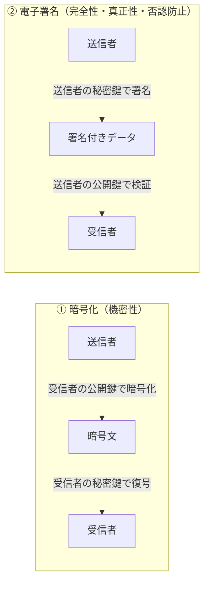
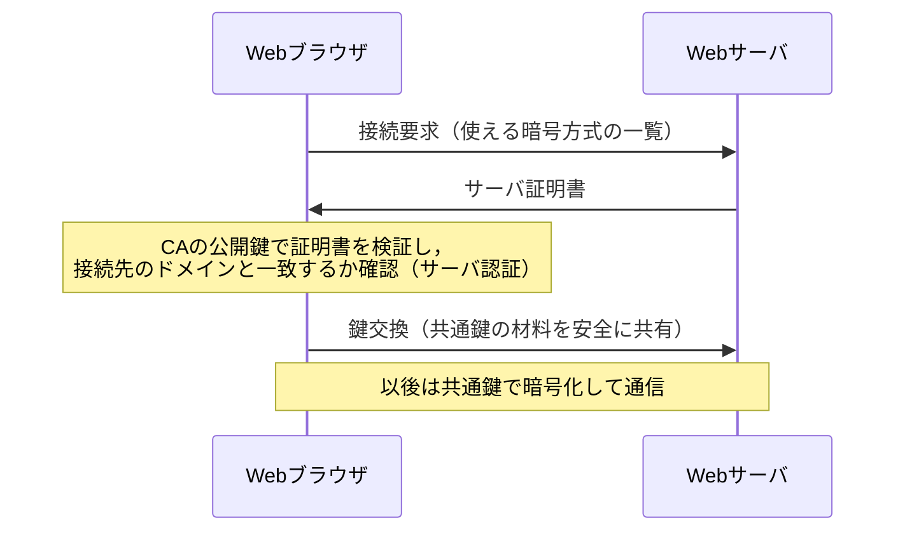
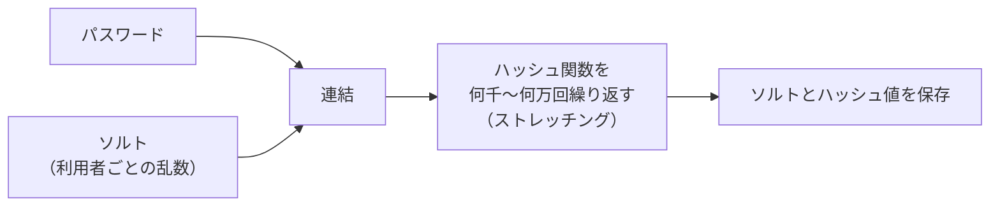
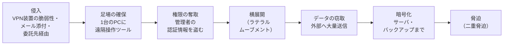
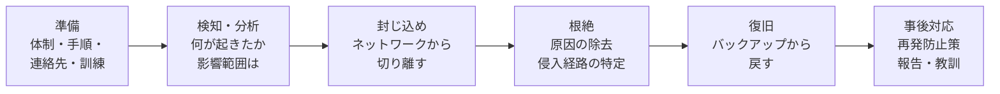

# 応用情報技術者試験 科目B 攻略マニュアル【問1 情報セキュリティ（必須）】

> **このマニュアルの使い方**：過去問を解く前に、第1章〜第3章を通して読む。第1章で「問題文の読み方と答え方」を、第2章で「出てくる技術の意味」を、第3章で「よく出る場面の型」を押さえる。そのあと過去問（`kakomon/01_security.md`）を解き、間違えた箇所を第2章に戻って確認する。
>
> 根拠：2009〜2025年度の過去問33回分の問題・解答例・採点講評、シラバスVer.7.2、試験要綱Ver.5.6（`data/syllabus/`）。
> 問1は**必須**。1問20点、科目Bは5問で100点満点、60点以上で合格。2026年度からCBT方式（科目B 150分）。

---

## 目次

- 第1章 問1の解き方（最初に読む）
- 第2章 必ず知っておく基礎知識（意味の整理）
  - 2-1 情報セキュリティの目的（CIA）
  - 2-2 脅威・脆弱性・リスクとリスク対応
  - 2-3 暗号の基本（共通鍵・公開鍵・ハッシュ）
  - 2-4 電子署名と電子証明書（PKI）
  - 2-5 TLS（HTTPS）の仕組み
  - 2-6 認証（本人確認）
  - 2-7 パスワード攻撃と対策
  - 2-8 マルウェアと攻撃の流れ
  - 2-9 Webアプリケーションへの攻撃
  - 2-10 ネットワークの防御（FW・IDS/IPS・WAF・ゼロトラスト）
  - 2-11 電子メールのセキュリティ
  - 2-12 検知と対応（ログ・SIEM・EDR・インシデント対応）
  - 2-13 バックアップと復旧
  - 2-14 組織・人・物理の対策
  - 2-15 AIとセキュリティ（2024年秋からシラバスに追加）
- 第3章 よく出る場面の型（7パターン）
- 第4章 記述の書き方（良い答え・悪い答え）
- 第5章 2026年度に向けて
- 第6章 直前チェックリスト

---

## 第1章 問1の解き方（最初に読む）

### 1-1. 問1はどういう問題か

問1は、**ある会社で起きた（又は起きそうな）セキュリティの出来事**を題材に、次の3つを聞いてくる。

1. **何が起きたのか**（攻撃の名前、原因、被害の範囲）
2. **なぜ防げなかったのか**（対策の不備）
3. **どう直すか**（再発防止策、その目的）

問題文は2〜4ページ。〔現状〕〔調査結果〕〔対策の検討〕のような見出しで区切られ、図（ネットワーク構成）や表（ログ、時系列、対策一覧）が付く。設問は4〜5問で、**空欄を選択肢から選ぶ問題**と、**20〜45字程度の記述**が半々くらい。

### 1-2. 解く手順

1. **設問を先に読む**（2分）：何を探せばよいかを決める。設問に出てくる下線番号（①②…）と空欄記号（a、b…）の場所を本文で確認する。
2. **本文を読みながら印を付ける**：
   - 構成図：機器の位置（社内・DMZ・インターネット側）、通信の向き
   - 「〜できる」「〜していない」「〜の場合がある」：**対策の不備の伏線**
   - 数値・時刻・設定値：計算や時系列の問題で使う
3. **選択問題から解く**：用語を知っていれば即答できる。
4. **記述は本文の語句を使って書く**：第4章の型に当てはめる。
5. **見直し**：設問の「〜の観点から」「本文中の字句を用いて」「〜した後に」を満たしているか。

### 1-3. 採点講評が毎年言っていること

採点講評（IPAが公表する講評）を33回分読むと、失点の原因はほぼ次の4つに集約される。

| 失点の原因 | 講評での言われ方（例） | 防ぎ方 |
|---|---|---|
| 問われていないことを答える | 発生**後**の対応を問うのに発生**前**の対策を書いた（2014春）／ウイルス定義ファイルを問うのにパッチを書いた（2018春） | 設問の条件語に印を付けてから書く |
| 本文に既にある対策を答える | 既に問題文で触れられている内容を答えた（2018春） | 本文で「実施済み」のことは答えにならない |
| 用語の意味があいまい | SIEM・EDR・クリアスクリーン・Common Criteria・CIA を正確に知らない | 第2章で意味を押さえる |
| 仕組みを理解していない | ロックアウトがリバースブルートフォースに効かない理由／ICMPにポート番号がない／ハッシュは入力の範囲が狭いと総当たりで特定できる | 「なぜそうなるか」まで理解する |

---

## 第2章 必ず知っておく基礎知識（意味の整理）

各項目は「**一言で**」「**仕組み**」「**試験ではこう問われる**」「**よくある誤解**」の順に書いている。

### 2-1. 情報セキュリティの目的（CIA）

**一言で**：情報を「見てよい人だけが見られ（機密性）、正しいまま保たれ（完全性）、使いたいときに使える（可用性）」状態にすること。

| 要素 | 意味 | 脅かす出来事の例 | 守る対策の例 |
|---|---|---|---|
| **機密性** Confidentiality | 許可された人だけがアクセスできる | 情報漏えい、盗聴、のぞき見 | 暗号化、アクセス制御 |
| **完全性** Integrity | 情報が正確で、改ざんされていない | 改ざん、誤入力 | 電子署名、ハッシュ値の比較、入力チェック |
| **可用性** Availability | 必要なときに使える | DoS攻撃、故障、ランサムウェアによる暗号化 | 冗長化、バックアップ |

追加の4要素（JIS Q 27000）：**真正性**（本物であること）、**責任追跡性**（誰がやったか追えること）、**否認防止**（後で「やっていない」と言えないこと）、**信頼性**（意図どおりに動くこと）。

**試験ではこう問われる**：「この対策で確保される情報セキュリティの要素は何か」。2024秋では「3要素以外を答えた誤り」が講評で指摘された。

**よくある誤解**：ランサムウェアは「情報が見られる」被害ではなく、まず**可用性**の侵害（使えなくなる）。データ窃取を伴えば機密性も侵害される。

### 2-2. 脅威・脆弱性・リスクとリスク対応

**一言で**：**脅威**（攻撃者や災害など、害を与えるもの）が**脆弱性**（弱点）を突くと被害が起こる。その起こりやすさと影響の大きさを合わせたものが**リスク**。

- **脅威の例**：攻撃者、マルウェア、内部不正、地震、操作ミス
- **脆弱性の例**：修正されていないソフトウェアの欠陥、弱いパスワード、教育不足、ルールの未整備
- **リスクの大きさ** ＝ 発生の可能性 × 影響の大きさ

**リスク対応の4つの選択肢**

| 対応 | 意味 | 例 |
|---|---|---|
| **回避** | リスクの原因となる活動をやめる | 危険な機能を廃止する |
| **低減** | 発生の可能性か影響を小さくする | パッチ適用、多要素認証 |
| **移転（共有）** | 他者に負担を移す | サイバー保険、外部委託 |
| **保有（受容）** | 対策をとらず受け入れる | 影響が小さいので許容する |

**試験ではこう問われる**：対策がどれに当たるかの選択。PM（問9）でも同じ考え方を使う。

### 2-3. 暗号の基本（共通鍵・公開鍵・ハッシュ）

**一言で**：暗号は「鍵を持つ人だけが元に戻せる」ようにする技術。鍵の使い方で2種類ある。ハッシュは暗号ではなく「データの指紋」。

| 方式 | 鍵 | 特徴 | 代表 |
|---|---|---|---|
| **共通鍵暗号** | 暗号化と復号に**同じ鍵** | 処理が**速い**。鍵を相手に安全に渡すのが難しい。相手ごとに鍵が必要 | AES |
| **公開鍵暗号** | **公開鍵**（誰に渡してもよい）と**秘密鍵**（本人だけが持つ）のペア | 鍵を渡す問題が解決する。処理が**遅い** | RSA、楕円曲線暗号 |
| **ハッシュ関数** | 鍵なし | 任意の長さのデータから固定長の値を作る。**元に戻せない（一方向性）**。少しでも違えば値が大きく変わる | SHA-256 |

**公開鍵暗号の2つの使い方（★最重要）**

- 暗号化：**受信者の公開鍵**で暗号化 → 受信者だけが自分の秘密鍵で戻せる。
- 署名：**送信者の秘密鍵**で署名 → 誰でも送信者の公開鍵で検証できるが、作れるのは送信者だけ。
- 覚え方：「**秘密鍵を使う人が“本人”**」。暗号文を読める本人＝受信者、署名を作れる本人＝送信者。

**ハイブリッド暗号**：本文は速い**共通鍵**で暗号化し、その共通鍵を受信者の**公開鍵**で暗号化して送る。S/MIMEもTLSもこの組合せ。理由は「**公開鍵暗号は処理が重いから**」（2023秋で正答率が低かった設問）。

**ハッシュ関数の性質と弱点**
- 同じ入力からは必ず同じ値。異なる入力から同じ値を見つけるのは困難（衝突困難性）。
- **弱点**：入力のパターンが少ないと、全部の候補のハッシュ値を計算して突き合わせれば元の値が分かる。2017秋：会員番号（桁数が決まった数字）をハッシュ化しても、全ての番号を計算すれば特定できる。

**メッセージ認証コード（MAC）**：共通鍵とデータからハッシュ値のような値を作る。**改ざん検知**と**送信者の確認**ができるが、鍵を両者が持つので**否認防止はできない**（電子署名との違い）。

### 2-4. 電子署名と電子証明書（PKI）

**一言で**：電子署名は「この公開鍵は本当にその人のもの」という保証があって初めて意味を持つ。その保証書が**電子証明書**、発行者が**認証局（CA）**、その仕組み全体が**PKI（公開鍵基盤）**。

**仕組み**
1. 利用者が公開鍵をCAに提出し、本人確認を受ける。
2. CAは「この公開鍵はこの人（このドメイン）のもの」という内容に**CAの秘密鍵で署名**し、電子証明書を発行する。
3. 証明書を受け取った人は、**CAの公開鍵**で証明書の署名を検証する（CAの公開鍵はWebブラウザやOSに最初から入っているルート証明書から信頼の連鎖でたどる）。
4. 秘密鍵の漏えいなどで証明書を無効にするのが**失効**。失効しているかは**CRL**（失効リストを取得して確認）又は**OCSP**（問い合わせて確認）で調べる。

**サーバ証明書の種類**（2021春で正答率が低かった）

| 種類 | CAが確認すること | 意味 |
|---|---|---|
| DV（ドメイン認証） | ドメインの管理者であること | 自動で安く取れる。**フィッシングサイトも取得できる** |
| OV（組織認証） | 組織が実在すること | |
| EV（拡張認証） | 組織の実在を厳格に確認 | サイト運営組織の実在性を利用者に示せる |

**試験ではこう問われる**：「証明書の正当性は何で確認するか」→ **CAの公開鍵で証明書の署名を検証**（2023秋）。「クライアント証明書を入れたPCを紛失したときの対応」→ **証明書を失効させる**（2014春）。

### 2-5. TLS（HTTPS）の仕組み

**一言で**：Webブラウザとサーバの間を暗号化し、通信相手のサーバが本物であることを確かめる仕組み。

- **クライアント認証**：サーバがPCの**クライアント証明書**を確認し、許可された端末だけを接続させる（2014春、2022秋）。
- **TLSの終端**：暗号を解く機器（Webサーバ、負荷分散装置など）。そこに**サーバ証明書を置く**。終端より内側は暗号化されていない（ネットワーク問題でも頻出）。
- **暗号の危殆化**：古い暗号方式やプロトコル（SSL 3.0、TLS 1.0など）は破られる危険があるので無効にする（2018秋）。

### 2-6. 認証（本人確認）

**一言で**：利用者が本人であることを確かめること。確かめる材料は3種類ある。

| 要素 | 例 | 弱点 |
|---|---|---|
| **知識**（知っているもの） | パスワード、PIN、秘密の質問 | 推測・漏えい・使い回し |
| **所持**（持っているもの） | スマートフォン、ICカード、ワンタイムパスワード生成器、**クライアント証明書を入れた端末**、**Cookie** | 紛失・盗難 |
| **生体**（本人の特徴） | 指紋、顔、静脈 | 変更できない、誤認識 |

- **多要素認証**：**異なる要素**を組み合わせること。パスワード＋秘密の質問は両方とも「知識」なので多要素ではない。
- **生体認証の誤り率**：**他人受入率（FAR）**＝他人を通してしまう率、**本人拒否率（FRR）**＝本人を拒否してしまう率。しきい値を厳しくするとFARは下がるがFRRは上がる（トレードオフ）。
- **認証に使えないもの**：利用者自身が真正性を証明できない情報（例：PCの製造番号は誰でも読めて偽れる。2019春の誤答）。
- **シングルサインオン（SSO）とIdP**：一度の認証で複数のサービスを使える。認証を専門に行うサーバをIdP（Identity Provider）という。ゼロトラストの中心になる。
- **パスワードレス認証（FIDO2／WebAuthn、いわゆるパスキー）**：端末内で生成した**鍵ペア**を使う。サイトには**公開鍵だけ**を登録し、ログインのたびにサイトが送る乱数（チャレンジ）に端末内の**秘密鍵で署名**して返す。秘密鍵は端末から出ず、生体認証で秘密鍵の利用を許可する。
  - サイトから漏えいするのは公開鍵だけなので、**なりすましに使えない**。
  - 鍵はWebサイトのドメインごとに作られ、ブラウザがアクセス先のドメインを認証器に伝えるので、**偽サイトでは正規サイト用の署名が作られない（フィッシングに強い）**。

### 2-7. パスワード攻撃と対策

**攻撃の見分け方は「何を固定して、何を変えるか」**（2025春の講評で正答率が低かった論点）

| 攻撃 | 固定するもの | 変えるもの | 効く対策 | 効かない対策 |
|---|---|---|---|---|
| **総当たり（ブルートフォース）** | 利用者ID | パスワード（全パターン） | **アカウントロック**、試行間隔を空ける | — |
| **辞書攻撃** | 利用者ID | パスワード（よく使われる語） | アカウントロック、推測されにくいパスワード | — |
| **リバースブルートフォース** | **パスワード** | **利用者ID** | 送信元ごとの失敗回数の監視、多要素認証 | **アカウントロック**（同じIDには1回しか試さないので、しきい値に達しない） |
| **パスワードスプレー** | よく使われる少数のパスワード | 多数のID | 同上 | アカウントロック |
| **パスワードリスト攻撃**（クレデンシャルスタッフィング） | 他サイトから漏えいしたIDとパスワードの**組** | 組を次々に試す | **多要素認証**、パスワードの使い回し禁止の周知 | 複雑なパスワードの強制（漏えいしたものがそのまま使われるので無意味） |
| **レインボーテーブル攻撃** | — | （漏えいしたハッシュ値から、事前計算した表で元のパスワードを引く） | **ソルト** | ハッシュ化だけ |

**パスワードの安全な保存**

| 手法 | 何をするか | 何に効くか |
|---|---|---|
| **ハッシュ化** | 平文ではなくハッシュ値を保存 | データが漏れても、そのままではパスワードが分からない |
| **ソルト** | 利用者ごとに違う乱数をパスワードに付けてからハッシュ化 | **同じパスワードでも利用者ごとにハッシュ値が変わる** → 事前に計算した表（レインボーテーブル）が使えない。ソルトでパスワードの桁が実質的に長くなり、表を作るのが困難になる（2019春） |
| **ストレッチング** | ハッシュ計算を何度も繰り返す | **1回の試行にかかる時間が長くなる** → 総当たりが遅くなる |

**よくある誤解**：ソルトとストレッチングを逆に書く。「ソルト＝表を無効化」「ストレッチング＝遅くする」で覚える。

### 2-8. マルウェアと攻撃の流れ

**主なマルウェア**

| 名前 | 何をするか |
|---|---|
| **ランサムウェア** | ファイルを暗号化して使えなくし、元に戻す代わりに身代金を要求する。最近はデータを盗んで「公開されたくなければ払え」とも要求する（**二重脅迫**） |
| **RAT**（遠隔操作型）・**ボット** | 外部の**C&Cサーバ**（指令サーバ）から命令を受けて動く |
| **トロイの木馬** | 正常なソフトに見せかけて入り込む |
| **ワーム** | 自分で他の端末に広がる |
| **キーロガー** | キー入力を記録して盗む |
| **ファイルレスマルウェア** | ファイルを残さずメモリ上やOS標準の機能で動く（検出しにくい） |

**標的型攻撃の流れ（サイバーキルチェーン）**：偵察 → 武器化 → 配送（メール、Webサイト） → 攻撃（脆弱性の悪用） → インストール → **C&C通信** → 目的の実行（窃取・破壊）

**近年の典型的な流れ（ランサムウェア）**

- **横展開（ラテラルムーブメント）**：最初に侵入した端末を足掛かりに、社内の他の端末やサーバへ広がること。ホストの探索にICMP（ping）を使うことがある。**ICMPのエコー要求にはポート番号がない**（2022秋）。
- **サプライチェーン攻撃**：対策の弱い取引先・子会社・ソフトウェアの供給元を経由して、本来の標的に侵入する（2025年度は春秋とも出題）。
- **水飲み場型攻撃**：標的がよく見るWebサイトを改ざんし、閲覧した人を感染させる。
- **入口対策・内部対策・出口対策**：侵入を防ぐ（メールフィルタ）／広がりを防ぐ（ネットワーク分割、権限管理）／外への通信を防ぐ（C&C通信の遮断、プロキシでの認証）。**侵入は完全には防げない前提**で出口対策が重要（2017春）。

### 2-9. Webアプリケーションへの攻撃

| 攻撃 | 何が起きるか | 根本的な対策 |
|---|---|---|
| **SQLインジェクション** | 入力欄に入れた文字列がSQL文の一部として解釈され、データベースが不正に操作される | **プレースホルダ**（入力をSQL文と分けて渡す） |
| **クロスサイトスクリプティング（XSS）** | 入力したスクリプトがWebページに埋め込まれ、他の利用者のブラウザで実行される（Cookieの窃取など） | 出力時の**エスケープ処理**（`<` を `&lt;` に置き換えるなど） |
| **クロスサイトリクエストフォージェリ（CSRF）** | ログイン中の利用者に、罠のページから意図しない要求（送金、設定変更）を送らせる | 正規の画面にだけ埋め込む**トークン**（推測できない値）を要求時に確認する、重要な操作の前に再認証 |
| **OSコマンドインジェクション** | 入力がOSのコマンドとして実行される | OSコマンドを呼び出さない設計 |
| **ディレクトリトラバーサル** | `../` などでファイルの場所を指定し、公開していないファイルを読まれる | ファイル名を直接指定させない |
| **セッションハイジャック** | セッションIDを盗まれ、なりすまされる | 推測できないセッションID、HTTPSのみで送る |

**WAF**：HTTPの中身を検査して、これらの攻撃を遮断する装置。アプリケーションの修正までのつなぎや多層防御に使う。**ホワイトリスト方式**（許可したもの以外を拒否）は未知の攻撃にも効くが、設定が手間（2014秋）。

### 2-10. ネットワークの防御

| 機器・仕組み | 一言で | ポイント |
|---|---|---|
| **ファイアウォール（FW）** | 送信元・宛先のIPアドレスとポート番号で通信を許可／拒否 | **ステートフルパケットフィルタリング**：内側から始めた通信の応答は自動で通す。**中身（HTTPの内容、メールの添付）は見ない** → FWだけでは防げない攻撃がある（2014秋） |
| **DMZ** | インターネットにも社内にも直接つながらない中間の区画 | 公開するWebサーバやメールサーバを置く |
| **IDS** | 不審な通信を**検知して知らせる** | 遮断はしない |
| **IPS** | 不審な通信を**検知して遮断する** | 誤って正常な通信を止めることがある |
| **シグネチャ型／アノマリ型** | 既知の攻撃パターンと照合／通常と違う振る舞いを検知 | 誤検知（フォールスポジティブ）と見逃し（フォールスネガティブ） |
| **WAF** | Webアプリケーションへの攻撃を検知・遮断 | 2-9参照 |
| **プロキシサーバ** | 社内からWebへのアクセスを代理する | 利用者認証、URLフィルタリング、ログ取得 |
| **VPN** | インターネット上に暗号化した通信路を作る | **VPN装置自体の脆弱性**が侵入口になる事例が多い |
| **検疫ネットワーク** | 社内に接続する前に、端末のパッチやウイルス対策の状態を検査する | 基準を満たさない端末は隔離（2010秋） |

**ゼロトラスト**（2024春に出題。用語例にはないが出題された）

- 従来の**境界型防御**：「社内は安全、社外は危険」として、境界（FW、VPN）で守る。VPNで一度中に入られると、横展開を防げない。データがクラウドにあると境界が意味をなさない。
- **ゼロトラスト**：「社内外を問わず、どの通信も信頼しない」。アクセスのたびに、**利用者（IdPによる認証・多要素認証）**、**端末の状態（パッチ適用、EDR稼働）**、**アクセス先の権限**を確認する。
- 構成要素：IdP／SSO、多要素認証、端末管理（MDM）、EDR、クラウドプロキシ（SWG）、CASB（クラウドサービスの利用を可視化・制御）、ログの集中監視（SIEM）。

### 2-11. 電子メールのセキュリティ

**送信ドメイン認証**（なりすましメールを受信側で見分ける。2018秋・2019秋で正答率が低かった）

| 方式 | 仕組み | 確認できること |
|---|---|---|
| **SPF** | 送信側ドメインが「このIPアドレスから送ります」とDNSに登録。受信側は**接続してきたメールサーバのIPアドレス**と照合 | 送信元のサーバが正規か |
| **DKIM** | 送信側がメールに**電子署名**を付け、公開鍵をDNSに登録。受信側が署名を検証 | 送信元ドメインの正当性と、途中で**改ざんされていない**こと |
| **DMARC** | SPFとDKIMの結果と、利用者に見える差出人（ヘッダのFrom）のドメインが一致するかを評価し、失敗したメールの扱い（何もしない／隔離／拒否）を送信側が宣言する。結果の報告も受け取れる | 差出人の詐称への対処方針 |

- **S/MIME**：メールの暗号化と電子署名（2-3、2-4の応用）。本文は共通鍵で暗号化、共通鍵は受信者の公開鍵で暗号化、署名は送信者の秘密鍵（2023秋）。
- **PPAP**（パスワード付きZIPを送り、パスワードを別メールで送る）の問題：同じ経路で送るので盗聴に無力、受信側のウイルス検査をすり抜ける。**誤送信対策にはなるが、内部の人による持出しの対策にはならない**（2020の誤答）。
- **オープンリレー（第三者中継）**：外部の第三者が、自社のメールサーバを使って別の外部宛てにメールを送れてしまう設定。迷惑メールの踏み台になる。
- **OP25B**：ISPが、自社の回線から外部のメールサーバの25番ポートへの直接の送信を遮断すること。オープンリレーの対策とは別物。
- **POPとIMAP**（2015春で正答率が低かった）：POPはメールを端末にダウンロード（端末を紛失すると漏えい）、IMAPはサーバに置いたまま見る（アカウントを乗っ取られると全メールが見られる）。

### 2-12. 検知と対応（ログ・SIEM・EDR・インシデント対応）

| 仕組み | 一言で | 試験での使われ方 |
|---|---|---|
| **ログ** | 誰が・いつ・何をしたかの記録 | 改ざんされないよう別のサーバに集めて保管する |
| **NTPによる時刻同期** | 全機器の時計を正確に合わせる | **複数の機器のログを時系列で突き合わせて調査するため**（2017春）。時計がずれていると、ログの順序を取り違える |
| **SIEM** | 様々な機器のログを集めて**相関分析**し、攻撃を早く見つける | 単独のログでは気付かない攻撃を、複数のログの組合せで検知（2022春・2024春） |
| **EDR** | 端末の動き（プロセス、通信、ファイル操作）を記録・監視し、怪しい動きを検知して端末を隔離する | ウイルス対策ソフト（既知のパターンの検出）との違い：**侵入後の振る舞い**を見る（2023春で正答率が低かった） |
| **DLP** | 機密情報の持出しを検知・防止 | 内部不正対策 |
| **CSIRT** | インシデントに対応する社内の専門チーム | 平時から体制・手順・連絡先を準備しておく（2012春） |
| **SOC** | 24時間監視を行う組織（外部委託が多い） | |

**インシデント対応の流れ**

- **初動の基本**：被害の拡大を防ぐため、感染した端末を**ネットワークから切り離す**。ただし**電源は切らない**（メモリ上の痕跡など調査に必要な証拠が消えるため）。
- **デジタルフォレンジックス**：法的な証拠として使えるように、データを保全・解析すること。原本は触らず複製を調べ、ハッシュ値で同一性を示す（2020で正答率がやや低かった）。

### 2-13. バックアップと復旧

**一言で**：ランサムウェアが**バックアップまで暗号化する**ようになったので、「取っておけば安心」ではなく「**攻撃者がバックアップに触れないようにする**」ことが求められる（2018春・2023春・2025春）。

| 対策 | 意味 |
|---|---|
| **オフラインバックアップ** | バックアップした媒体をネットワークから切り離して保管する |
| **イミュータブル（変更不可）ストレージ** | 書き込んだデータを一定期間、誰も変更・削除できないストレージ（2025春で正答率が低かった） |
| **世代管理** | 複数の時点のバックアップを残す（感染に気付く前のデータに戻れる） |
| **別の認証情報で保護** | 業務用の管理者アカウントではバックアップに書き込めないようにする |
| **3-2-1ルール** | 3つのコピーを、2種類の媒体に、1つは別の場所に |
| **RPO／RTO** | どの時点まで戻せればよいか（データ損失の許容）／何時間で復旧すべきか |

**よくある誤解**：「世代数を増やせばよい」→ 同じ権限で全世代を暗号化されれば意味がない。

### 2-14. 組織・人・物理の対策

- **ISMS**（情報セキュリティマネジメントシステム、JIS Q 27001）：方針を決め、リスクを評価し、対策を実施し、点検・改善する（PDCA）。
- **情報セキュリティポリシー**：基本方針 → 対策基準 → 実施手順の3層。
- **不正のトライアングル**（内部不正が起きる3条件）：**機会**（やれる環境）、**動機**（金銭的な困窮、不満）、**正当化**（「会社が悪い」などの言い訳）。対策は機会を減らす技術的な対策だけでなく、動機・正当化を減らす心理的な対策も（2025秋）。
- **状況的犯罪予防**：「やりにくくする」「見つかりやすくする」「割に合わなくする」。**ログを取っていることを周知するだけでも抑止になる**（2020）。
- **物理的対策**：入退室管理、施錠、**クリアデスク**（机に書類を置かない）、**クリアスクリーン**（離席時に画面をロック。2021秋で正答率がやや低かった）。
- **Common Criteria**（ISO/IEC 15408）：IT製品のセキュリティ機能を評価・認証する国際規格（2021秋）。
- **脆弱性管理**：脆弱性情報を集め、深刻度（CVSSなど）で優先度を決め、修正プログラムを適用する。**修正プログラムをすぐ適用できない場合は、製造元が示す回避策（機能の無効化など）や利用停止で暫定対応する**。**SBOM**（ソフトウェアの部品表）があると、どの製品が影響を受けるかを早く特定できる。

### 2-15. AIとセキュリティ（2024年秋からシラバスに追加）

シラバスVer.7.0（2024年度秋期から適用）で、次の語が用語例に入った。**科目Bでは2025年度秋期までまだ主題として出題されていない**ので、2026年度に初めて出る可能性がある。

| 用語 | 意味 |
|---|---|
| **AIに対する脅威** | AIシステムそのものが攻撃されること |
| **プロンプトインジェクション** | AIへの入力に指示を紛れ込ませ、本来の指示を無視させて不正な動作をさせる。**直接型**（利用者が入力欄に書く）と**間接型**（AIが読み込むWebページや文書に攻撃者が指示を埋め込む）がある |
| **敵対的サンプル** | 人には分からない小さな加工で、AIに誤認識させるデータ（画像に細工して標識を誤認させるなど） |
| **ディープフェイク** | AIで作った偽の画像・音声・動画。なりすまし（経営者の声で送金を指示するなど）に悪用される |
| **AIを悪用した攻撃** | フィッシングメールの文面を自然にする、マルウェアの亜種を大量に作る、脆弱性を効率的に探すなど |
| **Security for AI** | AIそのものを守る技術・対策（入力の検査、出力の検証、学習データの保護、権限の最小化） |
| **AI for Security** | AIを使ってセキュリティを高める技術（攻撃の検知、ログの分析） |
| **ハルシネーション** | AIがもっともらしい誤りを出力すること（AIの利活用の分野の用語） |

**社内で生成AIを使うときの論点**（第1回模試の問1で扱った）

- 社内文書を検索して回答させる場合、**利用者が閲覧を許可された文書だけを検索対象にする**（アクセス権限の継承）。
- AIに与える権限（メール送信、ファイル操作）は**必要最小限**にし、重要な操作は人が確認してから実行する。
- 入力した機密情報が**AIの学習に使われない**契約・設定を選ぶ。個人情報は入力前に**マスキング**する。
- AIの回答は**根拠を確認**してから使う（ハルシネーション対策）。
- AIに外部のWebページを読ませる機能は、間接プロンプトインジェクションの入口になる。

---

## 第3章 よく出る場面の型（7パターン）

過去問の問1は、ほぼ次のどれかの「型」に当てはまる。型ごとに、典型的な設問と答え方を示す。

### 型1：ランサムウェア・標的型攻撃の事後調査（2025春、2023春、2022秋、2019秋、2018春、2017春）

| 典型的な設問 | 答え方の要点 |
|---|---|
| 侵入経路は何か | 時系列の表とログから、最初の不審な通信を探す（VPN装置、メール、委託先） |
| 被害が広がった理由 | 「〜の管理者アカウントで〜にアクセスできた」「〜が〜から書き込める状態だった」 |
| 初動対応の理由 | 切り離す＝拡大防止、電源を切らない＝証拠保全 |
| バックアップが役に立たなかった理由 | 業務と同じ権限で書き込めた → オフライン化・変更不可ストレージ |
| 再発防止策 | 脆弱性管理、多要素認証、権限の分離、ログの集中監視とNTP |

### 型2：パスワード・認証の強化（2024秋、2019春、2016秋、2015秋）

ログから攻撃の種類を見分ける（2-7の表）→ 効く対策と効かない対策 → 保存方法（ソルト・ストレッチング）→ 多要素認証・パスキー。

### 型3：PKIと暗号の応用（2023秋、2021春、2016秋、2014春）

「どの鍵で何をするか」（2-3の図）、証明書の検証と失効、DV／EV、クライアント証明書。

### 型4：境界防御とゼロトラスト（2024春、2014秋、2011特別）

FWでできること・できないこと、DMZ、IDS／IPS／WAFの違い、ゼロトラストで確認する3要素（人・端末・権限）。

### 型5：メールの安全化（2023秋、2018秋、2015春、2012秋）

送信ドメイン認証（SPF／DKIM／DMARC）、S/MIME、PPAP、POPとIMAP。

### 型6：内部不正・物理対策（2025秋、2021秋、2020）

不正のトライアングル、状況的犯罪予防、ログの周知による抑止、クリアデスク・クリアスクリーン、DLP。

### 型7：サプライチェーン・脆弱性管理（2025秋、2025春、2018秋）

委託先の管理、脆弱性情報への迅速な対応、SBOM、修正プログラム適用までの暫定対応。

---

## 第4章 記述の書き方（良い答え・悪い答え）

### 4-1. 型

| 問われ方 | 書き方の型 |
|---|---|
| 目的を述べよ | 「〜することで，〜できるようにするため」 |
| 理由を述べよ | 「〜なので，〜から」 |
| リスク（問題点）を述べよ | 「〜によって，〜が〜されるおそれ」 |
| 対策を述べよ | 「〈何に〉対して〈何を〉する」（対象と手段を必ず書く） |
| どのような攻撃か | 「〜を〜して，〜する攻撃」 |

### 4-2. 良い答え・悪い答え

**例1**：「全ての機器の時刻をNTPサーバに同期させる目的を述べよ（35字以内）」

| | 答え | 評価 |
|---|---|---|
| ✕ | 時刻を正確にするため | 手段の言い換え。0点 |
| △ | ログの時刻を合わせるため | 何のためか不足 |
| ○ | 複数の機器のログを時系列で正確に突き合わせて調査できるようにするため | 目的まで書けている |

**例2**：「アカウントロックが機能しなかった理由を述べよ」（リバースブルートフォース攻撃）

| | 答え | 評価 |
|---|---|---|
| ✕ | 攻撃者が多数のIPアドレスを使ったから | アカウントロックはIDごとの仕組みなので的外れ |
| ○ | 同じ利用者IDに対する試行が1回ずつで，連続失敗の回数に達しないから | 攻撃のパターンと対策の仕組みを結び付けている |

**例3**：「バックアップ用NASまで暗号化された原因を述べよ」

| | 答え | 評価 |
|---|---|---|
| ✕ | バックアップの世代が少なかったから | 原因ではない |
| ✕ | ランサムウェアに感染したから | 当たり前で、原因の説明になっていない |
| ○ | NASが業務サーバと同じ管理者アカウントで書き込める状態で接続されていたから | 本文の事実から、攻撃者が書き込めた理由を説明している |

### 4-3. 書くときの注意

- **本文の機器名・用語をそのまま使う**（「L3SW」「ファイルサーバ」「サービスアカウントS」）。
- 字数は**指定の8割以上**。短すぎると要素が欠ける。
- 設問の条件（「本文中の字句を用いて」「〜の観点から」「〜した後に」）を満たしているか、最後に確認する。

---

## 第5章 2026年度に向けて

### 5-1. 直近の出題の流れ

| 年度 | 春期 | 秋期 |
|---|---|---|
| 2025 | サプライチェーン経由のランサムウェア | サプライチェーン攻撃（ビジネス・ソフトウェア） |
| 2024 | ゼロトラスト | パスワード管理（ペネトレーションテスト） |
| 2023 | ランサムウェアとEDR | PPAPとS/MIME |
| 2022 | 通販サイトの再発防止とSIEM | EMOTET型マルウェア |
| 2021 | 権威DNSサーバへの攻撃 | オフィスの物理対策 |

**傾向**：2022年度以降は、技術そのものより**インシデントが起きた後の調査と再発防止**が中心。

### 5-2. 2026年度に出そうなテーマ

| テーマ | 根拠 |
|---|---|
| **生成AIのセキュリティ**（プロンプトインジェクション、AIの権限、学習データ、ハルシネーション） | シラバスVer.7.0で追加、科目B未出題 |
| **AIを悪用した攻撃**（巧妙なフィッシング、ディープフェイクによる送金詐欺） | 同上 |
| **VPN装置など境界機器の脆弱性からの侵入** | 近年の被害の主流。型1の延長 |
| **パスキー（FIDO2）** | 用語例「FIDO2，WebAuthn」。型2の延長 |
| **SBOMによる脆弱性管理** | 用語例「SBOMを利用した脆弱性管理」 |
| **ゼロトラストの運用**（IdP、端末の状態確認、CASB） | 2024春の延長 |
| **ビジネスメール詐欺（BEC）** | 用語例「ビジネスメール詐欺」 |
| **クラウドの設定不備・権限の過剰付与** | 用語例「クラウドサービスのセキュリティ」 |

---

## 第6章 直前チェックリスト

**用語の意味**
- [ ] CIA（機密性・完全性・可用性）を例とともに言える
- [ ] 暗号化は「受信者の公開鍵」、署名は「送信者の秘密鍵」と即答できる
- [ ] 証明書の検証は「CAの公開鍵」、失効の確認は「CRL／OCSP」
- [ ] ソルト＝事前計算の表を無効化、ストレッチング＝1回の試行を遅くする
- [ ] 総当たり・リバースブルートフォース・パスワードリスト攻撃の違いと、効く対策
- [ ] IDS（検知）・IPS（遮断）・WAF（Webアプリの攻撃）・FW（IPとポート）
- [ ] SPF（送信元サーバのIP）・DKIM（電子署名）・DMARC（扱いの宣言）
- [ ] SIEM（ログの相関分析）・EDR（端末の振る舞い監視）・NTP（ログの時系列の突合）
- [ ] ネットワークから切り離す＝拡大防止、電源を切らない＝証拠保全
- [ ] バックアップの保護＝オフライン・変更不可ストレージ・別の認証情報
- [ ] 不正のトライアングル（機会・動機・正当化）
- [ ] プロンプトインジェクション（直接・間接）、Security for AI、ハルシネーション

**解き方**
- [ ] 設問を先に読み、条件語（観点、時点、字句の指定）に印を付けた
- [ ] 本文で「既に実施済み」の対策を答えていない
- [ ] 目的は「〜するため」、理由は「〜から」で終えた
- [ ] 本文の機器名・用語を使い、字数の8割以上を書いた
