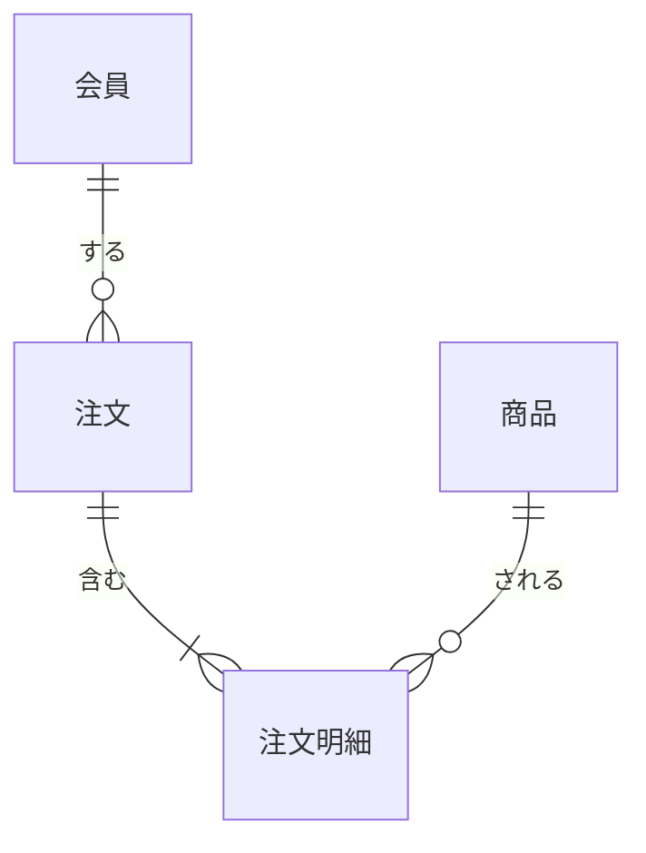

# 応用情報技術者試験 科目B 攻略マニュアル【問6 データベース】

> **このマニュアルの使い方**：過去問を解く前に第1章〜第3章を読む。第1章で「問題の読み方」、第2章で「E-R図・SQL・トランザクションの意味」、第3章で「よく出る問題の型」を押さえる。そのあと過去問（`kakomon/03_database.md`）を解き、間違えたら第2章に戻る。
>
> 根拠：2009〜2025年度の過去問33回分、シラバスVer.7.2、試験要綱Ver.5.6。2014年度以降は**問6**（選択問題）。
> 選ぶかどうかの目安：毎回「**E-R図の空欄＋SQLの空欄＋設計の考察**」という型がほぼ同じ。**練習量がそのまま点になる本命科目**。

---

## 目次

- 第1章 問6の解き方（最初に読む）
- 第2章 必ず知っておく基礎知識
  - 2-1 関係データベースの基本用語
  - 2-2 E-R図とカーディナリティ
  - 2-3 主キー・外部キーの決め方
  - 2-4 正規化
  - 2-5 SELECT文の基本（実行順序）
  - 2-6 結合（内部結合・外部結合）
  - 2-7 集約（GROUP BY・HAVING）
  - 2-8 副問合せ（IN・EXISTS・相関副問合せ）
  - 2-9 ウィンドウ関数
  - 2-10 再帰問合せ
  - 2-11 更新系SQL（INSERT・UPDATE・DELETE）
  - 2-12 DDLとDCL（CREATE・ALTER・GRANT）
  - 2-13 NULLの扱い
  - 2-14 トランザクションと排他制御
  - 2-15 インデックスと性能
  - 2-16 分析用のデータベース
- 第3章 よく出る問題の型（5パターン）
- 第4章 空欄・記述の書き方（良い答え・悪い答え）
- 第5章 2026年度に向けて
- 第6章 直前チェックリスト

---

## 第1章 問6の解き方（最初に読む）

### 1-1. 問6はどういう問題か

ある業務（販売管理、予約、在庫、受講管理など）のデータベースを題材に、次の3つを聞いてくる。

1. **E-R図・テーブル構造の空欄**（エンティティ、属性、関連、主キー）
2. **SQL文の空欄**（結合条件、WHERE句、集約、副問合せ）
3. **設計の考察**（なぜこの設計か、不具合の原因、性能改善、排他制御）

### 1-2. 解く手順

1. **〔業務の概要〕を読み、「1つの〜に複数の〜」「〜ごとに」を全て拾う**：これがE-R図の多重度と主キーを決める。
2. **テーブル構造の各列の意味を確認**：「適用終了日は最終日を格納」「現在有効なものはNULL」など、SQLの条件を決める記述に印を付ける。
3. **E-R図を自分で描き直す**：空欄の関連は、業務の概要の文と照らし合わせて決める。
4. **SQLは、まず日本語で処理内容を言い直す**：「会員ごとに」→ GROUP BY 会員ID、「1件もない会員も含めて」→ 外部結合。
5. **SQLを埋めたら、問題文の例のデータで結果を確かめる**。

### 1-3. 採点講評が毎年言っていること

| 失点の原因 | 講評での言われ方（例） | 防ぎ方 |
|---|---|---|
| 主キーの下線の付け忘れ | 実線の下線が付いていない（2025春・2025秋） | 属性を書いたら下線の種類を確認 |
| 多重度の誤り | 1対1の関連を記載（2025秋、2022秋） | 「一つの〜に対して複数の〜」を本文から探す |
| 矢印の向きの誤り | 矢印を逆方向に記載（2018秋） | 「多」の側（外部キーを持つ側）に矢印 |
| 外部結合とNULL | 右側の表に該当行がないとNULLになる仕様を知らない（2023春） | 2-6、2-13を押さえる |
| DDL・DCLを書けない | ALTER TABLE、GRANT、CREATE TABLE、削除時の動作（2022秋・2022春・2025秋） | 2-12の構文を書いて覚える |
| 要件の読み落とし | 部署ごとだけでなく年月ごとでも管理する要件（2022秋） | 「〜ごと」は全て主キー候補 |
| 文法ミス | SQLの文法上のコーディング誤り（2019春）、WINDOWと書く（2023秋） | BNFや例の構文をそのまま使う |

---

## 第2章 必ず知っておく基礎知識

### 2-1. 関係データベースの基本用語

| 用語 | 意味 |
|---|---|
| **表（テーブル）** | データを行と列で表したもの。関係（リレーション）ともいう |
| **行（レコード、タプル）** | 1件分のデータ |
| **列（属性、カラム）** | データの項目 |
| **主キー** | 行を一意に特定できる列（の組）。NULL不可、重複不可 |
| **外部キー** | 他の表の主キーを参照する列。参照先に存在しない値は入れられない（**参照制約**） |
| **候補キー** | 主キーになれる列（の組）。そのうち1つを主キーにする |
| **代用キー（サロゲートキー）** | 業務上の意味を持たない連番などを主キーにしたもの。業務上のキー（自然キー）が変わる可能性がある場合に使う（2017秋） |

### 2-2. E-R図とカーディナリティ

**一言で**：業務の「もの」（エンティティ）と「もの同士の関係」（リレーションシップ）を図にしたもの。

**IPAの表記**
- エンティティ：長方形
- **1対多**：「1」の側は線の端に何も付けず、「**多」の側に矢印**を付ける。例：`部署 ──→ 社員`（1つの部署に複数の社員）
- **1対1**：線だけ（矢印なし）
- **多対多**：両端に矢印。テーブルにするときは**交差エンティティ（連関エンティティ）**を間に入れて、1対多と多対1に分ける


（参考：一般的なE-R図の記法で、注文明細が「注文」と「商品」の多対多を分解した交差エンティティ。IPAの試験では矢印の記法で描かれる）

**多重度の決め方**：「1つの A に B はいくつあるか」と「1つの B に A はいくつあるか」を、両方向から本文で確認する。
- 例：「同一の回線番号のまま定期的に端末を交換する」→ 1つの契約に複数の端末 → 1対多（2022秋で1対1の誤答が多かった）

**スーパータイプとサブタイプ**（2025秋）
- 共通の属性を持つ親（スーパータイプ）と、種類ごとの固有の属性を持つ子（サブタイプ）に分ける。例：「受講者」の下に「社員受講者」「社外受講者」。
- **共通の属性はスーパータイプ、固有の属性はサブタイプ**に置く。サブタイプの主キーはスーパータイプと同じ（主キーかつ外部キー）。
- **排他的**（どれか1つだけ）か**共存的**（複数に当てはまる）かを本文で確認する。

### 2-3. 主キー・外部キーの決め方

**主キーは「何が決まれば1行に決まるか」で考える**。

| 本文の記述 | 主キー |
|---|---|
| 請求は部署ごと・年月ごとに1件 | （部署ID，年月） |
| 同じ日に2回以上プランを変更できない、以前のプランに戻すこともある | （会員ID，適用開始日）。（会員ID，プランコード）は戻すと重複する |
| 一つの注文明細を複数の倉庫から分けて引き当てる | （注文番号，明細番号，倉庫コード） |

**表記**：主キーは**実線の下線**、外部キーは**破線の下線**、主キーかつ外部キーは両方。

### 2-4. 正規化

**一言で**：同じ事実を1か所にだけ持つように表を分けること。目的は**更新時異状（同じ情報を複数の行で持つことによる不整合）を防ぐ**こと。

| 正規形 | 条件 | 違反の例 |
|---|---|---|
| 第1正規形 | 繰返し項目がない（1つのセルに1つの値） | 「商品1, 商品2, 商品3」の列 |
| 第2正規形 | 主キーの**一部**だけで決まる列がない | 主キー（注文番号，商品コード）なのに、商品名が商品コードだけで決まる |
| 第3正規形 | 主キー以外の列で決まる列がない（推移的関数従属がない） | 社員表に部署コードと部署名がある（部署名は部署コードで決まる） |

### 2-5. SELECT文の基本（実行順序）

**書く順序**：`SELECT → FROM → WHERE → GROUP BY → HAVING → ORDER BY`
**処理される順序**：`FROM（結合）→ WHERE（行の絞込み）→ GROUP BY（グループ化）→ HAVING（グループの絞込み）→ SELECT（列の選択）→ ORDER BY（並べ替え）`

この順序を知っていると、「集約関数をWHERE句に書けない理由」（WHEREの時点ではまだグループになっていない）が分かる。

```sql
SELECT d.部署名, COUNT(*) AS 人数
  FROM 社員 e JOIN 部署 d ON e.部署ID = d.部署ID
 WHERE e.在籍区分 = '1'          -- 在籍者だけに絞る（グループ化の前）
 GROUP BY d.部署名               -- 部署ごとにまとめる
HAVING COUNT(*) >= 10            -- 10人以上の部署だけ（グループ化の後）
 ORDER BY 人数 DESC              -- 多い順
```

### 2-6. 結合（内部結合・外部結合）

| 結合 | 結果 |
|---|---|
| **内部結合** `A JOIN B ON 条件` | 条件に合う組だけ |
| **左外部結合** `A LEFT OUTER JOIN B ON 条件` | Aの全ての行。Bに相手がない行は、**Bの列がNULL**になる |
| 右外部結合 | Bの全ての行 |
| 完全外部結合 | 両方の全ての行 |
| 交差結合 `CROSS JOIN` | 全ての組合せ |
| 自己結合 | 同じ表に別名を付けて結合（例：社員と、その上司も社員） |

**外部結合を使う場面**：「売上が0件の商品も含めて」「請求がない会員も一覧に」（2016春・2023春）。

**よくある誤解（★）**：外部結合した相手側の表の条件を **WHERE句** に書くと、相手がいない行（NULLの行）が条件を満たさずに消え、**内部結合と同じ結果**になる。相手側の条件は **ON句** に書く。

```sql
-- ○ 請求がない会員も残る
SELECT m.会員ID, COALESCE(s.請求額, 0)
  FROM 会員 m LEFT OUTER JOIN 請求 s
    ON m.会員ID = s.会員ID AND s.請求年月 = '202610'
```

### 2-7. 集約（GROUP BY・HAVING）

| 集約関数 | 意味 | NULLの扱い |
|---|---|---|
| `COUNT(*)` | 行数 | NULLの行も数える |
| `COUNT(列)` | その列がNULLでない行数 | NULLは数えない |
| `SUM`, `AVG`, `MAX`, `MIN` | 合計、平均、最大、最小 | NULLは無視 |

- **GROUP BY に書いていない列は、SELECT に集約関数なしで書けない**。
- **HAVING**：グループ化した結果に対する条件（2020で正答率がやや低かった）。

### 2-8. 副問合せ（IN・EXISTS・相関副問合せ）

```sql
-- IN：副問合せの結果に含まれる
SELECT * FROM 商品 WHERE 商品コード IN (SELECT 商品コード FROM 売上 WHERE 日付 = :日付)

-- NOT EXISTS：該当する行が1件もない（相関副問合せ：外側の行を参照する）
SELECT * FROM 会員 m
 WHERE NOT EXISTS (SELECT * FROM 注文 o WHERE o.会員ID = m.会員ID)
```

- **相関副問合せ**：副問合せの中で外側の表（ここでは m）を参照する。外側の1行ごとに副問合せが評価される。
- **UNION**（結果を縦に足す、重複は除く）と **UNION ALL**（重複も残す）。

### 2-9. ウィンドウ関数

**一言で**：行をまとめずに（GROUP BYのように1行にせずに）、グループ内での順位・累計・前後の値を各行に付ける関数（2023秋）。

```sql
SELECT 店舗ID, 日付, 売上,
       SUM(売上) OVER (PARTITION BY 店舗ID ORDER BY 日付)       AS 累計,
       RANK()    OVER (PARTITION BY 店舗ID ORDER BY 売上 DESC)  AS 順位,
       ROW_NUMBER() OVER (PARTITION BY 会員ID ORDER BY 日付 DESC) AS 新しい順,
       LAG(売上) OVER (PARTITION BY 店舗ID ORDER BY 日付)       AS 前日の売上
  FROM 日次売上
```

| 部分 | 意味 |
|---|---|
| `OVER (...)` | ウィンドウ関数であることを示す（**WINDOWではない**：2023秋の誤答） |
| `PARTITION BY 列` | グループの単位（グループごとに計算をやり直す） |
| `ORDER BY 列` | グループ内の並び順 |
| `ROW_NUMBER()` | 1, 2, 3…の連番（同じ値でも違う番号）。**最新の1件**を取るのに使う |
| `RANK()` | 順位（同じ値は同順位、次は飛ぶ：1, 1, 3） |
| `LAG(列)` / `LEAD(列)` | 1つ前／1つ後の行の値。先頭行のLAGは **NULL** |

### 2-10. 再帰問合せ

**一言で**：親子関係（部品構成、組織、取引の連鎖）を、深さが分からなくても全部たどる問合せ（2024秋）。

```sql
WITH RECURSIVE 展開(品目, 必要数) AS (
    SELECT 子品目, 所要数 FROM 構成 WHERE 親品目 = 'P1'   -- ① 出発点
  UNION ALL
    SELECT k.子品目, t.必要数 * k.所要数                   -- ② ①の結果を使って1段ずつ下へ
      FROM 展開 t JOIN 構成 k ON k.親品目 = t.品目
)
SELECT 品目, SUM(必要数) FROM 展開 GROUP BY 品目
```

- データに**循環**（AがBの子で、BがAの子）があると、終わらなくなる。

### 2-11. 更新系SQL

```sql
INSERT INTO 注文 (注文番号, 会員ID, 注文日) VALUES (:注文番号, :会員ID, CURRENT_DATE)
UPDATE 在庫 SET 引当済数 = 引当済数 + :数, 版番号 = 版番号 + 1 WHERE 商品コード = :商品
DELETE FROM カート WHERE 会員ID = :会員ID
```

- `:変数名` は**埋込み変数**（プログラムから値を渡す）。2021秋・2019秋で正答率が低かった。
- **UPDATE の SET 句で現在の値を使う**（`引当済数 = 引当済数 + :数`）と、読み込んでから計算して書き戻すより安全（2-14参照）。

### 2-12. DDLとDCL

```sql
CREATE TABLE 受講 (
    受講者ID   INTEGER NOT NULL,
    開催ID     INTEGER NOT NULL,
    申込日     DATE,
    PRIMARY KEY (受講者ID, 開催ID),
    FOREIGN KEY (開催ID) REFERENCES 開催 (開催ID) ON DELETE CASCADE
)

ALTER TABLE 請求 ADD CONSTRAINT 請求_一意 UNIQUE (会員ID, 請求年月)

CREATE VIEW 在籍社員 AS SELECT 社員ID, 氏名, 部署ID FROM 社員 WHERE 在籍区分 = '1'

GRANT SELECT, UPDATE ON 在籍社員 TO 人事担当
REVOKE UPDATE ON 在籍社員 FROM 人事担当
```

| 構文 | 意味 |
|---|---|
| `NOT NULL` | NULLを入れられない |
| `UNIQUE` | 重複不可（主キー以外の一意性） |
| `CHECK (条件)` | 値の範囲などの制約 |
| `ON DELETE CASCADE` | 参照先の行を削除したら、参照している行も一緒に削除 |
| `ON DELETE SET NULL` | 参照先を削除したら、外部キーをNULLに |
| `ON DELETE RESTRICT` / `NO ACTION` | 参照されている行は削除できない |
| `GRANT 権限 ON 表 TO 利用者` | 権限を与える（DCL） |
| ビュー | SELECT文に名前を付けた仮想の表。見せる列・行を限定して**権限管理**に使う（2018秋） |

### 2-13. NULLの扱い

- NULLは「値がない（不明）」。**NULLとの比較（=, <, >）は真にも偽にもならない（不明）**ので、WHERE句では選ばれない。
- NULLかどうかは `IS NULL` / `IS NOT NULL` で調べる（`= NULL` は誤り）。
- `COALESCE(列, 0)`：NULLなら0に置き換える。

### 2-14. トランザクションと排他制御

**トランザクション**：一連の処理を「全部成功」か「全部取消し」にする単位。**ACID特性**：原子性（全部か無か）、一貫性、独立性（同時に動いても互いに影響しない）、耐久性（確定したら消えない）。

**同時に更新すると起きる問題**

| 問題 | 内容 |
|---|---|
| **ロストアップデート**（更新の喪失） | 2人が同じ値を読み、それぞれ計算して書き戻すと、先の更新が消える |
| ダーティリード | 確定前の他人の変更を読む |
| ファジーリード | 同じ行を2回読むと値が違う |
| ファントムリード | 同じ条件で2回読むと行数が違う |

**対策**

| 方式 | 仕組み | 向いている場面 |
|---|---|---|
| **悲観ロック** | 読むときに `SELECT … FOR UPDATE` でロックし、他の処理を待たせる | 競合が多い |
| **楽観ロック** | ロックせずに読み、更新時に**版番号（バージョン）が読んだときと同じか**を確認。違えば（更新件数0件）やり直し | 競合が少ない |
| **条件付き更新** | `UPDATE … SET 数 = 数 − :n WHERE 数 >= :n` のように、判定と更新を1文で行う | 在庫の引当てなど |

**デッドロック**：2つの処理が、互いに相手のロックの解放を待って止まること。**ロックを獲得する順序を統一する**（例：商品コードの昇順）と防げる。

### 2-15. インデックスと性能

**一言で**：本の索引のように、検索を速くする仕組み。代表は**B木（B+木）インデックス**。

- 作るとよい列：**検索条件・結合条件に使い、値の種類が多い（選択性が高い）列**。
- 作らない方がよい列：値の種類が少ない列（性別、区分など）、更新が多い列（更新のたびにインデックスも更新される）。
- **複合インデックス**（A, B の順）は、**先頭の列Aを使った検索**には効くが、**Bだけの検索には効かない**。
- `LIKE '%語%'`（前方が任意）はインデックスが効きにくい。

### 2-16. 分析用のデータベース

| 用語 | 意味 |
|---|---|
| **DWH**（データウェアハウス） | 分析用に、複数のシステムのデータを時系列で集めたもの |
| **データマート** | 特定の部門・用途向けに**あらかじめ集計した表**。分析のレスポンスを速くする（2021春） |
| **スタースキーマ** | 中心に**ファクト表**（売上明細など数値）、周りに**ディメンション表**（日付・店舗・商品） |
| **ETL** | データの抽出・変換・格納 |
| **マルチテナント** | 1つのシステムを複数の顧客企業で共用。**データベースごと／スキーマごと／行ごと**に分ける方式があり、分けるほど他社のデータが漏れる範囲を狭められる（2024春） |

---

## 第3章 よく出る問題の型（5パターン）

### 型1：システム改修に伴うE-R図の変更（2025秋、2018春、2017秋、2017春）
業務の変更（新サービス、例外ケース）→ エンティティや属性を追加。
- 問われること：追加するエンティティ、主キー、影響を受けるエンティティ、スーパータイプ／サブタイプ、代用キー。

### 型2：集計・分析のSQL（2025春、2023秋、2023春、2021春、2016春）
- 問われること：結合、GROUP BY／HAVING、外部結合（0件も含める）、ウィンドウ関数、データマート。

### 型3：データの不整合と排他制御（2022春、2021秋、2020、2014秋）
- 問われること：ロストアップデート、ロック方式、デッドロック、UNIQUE制約、暫定対応（データ修正）と恒久対応（制約・プログラム修正）。

### 型4：権限とセキュリティ（2024春、2022秋、2018秋）
- 問われること：GRANT、ビューによる列・行の制限、マルチテナントでのスキーマ分割。

### 型5：再帰・性能（2024秋、2015秋）
- 問われること：自己参照の関連、再帰問合せ、インデックスを付ける列、LIKEの書き方。

---

## 第4章 空欄・記述の書き方（良い答え・悪い答え）

**例1**：主キーの空欄（請求は部署ごと・年月ごとに1件）

| | 答え | 評価 |
|---|---|---|
| ✕ | 部署ID | 年月が抜けて一意にならない（2022秋の誤答） |
| ○ | 部署ID，年月（両方に実線の下線、部署IDには破線の下線も） | |

**例2**：「HAVING 句と WHERE 句の違いを意識したSQL」

| | 答え | 評価 |
|---|---|---|
| ✕ | `WHERE COUNT(*) >= 10` | WHEREの時点ではグループ化されていない |
| ○ | `HAVING COUNT(*) >= 10` | |

**例3**：「この設計（会社ごとにスキーマを分ける）の利点」

| | 答え | 評価 |
|---|---|---|
| ✕ | セキュリティが高まる | 何がどう高まるか不明 |
| ○ | 誤ったSQLを実行しても他社のデータが参照されず，漏えいの範囲を限定できる | 仕組みと効果が書けている |

**記述の型**

| 問われ方 | 型 |
|---|---|
| 設計の理由 | 「〜を〜ごとに管理する必要があるので，〜を主キーに含めた」 |
| 不具合の原因 | 「〜が一意でないので，〜が複数行返り，〜になった」 |
| 暫定対応／恒久対応 | 暫定＝データの修正、恒久＝制約の追加・プログラムの修正・データモデルの変更 |
| 性能改善 | 「〜をあらかじめ集計したデータマートを作り，問合せ時の集計をなくす」 |

---

## 第5章 2026年度に向けて

### 5-1. 直近の出題

| 年度 | 春期 | 秋期 |
|---|---|---|
| 2025 | 販売管理（分析用SQL、副問合せの結合） | 受講管理（スーパー／サブタイプ、DDL） |
| 2024 | SaaSのマルチテナント（スキーマ分割） | 個人間売買（再帰問合せ、LIKE、インデックス） |
| 2023 | KPI集計（外部結合とNULL） | 在庫管理（ウィンドウ関数、BNF） |
| 2022 | クーポン発行（排他制御、連番） | 端末管理（GRANT、CREATE TABLE） |

**傾向**：基本の型（E-R図＋SQL）は変わらず、毎回1つ「新しめのSQL」（ウィンドウ関数、再帰、LIKEのエスケープ、DDLの参照動作）が入る。

### 5-2. 出そうなテーマ

| テーマ | 理由 |
|---|---|
| 楽観ロック（版番号）と更新件数の確認 | 2022春以来の排他制御 |
| ウィンドウ関数の応用（LAGで前回比、ROW_NUMBERで最新1件） | 用語例「ウィンドウ関数」 |
| 生成AIの検索用データ（文書と閲覧権限の管理） | AI関連の用語例の追加 |
| 個人情報の削除要求と論理削除 | 個人情報保護の関心 |
| IoTの時系列データと集計表 | データ活用の定番 |

---

## 第6章 直前チェックリスト

**知識**
- [ ] 1対多の矢印は「多」側、多対多は交差エンティティで分解
- [ ] 主キー＝実線の下線、外部キー＝破線の下線
- [ ] SELECTの処理順序（FROM→WHERE→GROUP BY→HAVING→SELECT→ORDER BY）
- [ ] 外部結合で相手がない行はNULL、相手側の条件はON句に書く
- [ ] COUNT(*) と COUNT(列) の違い、IS NULL、COALESCE
- [ ] EXISTS／相関副問合せ、ウィンドウ関数（OVER, PARTITION BY）、WITH RECURSIVE
- [ ] CREATE TABLE、ALTER TABLE、UNIQUE、ON DELETE、GRANT、CREATE VIEW
- [ ] ロストアップデート、悲観ロック／楽観ロック、デッドロックはロック順序の統一
- [ ] 複合インデックスは先頭の列から効く

**解き方**
- [ ] 「1つの〜に複数の〜」「〜ごとに」を全部拾った
- [ ] 列の意味（NULLの意味、日付が最終日を含むか）を確認した
- [ ] 埋めたSQLを例のデータで確かめた
