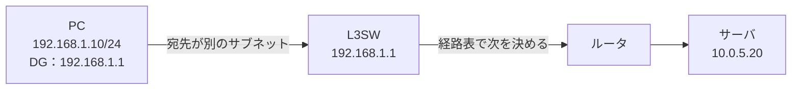
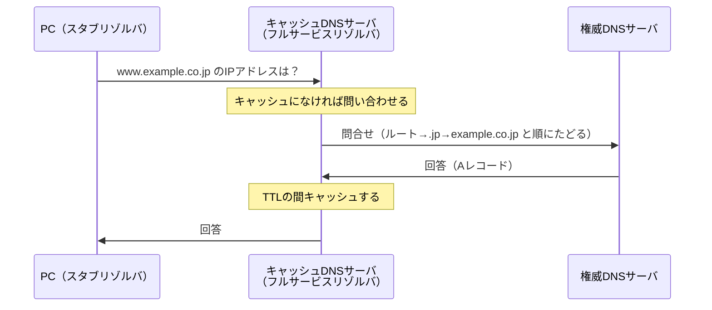
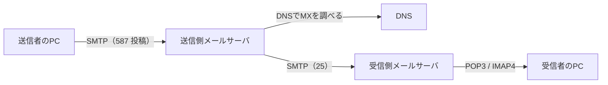

# 応用情報技術者試験 科目B 攻略マニュアル【問5 ネットワーク】

> **このマニュアルの使い方**：過去問を解く前に第1章〜第3章を読む。第1章で「構成図の読み方」、第2章で「階層ごとの仕組み（IPアドレス、経路、DNS、DHCP、VLAN、HTTP、メール）」、第3章で「よく出る問題の型」を押さえる。そのあと過去問（`kakomon/05_network.md`）を解く。
>
> 根拠：2009〜2025年度の過去問33回分、シラバスVer.7.2、試験要綱Ver.5.6。2014年度以降は**問5**（選択問題）。
> 出題範囲（試験要綱）：ネットワークアーキテクチャ、プロトコル、インターネット、イントラネット、VPN、通信トラフィック、有線・無線通信。
> 選ぶかどうかの目安：問われる技術は「**IPアドレス・経路・DNS・DHCP・NAT・VLAN・HTTP・メール**」の定番がほとんど。知識が点に直結し、問1（セキュリティ）とも重なるので**本命にしやすい**。

---

## 目次

- 第1章 問5の解き方（最初に読む）
- 第2章 必ず知っておく基礎知識
  - 2-1 通信の階層（どの層の話か）
  - 2-2 IPアドレスとサブネット
  - 2-3 経路制御とデフォルトゲートウェイ
  - 2-4 ARPとMACアドレス
  - 2-5 DHCP
  - 2-6 DNS
  - 2-7 NAT・NAPT
  - 2-8 TCP・UDPとポート番号
  - 2-9 VLANとスイッチ
  - 2-10 冗長化（VRRP・リンクアグリゲーション・STP）
  - 2-11 HTTP・HTTPS・WebSocket
  - 2-12 電子メールの仕組み
  - 2-13 VPN・トンネル
  - 2-14 負荷分散
  - 2-15 無線LANとLAN認証
  - 2-16 運用管理（ping・traceroute・nslookup・SNMP）
  - 2-17 IPv6
  - 2-18 クラウド時代の接続（SWG・ローカルブレイクアウト）
- 第3章 よく出る問題の型（5パターン）
- 第4章 空欄・記述の書き方（良い答え・悪い答え）
- 第5章 2026年度に向けて
- 第6章 直前チェックリスト

---

## 第1章 問5の解き方（最初に読む）

### 1-1. 問5はどういう問題か

ある会社のネットワークで、**構成の変更（クラウド移行、テレワーク、負荷分散）や障害の調査**が題材。構成図と、IPアドレス・経路表・通信の一覧などの表が付く。設問は次の3種類。

1. **空欄**：用語、IPアドレス、経路表のネクストホップ、ポート番号、DNSのレコード
2. **通信の経路を追う**：あるパケットがどの機器を通るか、送信元IPアドレスは何に変わるか
3. **問題の原因と対策**：つながらない理由、遅い理由、設定すべき内容

### 1-2. 解く手順

1. **構成図の各機器に、属するネットワーク（サブネット）を書き込む**。
2. **通信の一覧表（送信元・宛先・ポート）を見て、通信の向きを矢印で書く**。
3. 問われた通信について、**PCから宛先まで1ホップずつ追う**：「同じサブネットか → 違えばデフォルトゲートウェイへ → 経路表でネクストホップ → …」。
4. 途中で **NAT・プロキシ・負荷分散装置・トンネル** を通るたびに、送信元・宛先IPアドレスがどう変わるかを書く。
5. 記述は「**どの機器の、どの設定を、何に**」の3点を本文の機器名で書く。

### 1-3. 採点講評が毎年言っていること

| 失点の原因 | 講評での言われ方（例） | 防ぎ方 |
|---|---|---|
| デフォルトゲートウェイ／デフォルトルートの理解不足 | 役割を理解していない（2020、2019春、2023春） | 2-3を押さえる |
| ネットワークアドレスと端末のアドレスの混同 | ネットワークアドレスを問うのに端末のIPアドレス（2023秋） | 「ネットワークアドレス」「範囲」の語に注意 |
| トンネルの内側と外側の混同 | IPsecルータを送信元と答えた（2022春） | 2-13 |
| 似た技術の混同 | OP25Bとオープンリレーの防止の混同（2025秋） | 2-12 |
| 機器の役割の取り違え | DHCPリレーを動かす機器（2020）、TLS証明書を置く機器（2021春） | 2-5、2-11 |
| 運用系の用語 | ゾーン転送、SNMPトラップ、nslookup、IEEE 802.1X（2023春、2025春） | 2-6、2-15、2-16 |
| 通信の向き | トラフィックが逆向きであることを読み取れない（2020） | 通信表に矢印を書く |

---

## 第2章 必ず知っておく基礎知識

### 2-1. 通信の階層（どの層の話か）

| 層（TCP/IP） | 主なもの | 機器 | 宛先の指定 |
|---|---|---|---|
| アプリケーション層 | HTTP、DNS、SMTP、DHCP、SNMP | サーバ、プロキシ | URL、メールアドレス |
| トランスポート層 | **TCP**、**UDP** | FW（ポートで判断） | **ポート番号** |
| インターネット層 | **IP**、ICMP | **ルータ**、**L3スイッチ** | **IPアドレス** |
| ネットワークインタフェース層 | イーサネット、無線LAN、ARP | **L2スイッチ**、AP | **MACアドレス** |

### 2-2. IPアドレスとサブネット

**一言で**：IPアドレス（IPv4は32ビット）は「**ネットワーク部**（どのネットワークか）」と「**ホスト部**（そのネットワークのどの機器か）」に分かれる。境目を示すのが**サブネットマスク**（/24 のような**プレフィックス長**）。

| プレフィックス | サブネットマスク | ブロックの大きさ | 使えるホスト数 |
|---|---|---|---|
| /24 | 255.255.255.0 | 256 | 254 |
| /25 | 255.255.255.128 | 128 | 126 |
| /26 | 255.255.255.192 | 64 | 62 |
| /27 | 255.255.255.224 | 32 | 30 |
| /28 | 255.255.255.240 | 16 | 14 |

- **ネットワークアドレス**：ホスト部が全て0（ブロックの先頭）。**ブロードキャストアドレス**：ホスト部が全て1（ブロックの末尾）。どちらも機器には付けられない → ホスト数は 2^(ホスト部のビット数) − 2。
- **計算例**：192.168.10.130/26 → ブロック64の区切り（0, 64, 128, 192）のうち130は128〜191 → ネットワークアドレス192.168.10.128、ブロードキャスト192.168.10.191。
- **プライベートアドレス**：10.0.0.0/8、172.16.0.0/12、192.168.0.0/16。インターネットでは使えない（NATで変換する）。
- **CIDR**：クラスにとらわれず任意の長さで区切る。**アクセス制御は必要最小限の範囲**で指定する（2021秋）。

### 2-3. 経路制御とデフォルトゲートウェイ

**一言で**：宛先が**自分と同じサブネット**なら直接送る。**違うサブネット**なら**デフォルトゲートウェイ**（ルータ・L3SW）に送る。ルータは**経路表**を見て次の機器（**ネクストホップ**）に送る。

| 用語 | 意味 |
|---|---|
| **デフォルトゲートウェイ** | **PC（端末）に設定する**、別のサブネット宛てのパケットの送り先 |
| **経路表（ルーティングテーブル）** | ルータが持つ「宛先ネットワーク → ネクストホップ」の表 |
| **デフォルトルート**（0.0.0.0/0） | **経路表の中の**、どの宛先にも当てはまらないパケットの送り先（インターネット向けなど） |
| **最長一致** | 経路表で複数当てはまるときは、プレフィックスが最も長い（範囲が狭い）経路を使う |
| 静的経路／動的経路 | 手で設定する／OSPF・RIPなどで自動で学習（障害時に自動で切り替わる。2017春） |

**よくある誤解**：デフォルトゲートウェイ（端末の設定）とデフォルトルート（経路表の行）は別物。

### 2-4. ARPとMACアドレス

- 同じサブネット内では、**MACアドレス**（機器固有の48ビット）で相手に届ける。
- **ARP**：IPアドレスからMACアドレスを調べる（ブロードキャストで問い合わせる）。
- 別のサブネットに送るときは、宛先MACアドレスは**デフォルトゲートウェイのMACアドレス**になる（宛先IPアドレスは最終の相手のまま）。

### 2-5. DHCP

**一言で**：PCにIPアドレス、サブネットマスク、デフォルトゲートウェイ、DNSサーバのアドレスを自動で配る仕組み。

- 手順：Discover（探す）→ Offer（提案）→ Request（要求）→ Ack（承認）。最初のDiscoverは**ブロードキャスト**なので、**ルータを越えられない**。
- **DHCPリレーエージェント**：DHCPサーバが別のサブネットにあるとき、ブロードキャストを受け取ってサーバに中継する。**PCと同じサブネットにある機器（L3SWなど）で動かす**（2020）。
- **リース期間**：配ったアドレスの有効期限。

### 2-6. DNS

**一言で**：名前（www.example.co.jp）とIPアドレスを対応付ける仕組み。

| 用語 | 意味 |
|---|---|
| **スタブリゾルバ** | PCの中の名前解決の機能。キャッシュDNSサーバに問い合わせるだけ（2017春で正答率が低かった） |
| **キャッシュDNSサーバ**（フルサービスリゾルバ） | 権威DNSサーバに順に問い合わせて答えを探し、一定時間覚えておく |
| **権威DNSサーバ** | 自分のドメイン（ゾーン）の情報の正本を持つ |
| **ゾーン転送** | プライマリの権威DNSサーバから、セカンダリにゾーン情報を複製すること（2023春で正答率が低かった） |
| **TTL** | キャッシュしてよい時間。**サーバの移転前にTTLを短くしておく**と、切替えが早く伝わる |
| **DNSラウンドロビン** | 1つの名前に複数のAレコードを登録し、問い合わせのたびに順番を変えて返す簡単な負荷分散。**故障したサーバも返してしまう**（ヘルスチェックがない） |

**主な資源レコード**

| レコード | 意味 |
|---|---|
| **A** | 名前 → IPv4アドレス |
| **AAAA** | 名前 → IPv6アドレス |
| **CNAME** | 別名（www → server1 など） |
| **MX** | そのドメインのメールを受け取るサーバ |
| **NS** | そのゾーンの権威DNSサーバ |
| **PTR** | IPアドレス → 名前（逆引き） |
| **TXT** | 任意の文字列（SPFの設定など） |

### 2-7. NAT・NAPT

- **NAT**：プライベートIPアドレスとグローバルIPアドレスを1対1で変換する（**静的NAT**で公開サーバに外からアクセスさせる）。
- **NAPT**（IPマスカレード）：多数のPCのアドレスを、**ポート番号も使って1つのグローバルアドレス**に変換する。結果として、インターネットからは社内のPCのアドレスが見えない。
- **送信元IPアドレスが変わる**ことに注意：NAPTを通ったパケットの送信元は**FWのグローバルアドレス**。相手のサーバがIPアドレスでアクセスを制限している場合に影響する。

### 2-8. TCP・UDPとポート番号

| | TCP | UDP |
|---|---|---|
| 一言で | 確実に順番どおり届ける（接続を確立し、届いたかを確認し、再送する） | 確認なしで速く送る |
| 使い道 | HTTP、メール、ファイル転送 | DNSの問合せ、音声・動画、DHCP |

**主なポート番号**

| ポート | 用途 |
|---|---|
| 20/21 | FTP |
| 22 | SSH |
| 25 | SMTP（サーバ間のメール転送） |
| 53 | DNS |
| 67/68 | DHCP |
| 80 / 443 | HTTP / HTTPS |
| 110 / 995 | POP3 / POP3S |
| 123 | NTP |
| 143 / 993 | IMAP4 / IMAPS |
| 161 / 162 | SNMP / SNMPトラップ |
| 587 | メール投稿（サブミッション） |

**ICMP**（pingなど）はIP層のプロトコルで、**ポート番号を持たない**（2022秋）。

### 2-9. VLANとスイッチ

| 用語 | 意味 |
|---|---|
| **L2スイッチ** | MACアドレスで中継。同じVLAN内の通信 |
| **L3スイッチ** | ルータの機能も持つスイッチ。**VLAN間の通信を中継する** |
| **VLAN** | 1台のスイッチを論理的に複数のネットワークに分ける。部署ごとのゾーン分割などに使う |
| **ポートVLAN** | ポートごとに所属するVLANを決める（1ポート＝1VLAN） |
| **タグVLAN**（IEEE 802.1Q） | フレームにVLAN番号（タグ）を付け、**1本のケーブルで複数のVLANを運ぶ**（スイッチ同士の接続） |

### 2-10. 冗長化

| 技術 | 一言で |
|---|---|
| **VRRP** | 複数のルータ（L3SW）で1つの**仮想IPアドレス**を共有し、デフォルトゲートウェイを冗長化。故障したら待機側が引き継ぐ |
| **リンクアグリゲーション** | 複数のケーブルを束ねて1本として使い、帯域を増やし、1本が切れても通信を続ける |
| **STP**（スパニングツリー） | スイッチをループ状につないだときに、一部のポートを止めてループを防ぐ（2016春） |

### 2-11. HTTP・HTTPS・WebSocket

- **HTTP**：要求（GET、POSTなど）と応答の繰返し。WebブラウザはWebページの画像などを取るため、**同時に複数のTCPコネクション**を張る（2019秋）。HTTP/2では1本のコネクションで並行して送れる。
- **HTTPS**：HTTPをTLSで暗号化。**TLSを終端する機器にサーバ証明書を置く**。負荷分散装置で終端すると、そこから先のサーバまでは暗号化されない（2021春）。
- **WebSocket**：最初にHTTPで接続を確立し、その後は**サーバとブラウザが双方向に、接続を保ったまま**データを送れる。チャットなどに使う（2021春）。
- **Cookie／セッション**：HTTPは1回ごとに独立しているので、ログイン状態などをCookieで保持する。負荷分散装置が同じ利用者を同じサーバに振り分ける設定（セッション維持）が必要な場合がある。

### 2-12. 電子メールの仕組み

| 用語 | 意味 |
|---|---|
| **SMTP** | メールを送る（PC→サーバ、サーバ→サーバ） |
| **POP3 / IMAP4** | メールを受け取る（端末にダウンロード／サーバに置いたまま見る） |
| **MXレコード** | 宛先ドメインのメールサーバを示すDNSのレコード |
| **SMTP-AUTH** | 送信時に利用者を認証する |
| **オープンリレー（第三者中継）** | 自社と関係ない第三者のメールを中継してしまう設定。迷惑メールの踏み台になる。**中継は自社のネットワーク・利用者からのものに限る**設定で防ぐ |
| **OP25B** | ISPが、自社の回線から**外部のメールサーバの25番ポートへ直接送る通信を遮断**すること。オープンリレーの防止とは別物（2025秋で混同が多かった） |
| SPF / DKIM / DMARC | 送信ドメイン認証（問1のマニュアル2-11参照） |

### 2-13. VPN・トンネル

- **VPN**：インターネット上に暗号化した仮想の専用線を作る。拠点間（IPsec VPN）と、リモートアクセス（SSL-VPN、IPsec）がある。
- **トンネリング（カプセル化）**：元のパケットを丸ごと別のパケットに包んで運ぶ。**包まれた内側のパケットの送信元・宛先IPアドレスは変わらない**。外側のパケットはVPN装置同士のアドレス（2022春：IPsecルータ1と2の間で、内側の送信元IPアドレスは元のまま）。

### 2-14. 負荷分散

| 方式 | 仕組み | 注意点 |
|---|---|---|
| **DNSラウンドロビン** | DNSで複数のIPアドレスを順に返す | 故障を検知しない。キャッシュの影響で偏る |
| **負荷分散装置**（ロードバランサ） | **仮想IPアドレス**で要求を受けて、背後のサーバに振り分ける。**ヘルスチェック**で故障したサーバを外す | DNSには**仮想IPアドレス**を登録する（2018春）。**送信元IPアドレスが負荷分散装置のものに置き換わる**場合がある（サーバ側のログやアクセス制御に影響。2018秋） |

### 2-15. 無線LANとLAN認証

- **PoE**：LANケーブルで電力も送る。アクセスポイントの電源工事が不要になる（2019春）。
- **暗号化**：WPA2・WPA3。
- **IEEE 802.1X**（2025春）：LANや無線LANに接続する時点で利用者・端末を認証する。**サプリカント**（端末のソフト）、**オーセンティケータ**（スイッチ・アクセスポイント）、**認証サーバ**（RADIUSサーバ）の3者で行う。
- **MACアドレス認証**：登録したMACアドレスの端末だけ接続を許す（偽装される弱点がある）。

### 2-16. 運用管理

| ツール・仕組み | 何が分かるか |
|---|---|
| **ping** | 相手に届くか（ICMPエコー） |
| **traceroute** | 途中でどのルータを通るか、どこで止まるか |
| **nslookup / dig** | DNSサーバに実際に名前解決をさせて、答えを確認する（2025春で正答率が低かった） |
| **SNMP** | 機器の状態を管理サーバが定期的に取りに行く（ポーリング） |
| **SNMPトラップ** | 機器の側から、障害の発生を**管理サーバに通知する**（2025春） |
| **Syslog** | 機器のログを集約する |

### 2-17. IPv6

シラバスの用語例は「IPv6の必要性と特徴」まで。細かい仕組みは問題文で説明されることが多い。

- 128ビット。16ビットずつ8つの区切りを16進数で書く（例：2001:db8:a000:f0::80）。
- **省略のルール**：各区切りの**先頭の0**は省略できる。**連続する0の区切り**は1か所だけ「::」にまとめられる。
- サブネットは通常 /64。/48 の割当てからは 2^(64−48) ＝ 65,536個の /64 サブネットが作れる。
- **NAPTを使わない**のが基本 → 社内の端末にもインターネットで通用するアドレスが付く → **FWで外からの接続を拒否する設定が必要**（IPv4でNAPTが結果的に担っていた効果がなくなる）。
- アドレスの自動設定：ルータが送るメッセージでネットワーク部を知り、端末自身がホスト部を決める。プライバシー保護のため、ホスト部を定期的に変える一時アドレスがある。

### 2-18. クラウド時代の接続

| 用語 | 意味 |
|---|---|
| **ローカルブレイクアウト** | 拠点からSaaSなどへの通信を、本社を経由させず拠点の回線から直接インターネットに出す。本社回線の混雑を避ける（2022春の題材） |
| **SWG**（セキュアWebゲートウェイ） | クラウド上のプロキシ。URLフィルタリング、マルウェア検査、ログ取得をクラウドで行う（2024秋） |
| **IPアドレスによるアクセス制限の落とし穴** | 経路を変えると**送信元IPアドレスが変わる**ので、SaaS側の許可リストの見直しが必要。SWGの送信元アドレスは**他の契約者と共用**のことがあり、許可リストに入れると他社からも接続できてしまう |

---

## 第3章 よく出る問題の型（5パターン）

### 型1：DNSと名前解決（2025秋、2025春、2023秋、2023春、2018春）
- 問われること：レコードの種類、キャッシュとTTL、ゾーン転送、ラウンドロビン、名前解決の確認方法。

### 型2：経路とアドレス（2025秋、2022春、2021秋、2020、2017春）
- 問われること：デフォルトゲートウェイ、経路表、ネットワークアドレス、DHCPリレー、トンネルと送信元IPアドレス。

### 型3：構成変更とクラウド（2025秋、2024秋、2024春、2022春、2022秋）
- 問われること：SaaS・SWG・ローカルブレイクアウトで経路がどう変わるか、帯域の計算、アクセス制限への影響。

### 型4：Webとメール（2023秋、2021春、2019秋）
- 問われること：HTTPとコネクション、WebSocket、TLSの終端、MXとメールの流れ、ポート番号。

### 型5：LANの設計と障害対応（2025春、2021秋、2019春、2018秋）
- 問われること：VLAN、タグVLAN、PoE、802.1X、障害の切分け手順、SNMPトラップ、負荷分散装置でのアドレス変換。

---

## 第4章 空欄・記述の書き方（良い答え・悪い答え）

**例1**：「PCに設定するデフォルトゲートウェイを答えよ」

| | 答え | 評価 |
|---|---|---|
| ✕ | FWのアドレス | PCと同じサブネットにない機器は設定できない |
| ○ | PCと同じサブネットにあるL3SWのインタフェースのアドレス（構成図の値） | |

**例2**：「本社経由のWeb会議で、本社回線の上りに必要な帯域」

| | 答え | 評価 |
|---|---|---|
| ✕ | 1人2Mビット/秒 × 200人 ＝ 400Mビット/秒 | 営業所へ返す下りの通信も本社回線の上りを通ることを見落とし |
| ○ | 400（営業所→T社）＋ 400（T社→営業所）＝ 800Mビット/秒 | 本社を2回通る通信を両方数えた |

**例3**：「経路を変えた後、SaaSに接続できなくなった理由」

| | 答え | 評価 |
|---|---|---|
| ✕ | 経路が変わったから | 何が問題かを説明していない |
| ○ | 送信元IPアドレスが営業所のアドレスに変わり，SaaSのIP制限で許可されていないから | |

**記述の型**

| 問われ方 | 型 |
|---|---|
| 設定変更 | 「〈機器〉の〈設定項目〉を〈値〉に変更する」 |
| つながらない理由 | 「〜宛てのパケットが〜に送られ，〜で破棄されるから」 |
| 目的 | 「〜を〜経由にすることで，〜を変更せずに済むようにするため」 |
| 確認方法 | 「〜から〜に対して〈ping・nslookupなど〉を実行し，応答を確認する」 |

---

## 第5章 2026年度に向けて

### 5-1. 直近の出題

| 年度 | 春期 | 秋期 |
|---|---|---|
| 2025 | 社内LANの障害対応（802.1X、nslookup、SNMP） | サーバのクラウド移行（DHCP、DNS、NAT、経路） |
| 2024 | IoTとクラウド（MQTT） | SWGの導入 |
| 2023 | DNSラウンドロビン | メールサーバの構築 |
| 2022 | SaaS利用と経路（IPsec） | テレワーク |

**傾向**：基本の機能（DNS、DHCP、NAT、経路）を、クラウドやSaaSの利用という新しい場面で問う形が定番。

### 5-2. 出そうなテーマ

| テーマ | 理由 |
|---|---|
| IPv6の導入 | 用語例にあり、本格的な出題がない |
| ゼロトラスト・SASE・VPNの置き換え | 2024秋の発展 |
| クラウドの仮想ネットワーク（サブネット、ルーティング） | 2025秋の発展 |
| 無線LAN（WPA3、多数端末） | 2019春以来 |
| DNSの冗長化とセキュリティ | 定番 |
| 生成AIサービスの利用制御（SWGでの宛先制御・ログ） | AIの利用増 |

---

## 第6章 直前チェックリスト

**知識**
- [ ] /24〜/28 のマスク、ブロックの大きさ、ホスト数
- [ ] ネットワークアドレスとブロードキャストアドレスを計算できる
- [ ] デフォルトゲートウェイ（端末の設定）とデフォルトルート（経路表）の違い
- [ ] DHCPのDiscoverはブロードキャスト → リレーエージェント
- [ ] スタブリゾルバ・キャッシュDNS・権威DNS・ゾーン転送・TTL
- [ ] A・AAAA・CNAME・MX・NS・PTR・TXT
- [ ] NAPTで送信元IPアドレスが変わる、トンネルの内側は変わらない
- [ ] 主なポート番号、ICMPにポート番号はない
- [ ] ポートVLANとタグVLAN、VRRP
- [ ] TLSの終端に証明書、WebSocketは双方向
- [ ] オープンリレーとOP25Bの違い
- [ ] 802.1Xの3者、SNMPトラップ、nslookup

**解き方**
- [ ] 構成図に各機器のサブネットを書き込んだ
- [ ] 通信の向きを矢印で確認した
- [ ] パケットを1ホップずつ追い、アドレスの変化を書いた
