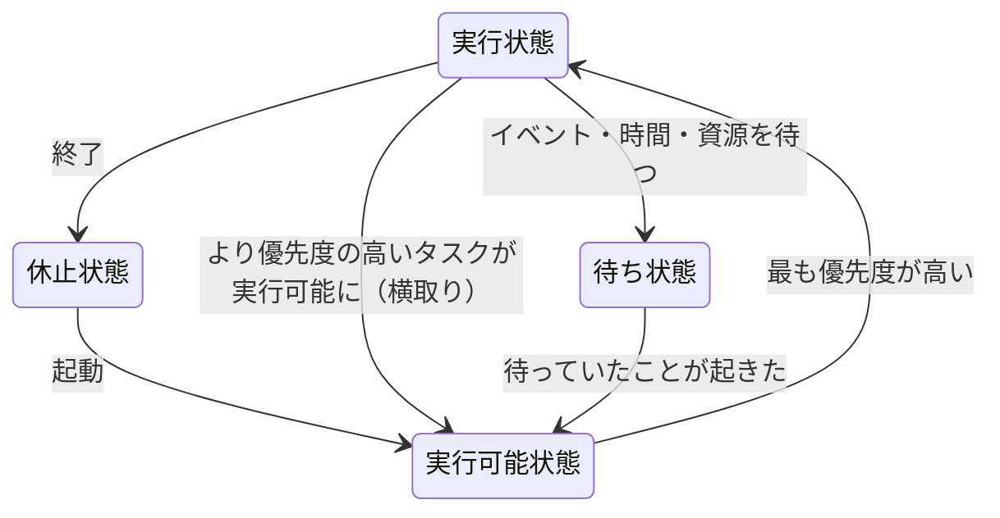

# 応用情報技術者試験 科目B 攻略マニュアル【問7 組込みシステム開発】

> **このマニュアルの使い方**：過去問を解く前に第1章〜第3章を読む。第1章で「仕様書型の問題の読み方」、第2章で「リアルタイムOS・状態遷移・タイマー・電力などの意味と計算」、第3章で「よく出る問題の型」を押さえる。そのあと過去問（`kakomon/06_embedded.md`）を解く。
>
> 根拠：2009〜2025年度の過去問33回分、シラバスVer.7.2、試験要綱Ver.5.6。2014年度以降は**問7**（選択問題）。
> 出題範囲（試験要綱）：リアルタイムOS・MPUアーキテクチャ、省電力・高信頼設計・メモリ管理、センサー・アクチュエーター、組込みシステムの設計、個別アプリケーション（携帯電話、自動車、家電ほか）。
> 選ぶかどうかの目安：題材は毎回違う機器（給餌器、キックボード、補聴器…）だが、**解く作業は「仕様の読み取り＋単位計算＋タスクと状態の追跡」で同じ**。専門知識はほとんど要らず、全て問題文に書いてある。**読解と計算が得意な人の隠れた本命**。

---

## 目次

- 第1章 問7の解き方（最初に読む）
- 第2章 必ず知っておく基礎知識
  - 2-1 組込みシステムの構成
  - 2-2 リアルタイムOSとタスク
  - 2-3 タスクの優先度とスケジューリング
  - 2-4 割込み
  - 2-5 タスク間の通信と排他制御
  - 2-6 状態遷移
  - 2-7 タイマーとカウント値
  - 2-8 クロック周波数と処理時間
  - 2-9 消費電力と電池寿命
  - 2-10 センサーの値の扱い
  - 2-11 バッファ
  - 2-12 通信（BLE・Wi-Fi・LPWA）
  - 2-13 安全と信頼性
- 第3章 よく出る問題の型（5パターン）
- 第4章 計算・記述の書き方（良い答え・悪い答え）
- 第5章 2026年度に向けて
- 第6章 直前チェックリスト

---

## 第1章 問7の解き方（最初に読む）

### 1-1. 問7はどういう問題か

ある機器（家電、ロボット、IoT端末、医療・ヘルスケア機器など）の**仕様書と設計書**を読ませる問題。たいてい次の表・図が付く。

- 構成要素の表（センサー、モーター、通信部、消費電流など）
- **タスクの一覧表**（タスク名、優先度、起動のきっかけ、処理内容）
- **状態遷移図・状態遷移表**
- 処理の流れ（シーケンス図、フローチャート）

設問は次の4種類。

1. **計算**：処理時間、タイマーのカウント値、データ量、電池の持続時間
2. **状態遷移・タスクの処理の空欄**：遷移先、遷移の条件、通知する情報
3. **設計の理由**：優先度をこう決めた理由、こう判定する理由
4. **不具合の原因と対策**：データの欠落、誤動作、遅れ

### 1-2. 解く手順

1. **表の単位に全部印を付ける**（mA と µA、ms と s、kHz と MHz、バイトとビット）。
2. **タスク一覧表の各行に「誰から起動され、誰に何を送るか」を矢印で書き込む**。
3. **状態遷移図を自分でなぞり、各状態で何をしているか確認する**。
4. 計算は**単位を基本単位（秒、アンペア、ビット）にそろえてから**。
5. 答えの直前に**桁数・端数処理の指示**を確認する（2025春で無視が多発）。

### 1-3. 採点講評が毎年言っていること

| 失点の原因 | 講評での言われ方（例） | 防ぎ方 |
|---|---|---|
| 桁数の指示の無視 | 小数点以下の桁数の指示を無視（2025春） | 書いた後に確認 |
| 単位の変換・計算の誤り | 単位の変換又は計算を誤った（2020、2019春） | 基本単位にそろえる |
| 16ビットに収まらない値 | 16ビットタイマのカウント値に収まらない（2018春） | 上限65,535と比べる |
| 主体の取り違え | 他のタスクの処理を書いた、自分の処理を書いた（2018春、2019春） | 設問の「〜タスクが〜に」を確認 |
| 条件を問うのに処理を書く | 遷移条件ではなく処理内容を記述（2019春） | 2-6 |
| 理由の取り違え | 優先度の理由を処理の順序で答えた（2024春） | 理由は「応答時間」「安全」で書く |
| 原因でなく経緯を書く | 欠落に至る前の状況を記述（2025秋） | 「なぜ欠落したか」の直接の原因を書く |
| 数え漏れ | ステレオカメラの2台目を計算していない（2021秋） | 構成要素の個数を確認 |
| 列挙の過不足 | 三つの処理の全てを挙げていない、関係ない処理を含めた（2022春・秋） | 本文の処理を過不足なく |

---

## 第2章 必ず知っておく基礎知識

### 2-1. 組込みシステムの構成

| 構成要素 | 役割 |
|---|---|
| **MCU**（マイコン） | CPU、メモリ、タイマー、入出力を1つのチップにまとめたもの |
| **センサー** | 温度、距離、加速度、光、重さなどを電気信号に変える |
| **アクチュエーター** | モーター、ソレノイド、ヒーターなど、電気信号で物を動かす |
| **A/D変換器** | センサーのアナログ値をデジタルの数値にする |
| **通信モジュール** | Wi-Fi、BLE、LTE、LPWA |
| **ウォッチドッグタイマー** | 一定時間ごとにソフトウェアがリセットしないと、異常とみなしてシステムを再起動する（暴走対策） |

### 2-2. リアルタイムOSとタスク

**一言で**：決められた時間内に処理を終えることを保証するためのOS。処理を**タスク**という単位に分け、優先度に従って実行する。

**タスクの状態**

- **実行状態**：今CPUを使っている（1つだけ）。
- **実行可能状態**：いつでも動けるが、より優先度の高いタスクが動いている。
- **待ち状態**：通知、時間の経過、資源の解放を待っている（CPUを使わない）。

### 2-3. タスクの優先度とスケジューリング

- **プリエンプティブ（横取り型）な優先度ベースのスケジューリング**：優先度の高いタスクが実行可能になると、動いている低いタスクを中断して切り替える。
- **優先度の決め方**：
  - **締切（デッドライン）が短い・応答を急ぐタスクほど高くする**。
  - **安全に関わるタスク**（非常停止、過熱検知、障害物検知）は最も高くする。
  - 周期タスクでは**周期が短いほど高くする**（レートモノトニック）。
- **よくある誤解**：「処理の順番が先だから優先度が高い」ではない。理由は**応答時間（締切）と安全**で書く（2024春の講評）。

### 2-4. 割込み

**一言で**：ボタンの押下、タイマーの満了、データの受信など、外部の出来事をCPUにすぐ知らせる仕組み。

- **割込みハンドラ**：割込みのときに動く短い処理。**時間のかかる処理はハンドラでせず、タスクに通知して任せる**（ハンドラが長いと、他の割込みを逃す）。
- **割込みのマスク**：一時的に割込みを受け付けないようにする。
- **省電力でクロックを止めている間は、タスクは動けない** → 復帰させられるのは**外部からのイベント（外部割込み、受信、ボタン）**だけ（2024秋で正答率が低かった）。

### 2-5. タスク間の通信と排他制御

| 仕組み | 一言で |
|---|---|
| **イベントフラグ** | 「起きた」ことを知らせる |
| **メッセージキュー（メールボックス）** | データを渡す。受け手が取り出すまで溜まる |
| **セマフォ** | 共有している資源（変数、装置）を同時に使わないよう、使う権利を管理する |

- **競合**：2つのタスクが同じデータを同時に書き換えると、値が壊れる → セマフォで排他制御する。
- **優先度逆転**：優先度の低いタスクが資源（セマフォ）を持っている間に、中くらいの優先度のタスクが動き続け、**資源を待っている高い優先度のタスクが長く待たされる**現象。対策は**優先度継承**（資源を持っているタスクの優先度を、待っているタスクの優先度まで一時的に上げる）。
- **デッドロック**：2つのタスクが互いの資源を待ち合って止まる → 資源を取る順序を統一する。

### 2-6. 状態遷移

**一言で**：機器の振る舞いを「**状態**」と「**状態を変えるきっかけ（イベント）**」で表したもの。

| 要素 | 意味 | 例 |
|---|---|---|
| **状態** | その時点のモード | 待機中、走行中、一時停止 |
| **イベント（遷移条件）** | 状態を変えるきっかけ | 「障害物を検知した」「ボタンが押された」 |
| **遷移時の処理（アクション）** | 遷移するときに行う処理 | 「扉をロックする」「モーターを停止する」 |

- 図では「イベント／処理」と書くことが多い。**遷移条件を問われたら「〜したとき」、処理を問われたら「〜する」**。
- **状態遷移表**：行に状態、列にイベントを並べ、マスに次の状態と処理を書く。「−」は何もしない（そのイベントは無視）。
- 同じ状態に戻る場合は、**直前の状態を覚えておく**必要があることがある（一時停止から「走行中」と「帰還中」のどちらに戻るか）。

### 2-7. タイマーとカウント値

**一言で**：一定周期のクロックを数え、設定した数に達したら割込みを発生させる。

| 計算 | 式 |
|---|---|
| タイマーに入るクロックの周波数 | 元のクロック周波数 ÷ 分周比 |
| カウント値（設定値） | 設定したい時間 × タイマーのクロック周波数 |
| 1カウントの時間（分解能） | 1 ÷ タイマーのクロック周波数 |

**例**：48MHzを分周比8で入れ、10ミリ秒を作る → 48,000,000 ÷ 8 ＝ 6,000,000Hz → 0.01 × 6,000,000 ＝ **60,000**。

- **nビットのタイマーの上限**：16ビットなら 2¹⁶ − 1 ＝ **65,535**。これを超えるなら分周比を大きくする（分解能は粗くなる）。
- **カウントダウン型**：設定値から0まで数え、0になったら割込み。**リロード**（設定値を再び読み込む）のタイミングに注意（2024春）。
- **カウンタの折り返し**：差を求めたら負になった場合は、最大値＋1を足して補正する（2019秋）。

### 2-8. クロック周波数と処理時間

| 計算 | 式 |
|---|---|
| 処理時間 | 実行に必要なクロック数（サイクル数）÷ クロック周波数 |
| 消費電力とクロック | 消費電力は**クロック周波数にほぼ比例**する |

- **最適なクロック周波数**：処理を**締切までに終えられる最も低い周波数**（それより低いと間に合わず、高いと電力の無駄。2024秋・2021春）。

### 2-9. 消費電力と電池寿命

| 計算 | 式 |
|---|---|
| 電荷量 | 電流 × 時間（mA × 秒 ＝ mA·秒） |
| 平均消費電流 | 1周期の電荷量の合計 ÷ 1周期の時間 |
| 電池の持続時間 | 電池容量[mAh] ÷ 平均消費電流[mA] |
| 消費電力 | 電圧 × 電流 |

**例**：スリープ中2µAが常に流れ、600秒ごとに測定（1.5mA×0.02秒）を10回と送信（15mA×0.1秒）を1回 → (0.3 ＋ 1.5) ÷ 600 ＝ 0.003mA ＝ 3µA、＋2µA ＝ 5µA → 220mAh ÷ 0.005mA ＝ 44,000時間 ≒ 1,833日。

**省電力の考え方**
- **間欠動作**：必要なときだけ起きて、それ以外はスリープする。
- **通信は電流が大きい** → 送信回数を減らす（データをまとめて送る）。
- 異常など急ぐ情報だけは**すぐ送る例外**を設ける。

### 2-10. センサーの値の扱い

| 問題 | 対策 |
|---|---|
| **ノイズ・チャタリング**（ボタンやセンサーの値が短時間でばたつく） | 一定時間、同じ値が続いたら確定する。複数回の平均をとる（2022秋） |
| **しきい値付近での繰返し** | **ヒステリシス**：検知するときと解除するときの条件を変える（例：30cm以内で停止、50cm以上が3秒続いたら再開） |
| 量の計測 | 前後2回の計測値の差をとる。**計測のタイミング**を仕様どおりに（2025秋） |
| A/D変換 | 分解能nビットなら、入力範囲を 2ⁿ 段階で表す。1段階の大きさ ＝ 範囲 ÷ 2ⁿ |

### 2-11. バッファ

**一言で**：データを一時的に溜めておく領域。生成の速さと処理の速さの差を吸収する。

- **バッファ長**：サンプリング周波数 × 1サンプルの大きさ × 保持する時間（**全体の長さか、1ブロックの長さか**を区別。2021春）。
- **リングバッファ**：配列の末尾まで書いたら先頭に戻って書く。書込み位置と読出し位置を **mod** で回す。**書込みが読出しを追い越すと、未処理のデータが上書きされて失われる**（2022春）。
- **遅延時間**：バッファが溜まるまでの時間 ＋ 処理時間 ＋ 出力時間。

### 2-12. 通信

| 方式 | 特徴 |
|---|---|
| **BLE**（Bluetooth Low Energy） | 近距離、低消費電力。スマートフォンや小型機器との接続 |
| **Wi-Fi** | 高速だが消費電力が大きい |
| **LTE・5G** | 広域、移動しながら通信 |
| **LPWA**（LTE-M、NB-IoT など） | 低消費電力・広域だが、低速で送れる量が少ない |

- **受信確認**：受け取った側が「届いた」と返す。確認が来なかったデータは**消さずに保持して再送する**（確認を待たずに消すと、通信障害のときに失われる）。
- **メッセージフロー**：シーケンス図で「どの順に、誰が誰に、何を送るか」を追う（2023春）。

### 2-13. 安全と信頼性

- **フェールセーフ**：故障や異常のときに**安全な側に倒す**（停止する、ヒーターを切る）。
- **フォールトトレランス**：故障しても機能を続ける（冗長化）。
- **フールプルーフ**：誤操作をしても危険にならないようにする（扉が閉まらないと動かない）。
- 異常の検知：センサーの値の範囲チェック、タイムアウト、ウォッチドッグタイマー。

---

## 第3章 よく出る問題の型（5パターン）

### 型1：タスク設計（2025秋、2024春、2023秋、2022秋、2020）
- 問われること：タスク間で通知する情報、処理の順序、優先度の理由。

### 型2：状態遷移（2023秋、2022春、2019春、2013秋）
- 問われること：遷移先、遷移条件、各状態で行う処理、直前の状態の記憶。

### 型3：省電力・電池（2024秋、2023春、2021春、2018春）
- 問われること：平均消費電流、電池寿命、最適なクロック周波数、スリープからの復帰。

### 型4：タイマー・データ量・バッファ（2024春、2022春、2021秋、2021春、2018春）
- 問われること：カウント値と分周比、撮影できる時間、バッファ長、遅延時間。

### 型5：センサー処理と不具合（2025秋、2022秋、2019秋）
- 問われること：ノイズ対策、判定の条件、データ欠落の原因、補正の方法。

---

## 第4章 計算・記述の書き方（良い答え・悪い答え）

**例1**：「安全監視タスクの優先度を最も高くした理由」

| | 答え | 評価 |
|---|---|---|
| ✕ | 最初に実行する処理だから | 順序は理由にならない |
| ✕ | 重要だから | 抽象的 |
| ○ | 障害物を検知してから停止指示を送るまでの遅れを最小にし，衝突を防ぐため | 応答時間と安全で書けている |

**例2**：「測定データが失われた原因」

| | 答え | 評価 |
|---|---|---|
| ✕ | ゲートウェイの電源が停止したから | きっかけであって原因ではない |
| ○ | 受信確認がない測定データも，次の測定で上書きしていたから | 直接の原因 |

**例3**：計算の答え方

| | 答え | 評価 |
|---|---|---|
| ✕ | 5.0（指示は「整数で」） | 桁数の指示違反 |
| ✕ | 480,000（16ビットタイマーの設定値） | 上限65,535を超える |
| ○ | 指示どおりの桁数で、範囲内の値 | |

**記述の型**

| 問われ方 | 型 |
|---|---|
| 優先度の理由 | 「〜は〜ミリ秒以内に〜しないと〜（安全・品質）を確保できないから」 |
| 不具合の原因 | 「〜タスクが〜している間に〜が起き，〜が上書きされたから」 |
| 遷移条件 | 「〜が〜を検知したとき」「〜から〜の通知を受けたとき」 |
| 対策 | 「〜を〜回連続で検知したら確定する」「〜を〜に拡張する」「〜の前に〜を停止する」 |

---

## 第5章 2026年度に向けて

### 5-1. 直近の出題

| 年度 | 春期 | 秋期 |
|---|---|---|
| 2025 | 電動キックボードのシェアリング | 猫の自動給餌・健康監視 |
| 2024 | 業務用コーヒーマシン（タイマー、優先度） | スマートイヤホン（クロックと電力） |
| 2023 | 位置通知タグ（電池、メッセージ） | トマト収穫ロボット（状態遷移） |
| 2022 | ワイヤレスカメラ（リングバッファ） | 傘シェアリング（ノイズ、タスク） |

### 5-2. 出そうなテーマ

| テーマ | 理由 |
|---|---|
| エッジAI（機器上でのAI推論）と処理時間・電力 | 用語例「エッジAI」 |
| 自律移動ロボット・ドローン（状態遷移、安全停止） | 2023秋の発展 |
| ファームウェアの無線更新（失敗時に元に戻す） | IoTの定番 |
| BLE・LPWAの省電力設計 | 2023春の発展 |
| 組込み機器のセキュリティ（セキュアブート） | 用語例「セキュアブート」 |

---

## 第6章 直前チェックリスト

**知識・公式**
- [ ] タスクの状態（実行・実行可能・待ち・休止）
- [ ] 優先度は「締切が短い・安全に関わるほど高い」
- [ ] 割込みハンドラは短く、重い処理はタスクへ
- [ ] セマフォ、優先度逆転と優先度継承
- [ ] 状態遷移の「条件」と「処理」の区別
- [ ] カウント値＝時間×（クロック÷分周比）、16ビットの上限65,535
- [ ] 処理時間＝サイクル数÷周波数、最適周波数は締切に間に合う最低値
- [ ] 平均電流＝電荷量の合計÷周期、寿命＝容量÷平均電流
- [ ] リングバッファの上書き、受信確認と再送
- [ ] チャタリング対策、ヒステリシス、フェールセーフ

**解き方**
- [ ] 単位を全てそろえてから計算した
- [ ] 桁数・端数処理の指示を守った
- [ ] 設問の主体（どのタスクの処理か）を確認した
