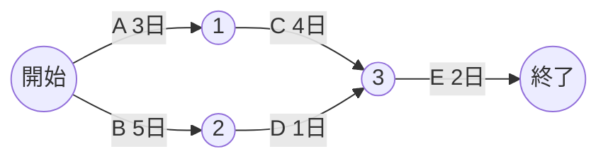

# 応用情報技術者試験 科目B 攻略マニュアル【問9 プロジェクトマネジメント】

> **このマニュアルの使い方**：過去問を解く前に第1章〜第3章を読む。第1章で「事例問題の読み方」、第2章で「スコープ・スケジュール・コスト・リスク・調達・アジャイルの意味と計算」、第3章で「よく出る問題の型」を押さえる。そのあと過去問（`kakomon/07_pm.md`）を解く。
>
> 根拠：2009〜2025年度の過去問33回分、シラバスVer.7.2、試験要綱Ver.5.6。2014年度以降は**問9**（選択問題）。
> 出題範囲（試験要綱）：プロジェクト全体計画、スコープ、資源、チーム、スケジュール、コスト、リスク、品質、調達、コミュニケーション、見積手法。
> 選ぶかどうかの目安：技術知識はほとんど要らない。**本文の事情（関係者の要望、制約、過去の失敗）をつないで答える読解問題**に、計算が1〜2問。文系・実務経験者の本命、技術系の人の保険。

---

## 目次

- 第1章 問9の解き方（最初に読む）
- 第2章 必ず知っておく基礎知識
  - 2-1 プロジェクトとプロジェクトマネジメント
  - 2-2 ステークホルダとコミュニケーション
  - 2-3 スコープとWBS
  - 2-4 スケジュール（クリティカルパス・短縮）
  - 2-5 CCPM
  - 2-6 見積り
  - 2-7 コストとEVM
  - 2-8 リスクマネジメント
  - 2-9 品質マネジメント
  - 2-10 調達と契約
  - 2-11 チームと資源
  - 2-12 変更管理
  - 2-13 アジャイル（スクラム）
  - 2-14 PoC・パッケージ導入・移行
- 第3章 よく出る問題の型（5パターン）
- 第4章 記述の書き方（良い答え・悪い答え）
- 第5章 2026年度に向けて
- 第6章 直前チェックリスト

---

## 第1章 問9の解き方（最初に読む）

### 1-1. 問9はどういう問題か

あるシステム開発・導入プロジェクトの**PM（プロジェクトマネージャ）の立場**で、計画を立てる・問題に対処する場面が題材。設問は次の3種類。

1. **用語・手法の空欄**（スコープクリープ、ステアリングコミッティ、ファストトラッキングなど）
2. **計算**（クリティカルパス、EVM、期待値、ベロシティ、見積り）
3. **PMの判断とその理由**（なぜその対応をしたか、何を合意すべきか、どんなリスクがあるか）

### 1-2. 解く手順

1. **登場人物と立場を一覧にする**：誰がPMか、誰が発注者・利用部門・ベンダーか、誰が決める人か。
2. **プロジェクトの目標と制約に印を付ける**：本稼働日、予算、「〜は変えられない」。
3. **「過去のプロジェクトでは〜」「〜部長は〜を懸念している」に印**：今回のリスクや設問の答えの伏線。
4. **設問の修飾語に印**：「費用面の」「品質の観点で」「〜を変えずに」。
5. 記述は**本文の固有の事情を1つ以上入れて**書く（一般論だと点にならない）。

### 1-3. 採点講評が毎年言っていること

| 失点の原因 | 講評での言われ方（例） | 防ぎ方 |
|---|---|---|
| 一般論 | 単に重要な業務であるから、という記述（2018春）／プロトタイピングを行う（2019秋） | 本文の事情（会社名・部署名・数値）を使う |
| 観点の指定を無視 | “費用面の”対応策を問うのに他の対策（2023春） | 設問の修飾語に印 |
| 目的を手段で答える | バーンダウンチャートを見る目的を「可視化のため」（2025秋） | 目的は「〜を期限までに終えるため」 |
| 納期を延ばす答え | “スケジュールの延期”と解答（2025春） | PMの答えは原則、制約を守る方向 |
| 用語の混同 | マネジメント予備（2021春）、プロダクトオーナの役割（2021秋）、フィット&ギャップ分析（2019春）、RBS（2022秋） | 第2章で意味を押さえる |
| 計算ミス | 期待値の計算（2022秋）、数値が若干異なる（2020）、EVMによる予測（2019秋） | 計算に使う要素を書き出す |

---

## 第2章 必ず知っておく基礎知識

### 2-1. プロジェクトとプロジェクトマネジメント

- **プロジェクト**：期限があり、独自の成果物を作る一時的な活動（定常業務と対比）。
- 制約の三要素：**スコープ（範囲）・スケジュール（納期）・コスト（費用）**。どれかを変えると他に影響し、**品質**にも影響する（2024春）。
- 主な知識の分野（PMBOK、JIS Q 21500）：統合、ステークホルダ、スコープ、資源、スケジュール、コスト、リスク、品質、調達、コミュニケーション。
- **プロジェクト憲章**：プロジェクトの目的・範囲・PMの権限を正式に認める文書。

### 2-2. ステークホルダとコミュニケーション

| 用語 | 意味 |
|---|---|
| **ステークホルダ** | プロジェクトに影響を与える、又は影響を受ける人・組織（発注者、利用部門、ベンダー、経営層） |
| **ステアリングコミッティ** | 経営層などで構成する、プロジェクトの重要な意思決定を行う会議体（2023春） |
| **エスカレーション** | PMの権限で解決できない問題を、上位の意思決定者に上げること |
| **コミュニケーション計画** | 誰に・何を・いつ・どの手段で伝えるか。複数拠点では特に共有のルールが重要（2019秋） |

### 2-3. スコープとWBS

- **スコープ**：プロジェクトで作るもの・行う作業の範囲。
- **WBS**：成果物と作業を階層的に分解した図。最下位の作業単位を**ワークパッケージ**という。WBSにない作業はスコープ外。
- **スコープクリープ**：小さな要望の追加が積み重なり、**正式な手続を経ずに範囲が膨らむ**こと（2024春）。対策：**変更は変更要求として受け付け、影響を評価して承認された分だけ反映する**。
- **スコープ記述書**：作るもの・作らないもの・受入れの基準を明記した文書。

### 2-4. スケジュール（クリティカルパス・短縮）

**アローダイアグラム（PERT図）とクリティカルパス**

- 経路 A→C→E ＝ 3＋4＋2 ＝ 9日、B→D→E ＝ 5＋1＋2 ＝ 8日。最も長い経路 **A→C→E（9日）がクリティカルパス**。プロジェクト全体の期間はこれで決まる。
- **余裕（フロート）**：遅れても全体に影響しない日数。クリティカルパス上の作業は余裕0。上の例でBとDには1日の余裕がある。
- **最早開始日**は前から計算し、合流点では**最大**をとる。**最遅開始日**は後ろから計算し、分岐点では**最小**をとる。
- **短縮の方法**

| 方法 | 内容 | 代償 |
|---|---|---|
| **クラッシング** | 人や資源を追加して作業を短くする | コストが増える |
| **ファストトラッキング** | 本来は順番に行う作業を並行して行う | 手戻りのリスクが増える |

- 短縮は**クリティカルパス上の作業**で行う（それ以外を短くしても全体は縮まない）。

### 2-5. CCPM（クリティカルチェーン・プロジェクトマネジメント）

**一言で**：作業ごとの見積りに含まれる安全余裕を取り除き、プロジェクトの最後にまとめて「**プロジェクトバッファ**」として持つ方法（2025春）。

- 背景：**パーキンソンの法則**（余裕があると使い切ってしまう）、**学生症候群**（ぎりぎりまで着手しない）。
- 非クリティカルな経路が合流する点には**合流バッファ**を置く。
- 人などの**資源の競合**も考慮した最長の経路を**クリティカルチェーン**という。
- 管理：作業の進み具合に対する**バッファの消費率**で、危険度を判断する。バッファが減ってきたら、要員を回すなどの手を打つ。

### 2-6. 見積り

| 手法 | 内容 | 向いている時期 |
|---|---|---|
| **類推見積り** | 似た過去のプロジェクトの実績から見積もる。**類似していて、かつ複数**のプロジェクトと比べる（2021春） | 初期（情報が少ない） |
| **ボトムアップ見積り** | WBSの最下位の作業ごとに見積もって積み上げる | 要件が固まった後 |
| **ファンクションポイント法** | **利用者から見た機能**（入力、出力、照会、内部のデータ、外部とのデータ）の数と複雑さで規模を見積もる。プログラム言語に依存しない | 要件定義後 |
| **三点見積り** | (楽観値 ＋ 4 × 最可能値 ＋ 悲観値) ÷ 6 | 不確実性がある作業 |
| **COCOMO** | プログラムの規模（行数）から工数を見積もる | |

### 2-7. コストとEVM

**EVM（アーンドバリューマネジメント）**：進捗とコストを金額で比べて管理する方法。

| 指標 | 意味 | 式 |
|---|---|---|
| **PV**（計画価値） | その時点までに**終わる予定だった**作業の予算 | |
| **EV**（出来高） | その時点までに**実際に終わった**作業の予算 | |
| **AC**（実コスト） | その時点までに**実際にかかった**コスト | |
| SV（スケジュール差異） | 進み具合 | EV − PV（負なら遅れ） |
| CV（コスト差異） | 費用の具合 | EV − AC（負なら超過） |
| **SPI** | スケジュールの効率 | EV ÷ PV（1未満なら遅れ） |
| **CPI** | コストの効率 | EV ÷ AC（1未満なら超過） |
| BAC | 完了時の総予算 | |
| **EAC**（完了時の総コストの見込み） | 今後も今の効率が続く場合 | AC ＋ (BAC − EV) ÷ CPI |
| | 今後は計画どおりの効率の場合 | AC ＋ (BAC − EV) |

**例**：BAC＝100、PV＝50、EV＝40、AC＝50 → SPI＝0.8（遅れ）、CPI＝0.8（超過）、EAC＝50＋(100−40)÷0.8＝125。

**予備費**

| 予備 | 対象 | 位置づけ |
|---|---|---|
| **コンティンジェンシー予備** | 特定済みのリスク（起きるかもしれないと分かっているもの） | コストベースラインの**内側**。PMの判断で使える |
| **マネジメント予備** | 予想できないリスク | コストベースラインの**外側**。使うには経営層の承認が要る（2021春） |

### 2-8. リスクマネジメント

**流れ**：特定 → 分析（定性的・定量的）→ 対応の計画 → 監視

| 段階 | 手法 |
|---|---|
| **特定** | ブレーンストーミング、チェックリスト（過去のリスク一覧）、有識者へのヒアリング、**RBS**（リスクの分類を階層にした図。漏れなく洗い出す。2022秋） |
| **定性的分析** | 発生確率 × 影響度のマトリクスで優先順位を付ける |
| **定量的分析** | 期待金額価値（発生確率 × 影響額）、**デシジョンツリー**、モンテカルロシミュレーション |
| **監視** | リスク登録簿の更新、新たなリスクの特定 |

**マイナスのリスクへの対応**

| 戦略 | 意味 | 例 |
|---|---|---|
| **回避** | 原因をなくす | 実績のない技術を使わない、範囲から外す |
| **転嫁（移転）** | 影響を第三者に移す | 保険、契約で費用負担を相手に移す |
| **軽減** | 発生確率か影響を下げる | 試作、要員の追加、レビューの強化 |
| **受容** | 対策をとらず受け入れる（起きたときの予備費を確保することも） | 影響が小さい |

**デシジョンツリーの期待値**：選択肢ごとに Σ(発生確率 × 金額) を計算し、比べる（2022秋）。

### 2-9. 品質マネジメント

- **品質計画**：品質の目標と測り方を決める（バグ密度、レビュー指摘密度、テスト網羅率）。
- **品質管理**：目標と実績を比べる。管理図、パレート図、特性要因図。
- **導入可否の判断基準**：本稼働に移ってよいかの基準を、事前に関係者と合意しておく（2020）。
- **現新比較テスト**：新システムと旧システムに同じデータを流し、結果が一致するかを確かめる（2020）。

### 2-10. 調達と契約

| 契約 | 受注者の責任 | 指揮命令 | 向いている工程 |
|---|---|---|---|
| **請負契約** | **成果物を完成させる責任** | 受注者 | 要件が確定した後の開発 |
| **準委任契約** | 専門家として注意を尽くして作業する責任（**完成の責任はない**） | 受注者 | 要件定義、PoC、運用支援など成果が不確実なもの |
| **労働者派遣契約** | ― | **発注者**が指揮命令 | 発注者の指示で働いてもらう |

- 請負契約では、発注者は原則として作業の途中に口を出せない → 品質を確かめたいなら、**中間成果物のレビューを契約で合意しておく**（2022春）。
- **偽装請負**：請負契約なのに発注者が受注者の作業者に直接指示すること（違法）。
- **多段階契約**：工程ごとに見積もって契約する。要件が固まってから精度の高い見積りで次の工程を契約できる（2021春）。
- **調達の流れ**：RFI（情報提供依頼）→ RFP（提案依頼書）→ 提案の評価 → 契約。
- **加重総和法**：評価項目ごとの点数に重みを掛けて合計し、比較する（2025春）。

### 2-11. チームと資源

- **RACIチャート**：作業ごとに、実行責任（R）・説明責任（A）・相談（C）・報告（I）の担当を決める表。
- **要員のスキルの確保**：社内で育てるか、外部に委託するか。プロジェクト終了後も必要な技術なら、自社でノウハウを持つ方法を考える（2023秋）。
- **タックマンモデル**：チームの成長段階（形成期、混乱期、統一期、機能期、散会期）。

### 2-12. 変更管理

- 変更は**変更要求**として受け付け、**スコープ・スケジュール・コスト・品質への影響を評価**し、**承認者が判断**してから反映する。
- **ベースライン**：承認された計画（スコープ、スケジュール、コスト）。変更は手続を経てベースラインを更新する。
- 要件の追加が膨らみやすいプロトタイピングでは、**要望の受付期限と件数の上限を事前に合意**する（2022春）。

### 2-13. アジャイル（スクラム）

**一言で**：短い期間（スプリント、1〜4週間）ごとに、動くソフトウェアを作って見直すことを繰り返す開発の進め方。

| 要素 | 内容 |
|---|---|
| **プロダクトオーナー** | 何を作るか（プロダクトバックログの優先順位）を決める責任者。要望の窓口 |
| **スクラムマスター** | スクラムが正しく進むよう支援し、障害を取り除く |
| **開発者** | 作る人。どう作るかを自分たちで決める |
| **プロダクトバックログ** | 作るもの（ユーザーストーリー）の優先順位付きの一覧 |
| **スプリントバックログ** | そのスプリントで行う作業 |
| **スプリントプランニング** | スプリントで何をするかを決める |
| **デイリースクラム** | 毎日15分程度。**開発者がスプリントゴールの達成に向けて、その日の計画を調整する**場（管理者への報告会ではない） |
| **スプリントレビュー** | 作ったものを関係者に見せて意見をもらう |
| **スプリントレトロスペクティブ** | 進め方の振り返り |
| **ストーリーポイント** | 作業の大きさの相対的な見積り |
| **ベロシティ** | 1スプリントで完了したストーリーポイント。**残りのポイント ÷ ベロシティ**で完了時期を予測する（端数は切り上げ） |
| **バーンダウンチャート** | 残作業の推移のグラフ |
| **完成の定義** | 「完了」とみなす共通の基準（テストまで終わっているかなど）。これがあいまいだと、ベロシティが実態より大きくなり予測が狂う |

- **ハイブリッド開発**：要件が固まっている部分はウォーターフォール、変化しやすい部分はアジャイル（2025秋）。インタフェースを早く決めることが要点。

### 2-14. PoC・パッケージ導入・移行

| 用語 | 意味 |
|---|---|
| **PoC**（概念実証） | 新しい技術やアイデアが実際に使えるかを小規模に試す。**評価の基準を事前に合意する**ことが重要（2024春） |
| **フィット&ギャップ分析** | パッケージ（SaaS）の標準機能と業務の要件を比べ、合う部分と合わない部分を洗い出す（2019春で正答率が低かった） |
| **カスタマイズの最小化** | 標準機能に業務を合わせる方が、費用と保守の負担が小さい。ただし競争力の源泉になっている独自の業務は残す判断もある |
| **移行方式** | 一括移行（一度に切り替える）／段階移行（拠点や機能ごとに順に）／並行運用（新旧を同時に動かす） |
| **移行リハーサル・切戻し計画** | 本番前に手順を試す、失敗したら旧システムに戻す手順を用意する |

---

## 第3章 よく出る問題の型（5パターン）

### 型1：リスクマネジメント（2024秋、2023春、2022秋、2022春、2018春、2016秋）
- 問われること：リスクの特定方法、対応戦略の分類、期待値の計算、予備費、ステークホルダへの報告。

### 型2：スケジュール（2025春、2019春）
- 問われること：クリティカルパス、短縮方法、CCPMのバッファ、要員の割当て。

### 型3：アジャイル・新しい開発（2025秋、2024秋、2024春、2021秋）
- 問われること：役割（プロダクトオーナー）、ベロシティの予測、バーンダウンチャートの目的、PoC、スコープクリープ。

### 型4：調達・見積り（2023秋、2022春、2021春）
- 問われること：契約形態の選択と理由、多段階契約、見積手法、ベンダー比較。

### 型5：品質・移行・ステークホルダ（2023春、2020、2019秋、2015春）
- 問われること：移行方式の選択、判断基準、現新比較、コミュニケーション計画、ステアリングコミッティ。

---

## 第4章 記述の書き方（良い答え・悪い答え）

**例1**：「バーンダウンチャートを毎日確認して作業を決める目的」（2025秋型）

| | 答え | 評価 |
|---|---|---|
| ✕ | 残作業を可視化するため | 手段の言い換え |
| ○ | 優先度の高いタスクを3週間で確実に終えるため | プロジェクトの目標に結び付けている |

**例2**：「プロトタイピングで要望が膨らむリスクへの対応」

| | 答え | 評価 |
|---|---|---|
| ✕ | 要望を受け付けない | 利用部門の協力を失い、品質も下がる |
| ✕ | プロジェクトを延期する | 制約を守る方向になっていない |
| ○ | 利用部門と，要望の提出期限と対応件数の上限を事前に合意する | 具体的な合意事項が書けている |

**例3**：「PoCの議論が平行線になった原因（事前に合意すべきだったこと）」

| | 答え | 評価 |
|---|---|---|
| ✕ | PoCの目的 | 目的は共有されていた |
| ○ | 本番化を判断するための評価方法と合格基準 | 対立の原因（物差しがない）を突いている |

**記述の型**

| 問われ方 | 型 |
|---|---|
| 目的 | 「〜することで，〜（リスク）を防ぎ，〜（目標）を達成するため」 |
| リスク | 「〜によって〜が発生し，〜（納期・コスト・品質）に影響するおそれ」 |
| 対応策 | 「〈誰〉と〈何〉について〈いつまでに〉合意する／〜する」 |
| 選んだ理由 | 「〜の要望（本文）を満たし，かつ〜を避けられるから」 |

---

## 第5章 2026年度に向けて

### 5-1. 直近の出題

| 年度 | 春期 | 秋期 |
|---|---|---|
| 2025 | CCPMによるスケジュール管理 | ウォーターフォールとアジャイルの混在 |
| 2024 | 農業DXのPoCとスコープクリープ | DXプロジェクトの計画とリスク |
| 2023 | クラウド移行（ステアリングコミッティ、リスク分析） | 内製か委託か、調達 |
| 2022 | 調達とリスク（請負契約） | リスクマネジメント（RBS、デシジョンツリー） |

### 5-2. 出そうなテーマ

| テーマ | 理由 |
|---|---|
| 生成AI導入のPoCと本番化（評価基準、データの権利） | AI関連の用語例の追加 |
| スクラムの基本（役割、ベロシティ、完成の定義） | 用語例にスクラムの各要素が並ぶ |
| SaaS導入とフィット&ギャップ | 2019春以来の定番 |
| EVMによる予測 | 2019秋以来 |
| 準委任契約の使い分け | 不確実な開発の増加 |

---

## 第6章 直前チェックリスト

**知識・公式**
- [ ] クリティカルパスの求め方、クラッシングとファストトラッキング
- [ ] CCPMのプロジェクトバッファ・合流バッファ・バッファ消費率
- [ ] EVM：SPI＝EV÷PV、CPI＝EV÷AC、EAC＝AC＋(BAC−EV)÷CPI
- [ ] 三点見積り（楽観＋4×最可能＋悲観）÷6、FP法、類推見積り
- [ ] リスク対応：回避・転嫁・軽減・受容
- [ ] コンティンジェンシー予備（内側）とマネジメント予備（外側）
- [ ] 請負（完成責任）・準委任（完成責任なし）・派遣（発注者が指示）
- [ ] スクラムの役割とイベント、ベロシティによる予測（切上げ）
- [ ] スコープクリープと変更管理、PoC、フィット&ギャップ

**解き方**
- [ ] 登場人物の立場と、プロジェクトの目標・制約を整理した
- [ ] 設問の修飾語（費用面の、〜を変えずに）を確認した
- [ ] 本文の固有の事情を1つ以上入れて書いた
