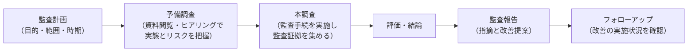

# 応用情報技術者試験 科目B 攻略マニュアル【問11 システム監査】

> **このマニュアルの使い方**：過去問を解く前に第1章〜第3章を読む。第1章で「監査の事例問題の読み方」、第2章で「監査の用語・コントロール・監査手続の意味」、第3章で「よく出る問題の型」を押さえる。そのあと過去問（`kakomon/10_audit.md`）を解く。
>
> 根拠：2009〜2025年度の過去問33回分、シラバスVer.7.2、試験要綱Ver.5.6。2014年度以降は**問11**（選択問題）。
> 出題範囲（試験要綱）：ITガバナンス及びIT統制と監査、情報システム・組込みシステムの企画・開発・運用・保守・廃棄プロセスの監査、プロジェクト管理の監査、**アジャイル開発の監査**、**外部サービス管理の監査**、情報セキュリティ監査、個人情報保護監査、他の監査との連携、監査の計画・実施・報告・フォローアップ、関連法規、監査人の倫理。
> 選ぶかどうかの目安：**答えの大半を本文中の語句の組合せで書ける**。知識は少なくて済むが、**監査手続の書き方の型**を知らないと点が伸びない。文章の読解が得意な人の本命。

---

## 目次

- 第1章 問11の解き方（最初に読む）
- 第2章 必ず知っておく基礎知識
  - 2-1 システム監査とは
  - 2-2 監査の流れ
  - 2-3 リスク・コントロール・監査要点・監査手続・監査証拠
  - 2-4 監査手続の技法
  - 2-5 コントロールの種類
  - 2-6 業務処理のコントロール（入力・処理・出力）
  - 2-7 職務分離
  - 2-8 アクセス管理
  - 2-9 システムの開発・変更・運用のコントロール
  - 2-10 サンプリング
  - 2-11 点検・モニタリング（3つのディフェンスライン）
  - 2-12 外部委託・パッケージ・クラウドの監査
  - 2-13 開発プロジェクトの監査
  - 2-14 コンティンジェンシー計画の監査
  - 2-15 新しい技術の監査（AI・RPA・アジャイル）
- 第3章 よく出る問題の型（5パターン）
- 第4章 記述の書き方（良い答え・悪い答え）
- 第5章 2026年度に向けて
- 第6章 直前チェックリスト

---

## 第1章 問11の解き方（最初に読む）

### 1-1. 問11はどういう問題か

ある会社の業務システム（販売、購買、会計、在庫、勤務管理など）について、**監査部門が監査を計画・実施する**場面が題材。〔システムの概要〕〔業務の流れ〕〔予備調査の結果〕などの段落と、**監査手続の案の表**が付く。設問は次の3種類。

1. **リスクの識別**：この業務・システムにはどんなリスクがあるか
2. **コントロールと監査手続**：リスクを防ぐ仕組みは何か、監査人はそれを何で確かめるか
3. **監査手続の不足**：この手続では何が確かめられないか、追加すべき手続は何か

答えはほぼ毎回「**どんなリスクがあり、どのコントロールで防ぎ、それを監査人はどの資料で確かめるか**」の組合せ。

### 1-2. 解く手順

1. **業務の流れを図にする**：誰が（担当者・承認者・システム）、何を（入力・承認・出荷・支払）、どの順に行うか。
2. **〔予備調査の結果〕の各項目に印を付ける**：「〜の場合がある」「〜できる設定になっている」「〜を兼務している」は**コントロールの不備（リスク）**の伏線。
3. **例外に注目する**：小規模な拠点、繁忙期、手作業での補完、緊急時の手順。
4. **監査手続の案の表を、監査要点と1行ずつ突き合わせる**：その手続で要点が本当に確かめられるか。
5. 記述は第4章の**型**で書く。

### 1-3. 採点講評が毎年言っていること

| 失点の原因 | 講評での言われ方（例） | 防ぎ方 |
|---|---|---|
| 資料とデータの取り違え | 閲覧すべき資料名ではなく、データ名を記載（2019秋） | 「〜一覧」「〜申請書」「〜ログ」「〜報告書」 |
| 具体性の不足 | 監査の目的そのものを書いた（2019春）／“アクセス権”としか書かない（2020） | 何を見て何を確かめるかまで書く |
| 照合の不備 | 二つの監査証拠を関係付けていない（2016春） | 「AとBを照合し」 |
| 監査要点の誤り | 監査手続で確認できない要点（2015秋） | 確かめられる命題にする |
| 手続の限界の理解 | 特定の手続で発見できない事象（2019秋、2016秋） | 別の資料との照合を組み合わせる |
| 基準値がない | 評価項目そのものを書き、本番移行してよい水準を書かない（2024秋） | 「〜率が〜%以上」 |
| 統制の種類の読み違え | 自動化された統制か手作業の統制か（2023春） | 本文の「システムで」「担当者が」を区別 |
| 背景の読み落とし | “今回の監査の背景を踏まえると”（2023秋） | 監査の経緯の段落を読む |

---

## 第2章 必ず知っておく基礎知識

### 2-1. システム監査とは

**一言で**：情報システムに関するリスクが適切にコントロールされているかを、**独立した立場の監査人が点検・評価し、改善を促す**こと。

| 用語 | 意味 |
|---|---|
| **システム監査基準** | 監査人の行動の規範（独立性、専門的能力、監査の進め方）。シラバスの用語例 |
| **システム管理基準** | 監査の判断の尺度になる、情報システムの管理のあるべき姿。シラバスの用語例 |
| **独立性** | 監査人は監査の対象から独立していなければならない（**自分が関わった業務・システムは監査しない**。2020） |
| **ITガバナンス** | 経営者が情報システムを適切に方向付け、監視すること |
| **内部統制** | 業務を適正に行うための社内の仕組み。そのIT部分をIT統制という |

### 2-2. 監査の流れ

- **予備調査**で業務とリスクを把握し、それに基づいて本調査の**監査手続**を決める（**リスクアプローチ**：リスクの高いところに重点を置く）。

### 2-3. リスク・コントロール・監査要点・監査手続・監査証拠（★最重要）

| 用語 | 意味 | 例（受注の承認） |
|---|---|---|
| **リスク** | 起こり得る望ましくない事象 | 承認されていない受注が登録され、出荷される |
| **コントロール** | リスクを防ぐ・見つける仕組み | 承認者が承認しないと、受注が確定しないようシステムで制御している |
| **監査要点** | 監査手続で確かめる**命題**（〜されているか） | 全ての確定した受注が、承認者によって承認されているか |
| **監査手続** | 監査要点を確かめる**具体的な方法** | 受注データと承認記録を**照合**し，承認のない確定受注がないことを確かめる |
| **監査証拠** | 監査手続で入手する資料・記録 | 受注データ、承認ログ、承認権限の設定表 |

**つながり**：リスク →（防ぐ）コントロール →（あるか・効いているか）監査要点 →（どう確かめるか）監査手続 →（何を見るか）監査証拠

### 2-4. 監査手続の技法

| 技法 | 意味 | 例 |
|---|---|---|
| **閲覧（査閲）** | 文書・記録を読んで確かめる | 規程、申請書、議事録を見る |
| **突合・照合** | **2つ以上の資料を突き合わせて**一致を確かめる | 申請書と登録IDの一覧を照合する |
| **質問（ヒアリング）** | 関係者に聞く（それだけでは証拠として弱い） | |
| **観察** | 実際の作業を見る | 現場でIDを共用していないかを見る（2023春） |
| **再実施** | 監査人が自分で同じ処理を行って結果を比べる | 集計を再計算する |
| **分析的手続** | 数値の推移や比率から異常を見つける | |
| **コンピュータ利用監査技法（CAAT）** | プログラムでデータを抽出・照合する | 全件を照合する |

### 2-5. コントロールの種類

| 分類 | 内容 |
|---|---|
| **予防的コントロール** | 起こらないようにする（入力チェック、承認、アクセス制限） |
| **発見的コントロール** | 起きたら見つける（照合、ログの点検、例外リスト） |
| **是正的コントロール** | 起きたら直す（バックアップからの復旧） |
| **自動化された統制** | システムに組み込まれた統制（入力チェック、権限による制限） |
| **手作業の統制** | 人が行う統制（上長の承認、帳票の照合）。**パッケージの標準機能で足りない部分を手作業で補う**ことが多い（2024春、2023春） |
| **IT全般統制** | 全システムに共通する統制（開発・変更管理、アクセス管理、運用管理） |
| **IT業務処理統制** | 個々のアプリケーションの統制（入力・処理・出力のチェック、マスタ管理） |

### 2-6. 業務処理のコントロール（入力・処理・出力）

| 段階 | リスク | コントロールの例 |
|---|---|---|
| **入力** | 誤入力、二重入力、未承認の入力 | 入力チェック（範囲、形式、マスタとの照合）、承認、件数・合計金額の照合（コントロールトータル） |
| **処理** | 処理漏れ、二重処理、計算誤り | 処理件数の照合、エラーリストの確認 |
| **出力** | 誤った帳票、権限のない人への配布 | 出力の確認、配布先の管理 |
| **マスタ** | 単価・顧客・勤務時間などの誤登録 | 登録の承認、変更履歴の確認（2025春：標準勤務時間の誤登録を防ぐ入力コントロール） |
| **システム間の連携** | データの欠落・重複・不一致 | 送信側と受信側の件数・金額の照合（2016春、2024春） |

### 2-7. 職務分離

**一言で**：1人が不正や誤りを起こしても見つかるように、**互いに牽制する仕事を別の人に分ける**こと。

| 分けるべき組合せ | リスク |
|---|---|
| **入力と承認** | 自分で入力して自分で承認できる（**自己承認**）→ 不正な取引 |
| 発注と検収 | 架空の発注で支払わせる |
| **開発と本番の運用** | 開発者が本番を勝手に変更する |
| 権限の付与と利用 | 自分に権限を与えて使う |

- 小規模な拠点では兼務が避けられない → **自分が入力したものは自分で承認できない設定**や、**事後の上長の確認**で補う（2017秋、2021春）。

### 2-8. アクセス管理

| コントロール | 監査で確かめること |
|---|---|
| **利用者IDの申請と承認** | 承認済みの申請書と、登録されたIDの一覧を照合し、申請のないIDがないか |
| **ID棚卸**（定期的な見直し） | 人事の異動・退職の記録と、有効なIDの一覧を照合し、不要なIDが残っていないか |
| **権限の内容** | **参照権限**か**更新権限**かまで確認（2020：“アクセス権”だけでは不十分） |
| **特権ID（管理者ID）** | 使用者を限定し、使用の記録と作業の報告を照合（2018秋：保守用IDの使用記録と作業報告書） |
| **共用ID** | 誰が操作したか分からない → 個人ごとのIDにする（2023春） |

### 2-9. システムの開発・変更・運用のコントロール

- **変更管理**：本番への変更は申請・承認・テストを経る。
- **本番環境へのアクセス制限**：開発者が本番を直接変更できない。**移行作業表を見るだけでは、表に載っていない不正な変更は見つからない** → 本番環境のアクセスログや変更記録と、承認された変更の記録を照合する（2019秋）。
- **運用**：バッチ処理の結果確認、障害の記録、バックアップ。

### 2-10. サンプリング

**一言で**：全件を調べるのが難しいとき、**母集団から一部を抜き出して**調べ、全体を推定すること（2021秋で理解不足が指摘）。

- **母集団が網羅的か（完全性）を先に確かめる**：抜き出す元のリストに全件が載っていなければ、抜けた部分のリスクは見つからない。
- リスクの高いものは全件を調べ、低いものをサンプリングする。

### 2-11. 点検・モニタリング（3つのディフェンスライン）

| 線 | 担当 | 役割 |
|---|---|---|
| 第1線 | 業務部門 | 日々の業務の中でリスクを管理し、**自部門を点検**する |
| 第2線 | リスク管理部門（システムリスク管理部門など） | 第1線の点検を指示・支援し、**不備の是正状況をモニタリング**する |
| 第3線 | 内部監査部門 | 第1線・第2線が有効に機能しているかを、独立した立場で評価する |

**監査の着眼点**（2025秋、2022秋）：点検が**形だけになっていないか** → 点検の対象は網羅されているか、点検結果の不備が是正されたか、第2線が役割を果たしているかを、指示の記録・点検結果・是正の記録を照合して確かめる。

### 2-12. 外部委託・パッケージ・クラウドの監査

- **外部委託**：委託先の業務も自社の業務プロセスの一部 → 委託先から入手する記録の信頼性を確かめる。データが入手できない場合は、**前提を補う追加の手続**（出荷と在庫の整合の確認など）が必要（2022春）。
- **パッケージ**：標準機能が自社の規程に合わない場合のリスクと、それを補う手作業、**承認の時期**（2024春）。
- **クラウド・SaaS**（外部サービス管理の監査は試験要綱に明記）：供給者の評価、契約、責任の分担、第三者による保証報告の利用。

### 2-13. 開発プロジェクトの監査

| 段階 | 着眼点 |
|---|---|
| **要件定義**（2018春） | 関係者が関与しているか、要件の根拠（法令・方針）が明確か、要件間で矛盾がないか |
| **基本設計**（2021秋） | 要件定義との整合、設計の妥当性、未確定の要件の管理 |
| **開発計画**（2024秋） | 評価項目と**本番移行してよい水準（基準値）**が決まっているか、効果が想定に届かないリスクへの対応 |
| **導入直後**（2017春） | 新しい業務プロセスに合わせてコントロールが見直されているか |

### 2-14. コンティンジェンシー計画の監査

**一言で**：システム障害や災害のときの代替手段・復旧手順が、**実際に機能するか**を確かめる（2023秋）。

- 計画の内容がシステム環境の変化に合わせて見直されているか。
- **訓練の内容**が、計画を発動したときの手順を十分に確かめられるものになっているか（机上の訓練では確かめられない手順がある）。

### 2-15. 新しい技術の監査

| 対象 | 着眼点 |
|---|---|
| **AIを応用したシステム**（2024秋に初出題） | 学習データの品質、評価項目と基準値、本番移行の判断、運用中の精度の監視、利用ルール |
| **RPA**（2019春） | ロボットの管理台帳、変更管理、野良ロボット（管理されていないロボット）の防止、業務システムの変更に伴う停止 |
| **アジャイル開発**（試験要綱に明記、**2009〜2025年度は未出題**） | スプリントごとの承認と記録、完成の定義、ドキュメントに代わる記録（バックログ、レビューの記録） |
| **テレワーク**（2022秋） | 端末の管理、利用者の管理、点検の実効性 |

---

## 第3章 よく出る問題の型（5パターン）

### 型1：業務アプリケーションの監査（2025春、2024春、2023春、2022春、2021春、2020、2019秋）
- 問われること：業務の流れからリスクを識別、入力・承認・連携のコントロール、職務分離、照合する資料。

### 型2：アクセス管理と点検の監査（2025秋、2022秋、2018秋、2016秋）
- 問われること：ID管理、特権ID、点検の実効性、是正状況のモニタリング。

### 型3：開発プロジェクトの監査（2024秋、2021秋、2018春、2017春）
- 問われること：工程ごとの着眼点、評価基準、サンプリング、未確定要件。

### 型4：計画・体制の監査（2023秋、2019春）
- 問われること：コンティンジェンシー計画と訓練、RPAの管理体制。

### 型5：情報セキュリティの監査（2022秋、2015秋）
- 問われること：ウイルス対策・テレワークの管理状況の確認方法、監査要点の書き方。

---

## 第4章 記述の書き方（良い答え・悪い答え）

### 4-1. 型（★これで半分取れる）

| 問われ方 | 型 |
|---|---|
| **監査手続** | 「**〈資料A〉と〈資料B〉を照合し，〈確かめる事項〉を確かめる**」 |
| **監査要点** | 「**〜が〜されているか**」 |
| **リスク** | 「**〜によって，〜が〜されるリスク**」 |
| **コントロール** | 「**〜は〜できないようシステムで制限されている**」「**〜が〜を承認している**」 |
| **閲覧すべき資料** | 「〜申請書」「〜一覧」「〜ログ」「〜報告書」「〜議事録」「〜規程」 |
| **改善提案** | 「〜を〜に変更し，〜を〜が確認する」 |

### 4-2. 良い答え・悪い答え

**例1**：「保守用IDが適切に使われていることを確かめる監査手続」（2018秋型）

| | 答え | 評価 |
|---|---|---|
| ✕ | 登録IDリストを確認する | 使い方が適切かは分からない |
| ✕ | 保守用IDの管理が適切かを確かめる | 目的の言い換えで手続になっていない |
| ○ | 保守用IDの使用記録と保守作業報告書を照合し，報告のない使用がないことを確かめる | 2つの資料を照合し、確かめる事項が具体的 |

**例2**：「承認者が受注入力の権限も持っている場合のリスク」（2020型）

| | 答え | 評価 |
|---|---|---|
| ✕ | 不正が起きるリスク | 何が起きるか不明 |
| ○ | 承認者が自ら受注を入力して承認し，不正な受注が確定するリスク | 主体・行為・結果がある |

**例3**：「本番移行の判断の評価項目として設定すべき内容」（2024秋型）

| | 答え | 評価 |
|---|---|---|
| ✕ | 回答満足率 | 項目の名前だけで判断できない |
| ○ | 回答満足率が80%以上であること | 移行してよい水準がある |

---

## 第5章 2026年度に向けて

### 5-1. 直近の出題

| 年度 | 春期 | 秋期 |
|---|---|---|
| 2025 | 勤務管理システムの運用・保守 | グループのアクセス管理の点検 |
| 2024 | 支払管理パッケージ（手作業の補完） | AIチャットボットの開発計画 |
| 2023 | 工場在庫管理（不正リスク） | コンティンジェンシー計画 |
| 2022 | 販売物流（外部倉庫） | テレワーク環境の点検 |

**傾向**：**点検の実効性**（第1線・第2線が機能しているか）と、**パッケージ＋手作業**の組合せが増えている。2024秋に初めてAIシステムが題材になった。

### 5-2. 出そうなテーマ

| テーマ | 根拠 |
|---|---|
| アジャイル開発の監査 | 試験要綱に明記、2009〜2025年度に未出題 |
| 外部サービス（クラウド・SaaS）管理の監査 | 試験要綱に明記 |
| 生成AIの利用の監査（利用ルール、入力データ、出力の確認） | 2024秋の発展、AI関連の用語例の追加 |
| サイバー攻撃を想定したコンティンジェンシー計画 | 2023秋の発展 |
| 個人情報保護監査 | 試験要綱に明記 |
| 利用部門が作るRPA・ローコードの管理 | 2019春の発展 |

---

## 第6章 直前チェックリスト

**知識**
- [ ] リスク・コントロール・監査要点・監査手続・監査証拠の違い
- [ ] 監査の流れ（計画→予備調査→本調査→評価→報告→フォローアップ）
- [ ] 監査手続の技法（閲覧・照合・質問・観察・再実施・CAAT）
- [ ] 予防的・発見的、自動化された統制・手作業の統制、IT全般統制・IT業務処理統制
- [ ] 職務分離（入力と承認、開発と運用）、自己承認の禁止
- [ ] ID棚卸、特権ID、参照権限と更新権限
- [ ] サンプリングと母集団の完全性
- [ ] 3つのディフェンスライン、点検の実効性
- [ ] 監査人の独立性

**解き方**
- [ ] 業務の流れを図にした（誰が・何を・どの順に）
- [ ] 予備調査の「〜できる」「兼務」「例外」に印を付けた
- [ ] 監査手続は「AとBを照合し，〜を確かめる」の型で書いた
- [ ] 権限は参照か更新かまで書いた
