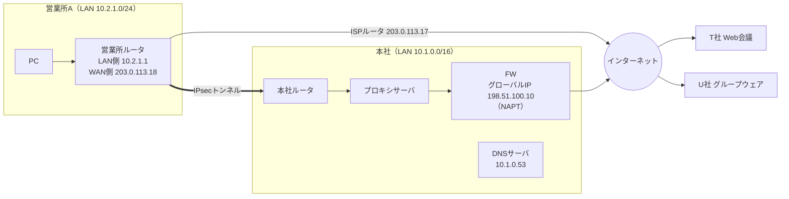
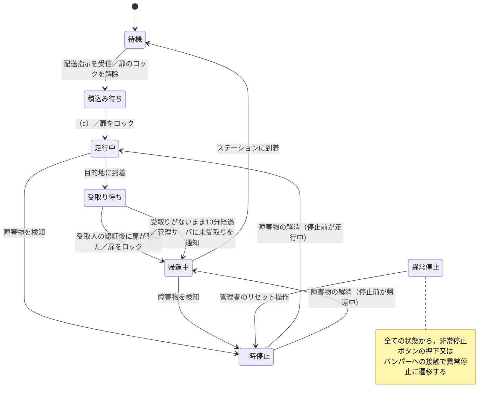
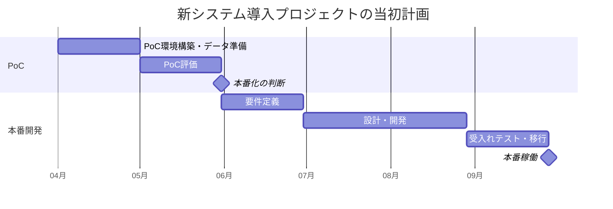

# 2026年度 応用情報技術者試験（科目B）予想模試 第1回 【問5〜問7】

> 問1〜問4は `第1回_問1-問4.md`。図はMermaid記法（GitHub、VS Code、Obsidian等でそのまま図として表示される）。
> 解答例・配点・解説は各問末尾の「▶」をクリックすると表示されます。

---

## 問5 営業所のインターネット接続方式の変更に関する次の記述を読んで，設問に答えよ。

Z社は，本社と10か所の営業所をもつ商社である。各営業所のLANは，インターネットVPN（IPsec）で本社と接続している。営業所のPCからインターネットへの通信は，全てIPsecトンネルを通って本社に集約され，本社のプロキシサーバとファイアウォール（以下，FWという）を経由して行われる。

近年，T社のWeb会議サービスとU社のグループウェアサービス（いずれもSaaS）の利用が増え，本社のインターネット回線の帯域が不足するようになった。そこで，情報システム部のH主任が，接続方式の変更を検討することになった。

〔現在のネットワーク構成〕

現在のネットワーク構成を図1に示す。

図1 現在のネットワーク構成（営業所Aを例示，他の営業所も同様）

- 営業所のPCは，本社のDNSサーバ（10.1.0.53）を利用して名前解決を行う。
- 本社のFWは，インターネット宛ての通信の送信元IPアドレスを，FWのグローバルIPアドレス 198.51.100.10 に変換する。
- U社のグループウェアでは，不正ログインへの対策として，接続を許可する送信元IPアドレスを登録する機能（以下，IP制限という）を利用しており，198.51.100.10 だけを登録している。
- 営業所ルータの経路表を表1に示す。

表1 営業所Aのルータの経路表（現在）

| 宛先ネットワーク | ネクストホップ |
|---|---|
| 10.2.1.0/24 | 直接接続（LAN側） |
| 10.0.0.0/8 | IPsecトンネル（本社） |
| 0.0.0.0/0 | IPsecトンネル（本社） |

注記 IPsecトンネルのパケット自体（カプセル化後のパケット）は，ISPルータ 203.0.113.17 を経由して本社に送られる。

〔帯域の問題〕

Web会議では，1人当たり上り・下りそれぞれ2Mビット/秒の通信が発生する。全営業所で合計200名が同時にWeb会議に参加すると，本社のインターネット回線の上り方向だけで ア Mビット/秒の帯域が必要となり，本社の契約帯域（上り・下りそれぞれ500Mビット/秒）を超えてしまう。ここで，IPsecによるカプセル化のオーバーヘッド，Web会議以外の通信は考えないものとする。

〔新しい接続方式〕

H主任は，クラウド型のプロキシサービスであるSWG（Secure Web Gateway）を契約し，次の方式とすることにした。

(1) 本社宛ての通信は，引き続きIPsecトンネルを経由する。
(2) T社のWeb会議とU社のグループウェアへの通信は，SWGを経由せず，営業所の回線から直接インターネットに送る。このような方式を b という。
(3) (1)，(2)以外のインターネット宛ての通信は，SWGを経由させる。SWGでは，URLフィルタリング，マルウェア検査を行い，アクセスログを記録する。

PCのプロキシ自動設定で，通信の振分けを表2のように設定する。

表2 PCの通信の振分けルール

| 順 | 宛先 | 経路 |
|---|---|---|
| 1 | 社内（10.0.0.0/8） | 直接（プロキシを使わない） |
| 2 | T社Web会議，U社グループウェアのFQDN | 直接（プロキシを使わない） |
| 3 | 上記以外 | SWG（swg.example のポート8080） |

これに合わせて，営業所ルータの経路表を表3のように変更する。

表3 営業所Aのルータの経路表（変更後）

| 宛先ネットワーク | ネクストホップ |
|---|---|
| 10.2.1.0/24 | 直接接続（LAN側） |
| 10.0.0.0/8 | c |
| 0.0.0.0/0 | d |

また，営業所ルータで，営業所LANからインターネットへの通信の送信元IPアドレスを 203.0.113.18 に変換する設定を追加する。

〔変更後の課題〕

H主任が変更案をレビューに諮ったところ，次の指摘を受けた。

指摘1：変更後は，①営業所のPCからU社のグループウェアに接続できなくなる。

指摘2：U社のグループウェアをSWG経由とし，SWGの送信元IPアドレスをIP制限に登録する案も考えられる。しかし，SWGの仕様書には“インターネットへの通信の送信元IPアドレスは，SWGが保有するアドレスブロック 192.0.2.0/24 の中から選ばれる。このアドレスブロックは全ての契約者で共用する。”と記載されているので，②この案は採用すべきではない。

指摘3：③現在は本社のプロキシサーバで全てのWebアクセスのログを取得しているが，変更後はログを取得できない通信が生じる。

設問1 〔新しい接続方式〕について答えよ。
- (1) 本文中の b に入れる適切な字句を解答群の中から選び，記号で答えよ。
- (2) 表3中の c ， d に入れる適切なネクストホップを，図1及び表1中の字句を用いて答えよ。
- (3) 表3中の宛先ネットワーク 0.0.0.0/0 の経路を何と呼ぶか。解答群の中から選び，記号で答えよ。

解答群
- ア スプリットトンネリング（ローカルブレイクアウト）
- イ スタティックNAT
- ウ デフォルトゲートウェイ
- エ デフォルトルート
- オ フォワードプロキシ
- カ ヘアピン接続

設問2 〔帯域の問題〕について答えよ。
- (1) 本文中の ア に入れる適切な数値を答えよ。
- (2) (1)の値が，Web会議の上り方向の通信量（1人当たり2Mビット/秒×200名）より大きくなる理由を，40字以内で述べよ。

設問3 指摘1について答えよ。
- (1) 現在，営業所AのPCからU社のグループウェアに送られたパケットは，U社にどの送信元IPアドレスで届くか答えよ。
- (2) 本文中の下線①の理由を40字以内で述べよ。
- (3) 指摘1への対策として，U社のグループウェアに設定すべき内容を35字以内で述べよ。

設問4 本文中の下線②について，採用すべきでない理由を40字以内で述べよ。

設問5 本文中の下線③について，ログを取得できなくなる通信を，表2の順の番号で答えよ。また，その通信のログを確保するための対策を30字以内で述べよ。

▶ 問5【解答例】【配点と採点基準】【出題意図とひっかけポイントの解説】（クリックで表示）

### 【解答例】

| 設問 | 解答例 |
|---|---|
| 設問1(1) | b：ア |
| 設問1(2) | c：IPsecトンネル（本社）　d：ISPルータ（203.0.113.17） |
| 設問1(3) | エ |
| 設問2(1) | ア：800 |
| 設問2(2) | 営業所への下りの通信もIPsecトンネルで本社回線の上り方向を通るから（33字） |
| 設問3(1) | 198.51.100.10 |
| 設問3(2) | 送信元IPアドレスが営業所の203.0.113.18となり，IP制限で拒否されるから（36字） |
| 設問3(3) | 各営業所のグローバルIPアドレスを，接続を許可するアドレスに登録する（32字） |
| 設問4 | SWGの送信元アドレスは他の契約者と共用であり，他社からの接続も許可されるから（37字） |
| 設問5 | 順：2　対策：T社とU社のサービスが提供する監査ログを取得し保管する（27字） |

**設問2(1)の計算**：変更前、営業所のPCのWeb会議の通信は全て本社を経由する。本社回線の上り方向には、①営業所PCからT社への上り通信 2×200＝400Mビット/秒（本社→T社）と、②T社から営業所PCへの下り通信 2×200＝400Mビット/秒（本社→IPsecトンネル→営業所）の両方が流れるので、合計 **800Mビット/秒**。

### 【配点と採点基準（部分点の条件）】（計20点）

| 設問 | 配点 | 採点基準 |
|---|---|---|
| 設問1(1) | 2点 | |
| 設問1(2) | 各1点 | d は「ISPルータ」「203.0.113.17」のどちらか一方でも可。「インターネット」だけは0点（ネクストホップは機器を答える） |
| 設問1(3) | 2点 | ウ（デフォルトゲートウェイ）は0点：PCに設定する「異なるサブネット宛ての送信先」と、経路表の「宛先不定のパケットの経路」の混同 |
| 設問2(1) | 3点 | 400（片方向しか数えていない）は0点 |
| 設問2(2) | 2点 | 「営業所向け（下り）の通信も本社回線の上りを使う」が必須 |
| 設問3(1) | 1点 | 10.2.1.x（PCのアドレス）、203.0.113.18 は0点 |
| 設問3(2) | 2点 | 「送信元が203.0.113.18（営業所のアドレス）に変わる」1点＋「IP制限（許可リスト）にない」1点 |
| 設問3(3) | 2点 | 「営業所のグローバルIPアドレスを許可リスト（IP制限）に追加」で満点 |
| 設問4 | 2点 | 「共用」と「他社（第三者）も接続可能になる」の両方で満点 |
| 設問5 | 2点 | 番号1点＋対策1点。番号は「2」のみ（1は社内宛てで元々プロキシを通らない） |

### 【出題意図とひっかけポイントの解説】

- **出題意図**：SaaSの利用増に伴う「ローカルブレイクアウト」「SWG」を題材に、経路表、NAPTによる送信元IPアドレスの変化、送信元IPアドレスに依存したアクセス制御の落とし穴を問う。2022春（IPsecトンネルと送信元IP）、2024秋（SWG）の発展形。
- **解答を一意に導く根拠**
  - 設問2：「全て本社に集約」「上り方向だけで」→ 往路と復路の両方が本社回線の上りを使う。オーバーヘッドを無視する条件も明記。
  - 設問3：「FWは送信元を198.51.100.10に変換」「IP制限に198.51.100.10だけを登録」「営業所ルータで送信元を203.0.113.18に変換する設定を追加」の3文で一意に決まる。
  - 設問4：SWG仕様書の「全ての契約者で共用」が根拠。
- **ひっかけポイント**
  - **帯域計算で片方向しか数えない**：本社経由（ヘアピン）の通信は、本社回線を2回通る。
  - **カプセル化の内側と外側**：IPsecトンネル経由の間は、U社に届く送信元は本社FWのアドレス（営業所ルータのWAN側アドレスではない）。
  - **デフォルトルートとデフォルトゲートウェイの混同**（2023春・2020の採点講評で指摘）。
  - ログの設問で「SWGのログを確認する」と書くのは誤り。直接通信はSWGを通らない。

---

## 問6 屋内配送ロボットの制御ソフトウェアに関する次の記述を読んで，設問に答えよ。

S社は，病院内で検体や薬剤を運ぶ屋内配送ロボット（以下，ロボットという）を開発している。ロボットは，看護師が積み込んだ荷物を，病棟間の指定された場所まで自律走行で運び，受取人がICカードで認証すると荷物の扉のロックを解除する。

〔ロボットの構成〕

ロボットの主な構成要素を表1に示す。

表1 ロボットの主な構成要素

| 構成要素 | 概要 |
|---|---|
| 制御部 | ロボット全体を制御する。リアルタイムOSを用いる。 |
| LiDAR | 周囲の物体までの距離を測定する。 |
| バンパーセンサー | 車体前後のバンパーへの接触を検知する。 |
| 非常停止ボタン | 押されると，制御部に割込みを発生させる。 |
| 駆動部 | 左右のモーターを制御部の指示に従って回転させる。最高速度は1.0m/秒。 |
| 荷室 | 扉とロックをもつ。扉の開閉状態を検知するセンサーをもつ。 |
| 操作パネル | 出発ボタン，ICカードリーダー，表示画面をもつ。 |
| 通信部 | 無線LANで管理サーバと通信する。 |

〔タスクの構成〕

制御部のタスクを表2に示す。優先度は，数値が小さいほど高い。

表2 制御部のタスク

| タスク名 | 優先度 | 処理概要 |
|---|---|---|
| 安全監視タスク | 1 | 20ミリ秒周期で起動し，LiDARの測定結果を確認する。進行方向30cm以内に障害物を検知した場合，又はバンパーへの接触，非常停止ボタンの押下を検知した場合は，直ちに駆動タスクに停止指示を送る。 |
| 駆動タスク | 2 | 10ミリ秒周期で起動し，モーターの回転速度を制御する。停止指示を受けると減速を開始する。 |
| 経路計画タスク | 3 | 100ミリ秒周期で起動し，現在位置を推定して目標速度を駆動タスクに送る。 |
| 通信タスク | 4 | 管理サーバとの間で配送指示，状態，ログを送受信する。 |
| 表示タスク | 5 | ロボットの状態を操作パネルに表示する。 |

〔状態遷移〕

ロボットの状態遷移を図1に示す。

図1 ロボットの状態遷移図（イベント／遷移時の処理）

- 障害物の解消は，進行方向50cm以内に障害物がない状態が3秒間継続したことで判定する。
- 異常停止から復帰する場合は，管理者が現地で安全を確認してリセット操作を行う。リセット後はいったん一時停止の状態とし，障害物の解消を判定してから走行を再開する。

〔停止距離の検討〕

安全監視タスクが進行方向30cm以内の障害物を検知してから，ロボットが停止するまでに進む距離が30cm未満であることを確認する。最高速度で走行中に，静止している障害物が30cmの位置に現れたものとし，次の条件で計算する。

- 安全監視タスクは20ミリ秒周期で測定結果を確認する。測定と判定の処理時間は無視する。
- 停止指示は，次に駆動タスクが起動した時点で処理され，その時点から減速を開始する。タスク間通信の時間は無視する。
- 減速中の減速度は2.5m/秒²で一定とする。

最悪の場合，障害物が30cmの位置に現れてから減速を開始するまでに ア ミリ秒掛かり，その間に進む距離と減速中に進む距離の合計は イ cmとなる。したがって，30cm未満で停止できる。

〔駆動タスクの周期の実現〕

駆動タスクの10ミリ秒周期は，16ビットのタイマーによる割込みで実現する。タイマーには，48MHzのクロックを分周比1，2，8，64のいずれかで分周したクロックが入力され，カウント値が設定値に達すると割込みを発生させてカウント値を0に戻す。設定値は1〜65,535の範囲で設定できる。設定値が16ビットに収まる範囲で，時間の分解能が最も高くなるよう，分周比は ウ ，設定値は エ とする。

〔試験で発生した不具合〕

結合試験で，バンパーへの接触を検知してから停止指示が送られるまでに，最大で約200ミリ秒の遅れが生じる事象が発生した。

調査の結果，次のことが分かった。
- 安全監視タスクと表示タスクは，ロボットの状態を格納した共有データを，セマフォを用いて排他制御して参照している。
- 表示タスクがセマフォを獲得して共有データを参照している最中に，通信タスクが実行可能状態となり，表示タスクより先に実行された。通信タスクはログの送信に最大約200ミリ秒を要し，その間，表示タスクはセマフォを解放できず，安全監視タスクはセマフォの獲得を待ち続けた。

このように，優先度の低いタスクが資源を保持していることによって，それより優先度の高いタスクの実行が，中間の優先度のタスクの実行に妨げられる現象を オ という。開発チームは，④リアルタイムOSの機能を用いて対策することにした。

設問1 図1について答えよ。
- (1) 図1中の（c）に入れる適切なイベントを，表1中の字句を用いて25字以内で述べよ。
- (2) 一時停止から復帰する際に正しい遷移先を決めるため，一時停止に遷移するときに保持しておくべき情報を20字以内で述べよ。
- (3) 障害物の解消の判定を，検知の条件（30cm以内）とは異なる条件（50cm以内に障害物がない状態が3秒間継続）としている目的を，40字以内で述べよ。

設問2 〔停止距離の検討〕について，本文中の ア ， イ に入れる適切な数値を答えよ。

設問3 〔駆動タスクの周期の実現〕について，本文中の ウ ， エ に入れる適切な数値を答えよ。

設問4 表2で，安全監視タスクの優先度を最も高くしている理由を，40字以内で述べよ。

設問5 〔試験で発生した不具合〕について答えよ。
- (1) 本文中の オ に入れる適切な字句を答えよ。
- (2) 本文中の下線④の対策の内容を40字以内で述べよ。

▶ 問6【解答例】【配点と採点基準】【出題意図とひっかけポイントの解説】（クリックで表示）

### 【解答例】

| 設問 | 解答例 |
|---|---|
| 設問1(1) | 扉が閉じた状態で出発ボタンが押された（17字） |
| 設問1(2) | 一時停止する直前の状態（走行中か帰還中か）（20字） |
| 設問1(3) | 障害物が30cm付近にいるとき，停止と走行が頻繁に繰り返されるのを防ぐため（34字） |
| 設問2 | ア：30　イ：23 |
| 設問3 | ウ：8　エ：60,000 |
| 設問4 | 障害物や接触を検知してから停止指示を送るまでの遅れを最小にし，人との衝突を防ぐため（39字） |
| 設問5(1) | オ：優先度逆転 |
| 設問5(2) | セマフォを獲得したタスクの優先度を，獲得を待つタスクの優先度まで一時的に引き上げる（40字） |

**設問2の計算**
- 最悪の場合、障害物が現れた直後に安全監視タスクの確認が終わっている → 次の確認まで最大20ミリ秒。停止指示を送った直後に駆動タスクが起動済み → 次の起動まで最大10ミリ秒。合計 **30ミリ秒**。
- 30ミリ秒で進む距離：1.0m/秒 × 0.03秒 ＝ 0.03m ＝ 3cm
- 減速中に進む距離：v² ÷ (2a) ＝ 1.0² ÷ (2 × 2.5) ＝ 0.2m ＝ 20cm
- 合計 **23cm**（30cm未満）

**設問3の計算**：10ミリ秒に必要なカウント数 ＝ 0.01秒 × 48MHz ÷ 分周比。分周比1：480,000、分周比2：240,000（いずれも65,535を超える）、分周比8：**60,000**（収まる）、分周比64：7,500（収まるが分解能が低い）。よって分周比 **8**、設定値 **60,000**。

### 【配点と採点基準（部分点の条件）】（計20点）

| 設問 | 配点 | 採点基準 |
|---|---|---|
| 設問1(1) | 2点 | 「扉が閉じている」と「出発ボタンの押下」の両方で2点。片方のみ1点 |
| 設問1(2) | 2点 | 「直前の状態（走行中か帰還中か）」。「現在位置」「目的地」は0点（遷移先を決める情報ではない） |
| 設問1(3) | 2点 | 「停止と走行が頻繁に繰り返される（チャタリング・ハンチング）のを防ぐ」で満点。「安全のため」だけは0点 |
| 設問2 | 各2点 | アは「20」（駆動タスクの待ちを見落とし）を0点。イはアの誤りを引き継いだ場合でも、計算方法が正しければ1点 |
| 設問3 | 各2点 | 分周比64は0点（「分解能が最も高くなる」の条件を満たさない）。設定値59,999 は0点（「設定値に達すると割込み」の仕様） |
| 設問4 | 2点 | 「検知から停止指示までの遅れ（応答時間）を最小化」＋「衝突防止（安全確保）」で満点 |
| 設問5(1) | 2点 | 「優先度逆転（プライオリティインバージョン）」 |
| 設問5(2) | 2点 | 優先度継承（又は優先度上限プロトコル）の内容を説明していれば満点。「通信タスクの優先度を下げる」は1点（根本対策でない） |

### 【出題意図とひっかけポイントの解説】

- **出題意図**：組込み問題の定番である「状態遷移」「タスク優先度の理由」「タイマーのカウント値」「最悪ケースの時間計算」「排他制御の不具合（優先度逆転）」を、自律移動ロボットという2026年のトレンド題材で問う。
- **解答を一意に導く根拠**
  - 設問1(1)：表1の荷室（扉の開閉状態を検知するセンサー）と操作パネル（出発ボタン）。
  - 設問1(2)：図1で一時停止から「停止前が走行中」「停止前が帰還中」の2本の遷移がある。
  - 設問2：「次に駆動タスクが起動した時点で処理」→ 駆動タスクの周期の待ちが加わる。
  - 設問3：「設定値は1〜65,535」「分解能が最も高くなる」の2条件。
- **ひっかけポイント**
  - **単位換算**（ミリ秒→秒、m→cm、MHz）と**16ビットの上限**：採点講評で2018春・2019春・2020に繰り返し指摘された失点パターン。
  - **最悪ケースの見落とし**：周期の待ちを片方（20ミリ秒）しか数えない。
  - 設問4で「優先度が最も高い処理だから」と同語反復で答えると0点。**理由は応答時間と安全**で書く。
  - 設問5(2)で「セマフォを使わない」は、排他制御が崩れるため不可。

---

## 問7 生成AIを活用した社内情報検索システムの導入プロジェクトに関する次の記述を読んで，設問に答えよ。

R社は，中堅の建設会社である。施工管理の担当者は，社内の技術基準書や過去の施工記録から必要な情報を探すのに多くの時間を費やしている。そこでR社は，生成AIを用いて，質問に対して関連文書を検索し，要約して回答するシステム（以下，新システムという）を導入することにした。プロジェクトマネージャ（PM）には，情報システム部のS課長が任命された。

〔プロジェクトの進め方〕

生成AIの回答の精度は，対象文書の内容や形式に大きく左右され，事前に見積もることが難しい。そこでS課長は，まず概念実証（PoC）を行い，その結果を評価してから本番開発に進むことにした。PoCは，生成AIを用いたシステム開発の実績があるT社に委託することにし，⑤契約形態は準委任契約とした。本番開発は，PoCの結果を踏まえて要件を確定させた上で，改めて契約することにした。

当初の計画を図1に示す。

図1 当初の計画

本番開発に進むかどうかは，経営企画部長，施工管理部長，情報システム部長で構成する b が判断する。

〔PoCの実施〕

PoCでは，技術基準書500件と過去3年分の施工記録2,000件を対象文書とした。施工管理部の担当者10名に1か月間試用してもらい，S課長はPoC評価の会議で施工管理部長に結果を報告した。

ところが，施工管理部長は“担当者に聞くと，使える場面もあるが，間違った回答もある。この程度では使えない。”と述べた。一方で，T社は“一般的な水準の精度が出ている”と主張し，議論は平行線となった。S課長は，⑥PoCの開始前に施工管理部長と合意しておくべきことがあったと反省した。

S課長は施工管理部長と協議し，担当者が実際に受けた質問から評価用の質問100問を作成し，熟練者が判定した正答率80%以上を本番化の基準とすることで合意した。評価の結果，正答率は72%であった。誤答の主な原因は，施工記録の形式が部署ごとに異なり，必要な箇所が正しく検索されないことであった。

〔データ利用に関する確認〕

PoCの対象とした施工記録には，協力会社との取引単価が含まれていた。協力会社との取引基本契約には，取引で知り得た情報を取引の目的以外に利用することを禁止する条項がある。S課長は，⑦本番開発の対象文書を確定させる前に必要な対応をとることにした。

〔リスクへの対応〕

S課長は，本番化に向けて正答率が基準に達しないリスクなどへの対応策を表1のとおり立案した。

表1 リスクへの対応策

| 項番 | 対応策 |
|---|---|
| 1 | T社との本番開発の契約に，正答率が80%に達するまでの精度向上作業をT社の費用負担で行う条項を設ける。 |
| 2 | 施工記録の形式を統一する前処理の作業を要件定義の前に追加し，評価には熟練者2名を参加させる。 |
| 3 | 図面の画像を検索対象とする機能は，技術的な実現性が確認できていないので，本番開発の範囲から除外する。 |
| 4 | 正答率が80%に達した後も残る誤回答のリスクについては，回答に根拠文書を表示し，利用者が原文を確認することを前提として，それ以上の対策はとらない。 |

〔要件定義中の要望〕

要件定義の途中で，施工管理部の担当者から“図面の画像も検索対象にしてほしい”“回答をそのまま報告書の様式で出力してほしい”などの要望が個別に寄せられるようになった。T社の担当者は，要望を受けるたびに要件定義書に追記していた。S課長は，このままでは a が発生し，本稼働日を守れなくなると考え，⑧要望の扱いを改めることにした。

設問1 〔プロジェクトの進め方〕について答えよ。
- (1) 本文中の b に入れる適切な字句を答えよ。
- (2) 本文中の下線⑤について，PoCの契約形態を請負契約ではなく準委任契約とした理由を，35字以内で述べよ。

設問2 本文中の下線⑥について，PoCの開始前に施工管理部長と合意しておくべきだった事項を，30字以内で述べよ。

設問3 表1の項番1〜4の対応策は，それぞれ，リスク対応戦略のどれに該当するか。解答群の中から選び，記号で答えよ。

解答群
- ア 回避
- イ 軽減
- ウ 受容
- エ 転嫁

設問4 本文中の下線⑦について，S課長がとるべき対応を，45字以内で述べよ。

設問5 〔要件定義中の要望〕について答えよ。
- (1) 本文中の a に入れる適切な字句を答えよ。
- (2) 本文中の下線⑧について，S課長が改めるべき要望の扱いを，45字以内で述べよ。

▶ 問7【解答例】【配点と採点基準】【出題意図とひっかけポイントの解説】（クリックで表示）

### 【解答例】

| 設問 | 解答例 |
|---|---|
| 設問1(1) | b：ステアリングコミッティ |
| 設問1(2) | 精度を事前に見積もることが難しく，成果物の完成を約束できないから（31字） |
| 設問2 | 本番化を判断するための評価方法と合格基準（19字） |
| 設問3 | 項番1：エ　項番2：イ　項番3：ア　項番4：ウ |
| 設問4 | 協力会社との契約上，取引単価を新システムで利用できるか法務部門に確認し，不可なら除外する（43字） |
| 設問5(1) | a：スコープクリープ |
| 設問5(2) | 要望は変更要求として受け付け，影響を評価した上で，採否を承認者が判断する手続とする（40字） |

### 【配点と採点基準（部分点の条件）】（計20点）

| 設問 | 配点 | 採点基準 |
|---|---|---|
| 設問1(1) | 2点 | 「ステアリングコミッティ（運営委員会）」。「経営会議」は1点 |
| 設問1(2) | 3点 | 「精度（成果）が不確実・事前に見積もれない」2点＋「完成責任を負えない（約束できない）」1点。「費用が安いから」は0点 |
| 設問2 | 3点 | 「評価方法（評価項目・評価データ）」と「合格基準（数値の目標）」の両方で3点。一方のみ2点 |
| 設問3 | 各1点 | |
| 設問4 | 3点 | 「契約上の利用可否（目的外利用の禁止）の確認」2点＋「利用できない場合は除外・マスキング」1点。「協力会社に同意を得る」も可 |
| 設問5(1) | 2点 | 「スコープクリープ」 |
| 設問5(2) | 4点 | 「変更要求として受け付ける（窓口の一本化）」1点＋「影響（コスト・スケジュール）を評価」1点＋「承認された要望だけを反映（変更管理手続）」2点。「要望を全て断る」は0点 |

### 【出題意図とひっかけポイントの解説】

- **出題意図**：生成AIのPoCから本番化までを題材に、不確実性の高いプロジェクトでの**評価基準の事前合意**、契約形態の選択、データ利用の権利確認、リスク対応戦略、スコープクリープへの対応という、PM問題の王道論点を問う。2024春（PoCとスコープクリープ）、2022春（請負と準委任）、2022秋（リスク対応）の論点を統合した。
- **解答を一意に導く根拠**
  - 設問1(2)：「精度は…事前に見積もることが難しい」が根拠。
  - 設問2：「担当者に聞くと…」「一般的な水準の精度」と、**評価の物差しがないこと**が議論が平行線になった原因。後段の「正答率80%以上を本番化の基準とすることで合意した」がそのまま答えの裏付け。
  - 設問3：項番1は費用負担を他者に移す（転嫁）、項番3は範囲から外す（回避）、項番4は「それ以上の対策はとらない」（受容）。
  - 設問4：「取引の目的以外に利用することを禁止」が根拠。
- **ひっかけポイント**
  - 項番2と項番4の区別：項番2は発生確率を下げる行動（軽減）、項番4は残ったリスクを受け入れる判断（受容）。「根拠文書を表示」に引っ張られて軽減としない。
  - 設問5(2)で「要望を受け付けない」と書く誤り。PMの正解は、**変更管理の手続に載せて判断する**こと（採点講評の「本文の事情を使わない一般論」型の失点にも注意）。
  - 設問2で「目的」「スケジュール」を答える誤り。下線⑥の直前の**対立の原因**から考える。

---

> 次回出力予定：第2回 問1〜問4（ランサムウェア／編集距離DP／排他制御／クラウド移行）。
