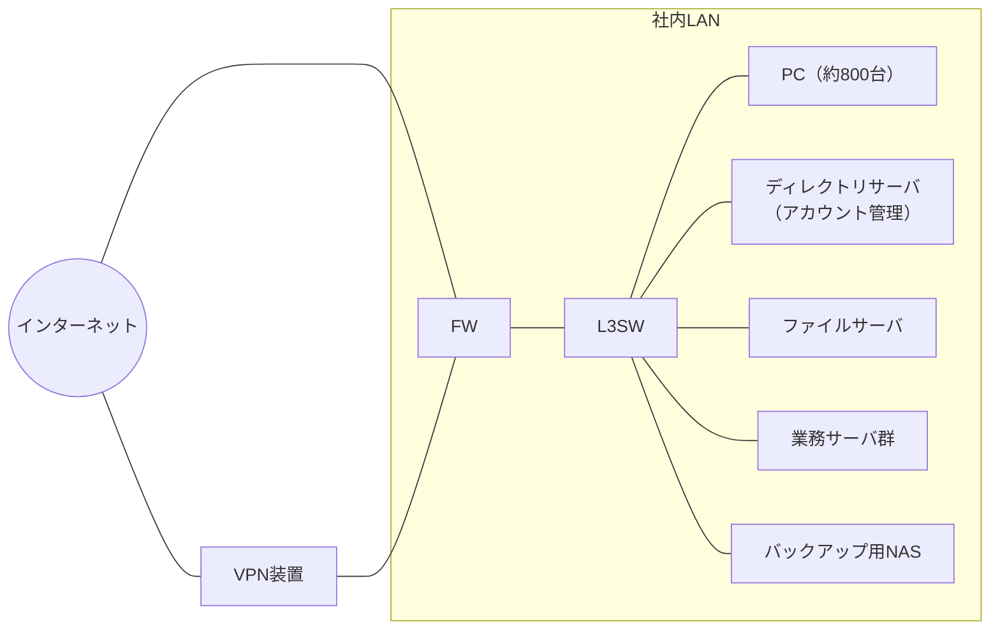
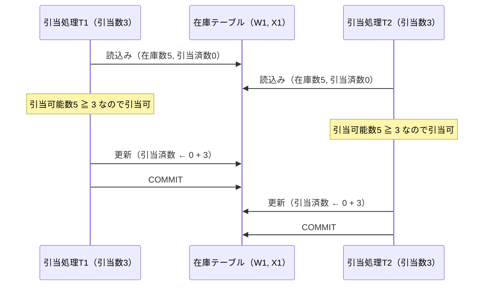
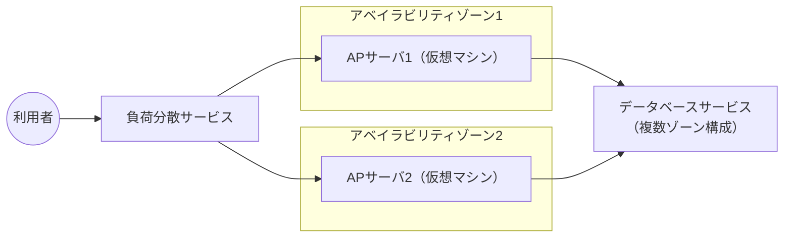

# 2026年度 応用情報技術者試験（科目B）予想模試 第2回 【問1〜問4】

> 本模試の問番号：問1（必須）情報セキュリティ／問2 プログラミング／問3 データベース／問4 システムアーキテクチャ／問5 ネットワーク／問6 組込みシステム開発／問7 プロジェクトマネジメント（問5〜問7は次回出力）。
> 図はMermaid記法。解答例・配点・解説は各問末尾の「▶」をクリックすると表示されます。
> シラバスとの対応：Ver.7.2 の用語例「ランサムウェア」「ラテラルムーブメント」「二重脅迫」「RaaS」「脆弱性管理」「デジタルフォレンジックス」（問1）、「動的計画法」（問2）、「排他制御」「デッドロック」（問3）、「IaaS／PaaS／SaaS」「SLA」「稼働率」（問4）。

---

## 問1 ランサムウェア被害の調査と再発防止に関する次の記述を読んで，設問に答えよ。

K社は，従業員800名の物流会社である。K社では，在宅勤務者や出張者が社内システムを利用できるよう，VPN装置を設置している。2026年9月6日の朝，複数のサーバで業務ファイルが開けなくなり，画面に身代金を要求するメッセージが表示されていることが分かった。K社のCSIRTは，外部のセキュリティ専門会社のL社と共同で調査を行った。

〔K社のネットワーク構成〕

K社のネットワーク構成を図1に示す。


図1 K社のネットワーク構成

- VPN装置は，利用者IDとパスワードで利用者を認証する。認証に成功した利用者は，社内LANの全てのサーバ及びPCに接続できる。
- サーバ及びPCは，ディレクトリサーバで管理するアカウントでログインする。サーバ管理者は，全てのサーバにログインできるドメイン管理者アカウントを共用している。
- 業務サーバ群とファイルサーバのデータは，毎日深夜にバックアップ用NASにコピーされる。NASは，各サーバから共有フォルダとして接続されており，ドメイン管理者アカウントで読み書きできる。NASには，直近7日分のバックアップを保存している。
- 各機器のログは，それぞれの機器の中に保存している。

〔調査結果〕

L社の調査で判明した事実を表1に示す。表1の日時は，正しい時刻に補正したものである。

表1 調査で判明した事実

| 日時 | 事実 |
|---|---|
| 8月20日 | VPN装置の製造元が，認証を経ずにVPN接続できる脆弱性を公表し，修正プログラムと，修正プログラム適用までの回避策（特定の機能の無効化）を示した。K社は，修正プログラムを9月10日の定期保守で適用する予定とした。 |
| 9月1日 02:10 | 攻撃者が脆弱性を悪用してVPN接続した。VPN装置のログには，認証の記録がないセッションが記録されていた。 |
| 9月1日 02:30 | VPN装置から，PC-Aへのリモートデスクトップ接続が成功した。PC-Aには，サーバ管理者が過去にログインした際の認証情報が残っていた。 |
| 9月3日〜5日 | 攻撃者が，ドメイン管理者アカウントで複数のサーバに順次ログインした。 |
| 9月5日 01:00〜04:00 | ファイルサーバから外部のサーバに，約40Gバイトのデータが送信された。 |
| 9月6日 03:00 | 業務サーバ群，ファイルサーバ及びバックアップ用NASのデータが暗号化された。 |

- このように，最初に侵入した端末を足掛かりにして，社内の別の端末やサーバへと侵入範囲を広げていく行為を a という。
- 攻撃者は，データの暗号化を解除するための身代金に加え，窃取したデータを公開しないことの見返りとしての金銭も要求した。このような手口を b という。
- 調査の初期段階では，VPN装置のログの時刻が他の機器より7分遅れていたので，VPN装置のログと他の機器のログの突合に時間を要した。例えば，表1の9月1日02:10の事象は，VPN装置のログには c と記録されていた。

〔初動対応〕

9月6日の朝に被害を確認したCSIRTは，①被害を受けたサーバの電源は切らずに，ネットワークケーブルを抜いて社内LANから切り離した。

〔再発防止策の検討〕

CSIRTは，表1を基に次の再発防止策を検討した。

対策1（脆弱性管理）：②脆弱性が公表された時点で，修正プログラムの適用までの間に実施すべきだった対応を，手順として定める。また，VPN装置で多要素認証を必須とする。

対策2（認証情報の管理）：サーバ管理者のアカウントを個人ごとに分け，通常の業務に使うアカウントとは別にする。PCには管理者の認証情報を残さない。

対策3（バックアップ）：③バックアップ用NASまで暗号化された原因を踏まえて，バックアップの保管方法を変更する。

対策4（監視）：各機器のログをSIEMに集約し，相関分析を行う。全ての機器の時刻をNTPサーバに同期させる。また，④表1の9月5日の事象をその時点で検知できるよう，検知ルールを追加する。

設問1 本文中の a ， b に入れる適切な字句を解答群の中から選び，記号で答えよ。また， c に入れる適切な時刻を答えよ。

解答群
- ア クリプトジャッキング
- イ サイバーキルチェーン
- ウ 水飲み場型攻撃
- エ 二重脅迫（ダブルエクストーション）
- オ ラテラルムーブメント
- カ リプレイ攻撃

設問2 本文中の下線①について，サーバの電源を切らなかった理由を35字以内で述べよ。

設問3 本文中の下線②について，9月10日の修正プログラムの適用を待たずに実施すべきだった対応を，表1中の字句を用いて40字以内で述べよ。

設問4 本文中の下線③について答えよ。
- (1) バックアップ用NASまで暗号化された原因を，本文中の字句を用いて45字以内で述べよ。
- (2) 変更後のバックアップの保管方法として適切なものを解答群の中から二つ選び，記号で答えよ。

解答群
- ア NASの共有フォルダの容量を増やし，保存する世代数を30日分にする。
- イ 書込み後は一定期間変更も削除もできない設定のストレージに保存する。
- ウ バックアップを取得するたびに，NASのファイル名を変更する。
- エ バックアップ用NASを業務サーバと同じセグメントに移設する。
- オ バックアップを取得した媒体を，取得後にネットワークから切り離して保管する。

設問5 本文中の下線④について，追加すべき検知ルールの内容を35字以内で述べよ。

<details>
<summary>▶ 問1【解答例】【配点と採点基準】【出題意図とひっかけポイントの解説】（クリックで表示）</summary>

### 【解答例】

| 設問 | 解答例 |
|---|---|
| 設問1 | a：オ　b：エ　c：9月1日 02:03 |
| 設問2 | メモリ上の情報など，調査に必要な痕跡が失われないようにするため（30字） |
| 設問3 | 製造元が示した回避策として特定の機能を無効化するか，VPN装置の利用を停止する（37字） |
| 設問4(1) | 窃取されたドメイン管理者アカウントで，NASの共有フォルダに書き込めたから（35字） |
| 設問4(2) | イ，オ |
| 設問5 | 業務時間外に社内から外部へ大量のデータが送信されたことを検知する（32字） |

**設問1 c の考え方**：VPN装置の時計は他の機器より7分**遅れて**いる。正しい時刻02:10の事象は、遅れた時計では 02:10 − 7分 ＝ **02:03** と記録される。

### 【配点と採点基準（部分点の条件）】（計20点）

| 設問 | 配点 | 採点基準 |
|---|---|---|
| 設問1 | a 2点／b 2点／c 2点 | c は「02:03」。「02:17」（遅れと進みの取り違え）は0点 |
| 設問2 | 3点 | 「証拠（痕跡・ログ・メモリ上の情報）を保全する」で満点。「被害の拡大を防ぐ」は0点（それはネットワークから切り離す理由） |
| 設問3 | 3点 | 「回避策（特定の機能の無効化）を適用」又は「VPN装置の利用を停止」のいずれかで満点。「修正プログラムを直ちに適用する」は1点（問いは「適用を待たずに」実施すべき対応） |
| 設問4(1) | 3点 | 「NASにドメイン管理者アカウントで書き込める」2点＋「攻撃者がその権限を窃取していた」1点 |
| 設問4(2) | 各1点 | イとオ。アは世代を増やしても同じ権限で暗号化されるので不可 |
| 設問5 | 3点 | 「外部への大量のデータ送信」2点＋「業務時間外（深夜）」又は「通常と比べて」等の条件1点 |

### 【出題意図とひっかけポイントの解説】

- **出題意図**：2025春の問1（サプライチェーン経由のランサムウェア）の系譜で、**侵入口（VPN装置の脆弱性）→ 横展開 → 持出し → 暗号化**という一連の攻撃を、時系列の表から読み解く力を問う。初動対応での証拠保全、脆弱性公表後の暫定対応、バックアップの保護、ログの時刻同期という定番論点を網羅した。
- **解答を一意に導く根拠**
  - 設問1 c：「7分遅れていた」の一文。
  - 設問3：表1の8月20日の行に「回避策（特定の機能の無効化）」が明記されている。
  - 設問4(1)：「NASは…ドメイン管理者アカウントで読み書きできる」と、表1の「ドメイン管理者アカウントで複数のサーバに順次ログイン」。
  - 設問5：表1の9月5日「01:00〜04:00」「約40Gバイト」「外部のサーバに」。
- **ひっかけポイント**
  - **時計のずれの向き**：遅れている時計の記録は、正しい時刻より**前**の時刻になる。
  - **切り離しと電源断の混同**：ネットワークから切り離すのは被害拡大防止、電源を切らないのは証拠保全。目的が別。
  - 設問4(2)で「世代数を増やす」を選ぶ誤り：採点講評（2025春）で「バックアップデータ自体が攻撃対象となる」点が指摘されている。**権限で守れない以上、変更不可（イミュータブル）か物理的な切離し（オフライン）**しかない。
</details>

---

## 問2 編集距離を用いた入力候補の提示に関する次の記述を読んで，設問に答えよ。

M社は，ECサイトの商品検索機能を改善するために，利用者が入力した検索語に誤りがある場合に，商品名の中から入力に近いものを候補として提示する機能を開発することにした。入力と商品名の近さの尺度として，編集距離を用いる。

〔編集距離〕

文字列sを文字列tに変換するために必要な，次の3種類の操作の最小回数を，sとtの編集距離という。
- 挿入：1文字を挿入する。
- 削除：1文字を削除する。
- 置換：1文字を別の1文字に置き換える。

例えば，“CAT”と“CUT”の編集距離は1（AをUに置換），“CAT”と“CART”の編集距離は1（Rを挿入）である。

〔編集距離を求めるアルゴリズム〕

sの長さをm，tの長さをnとする。sの先頭からi文字の部分文字列と，tの先頭からj文字の部分文字列との編集距離をD(i, j)とすると，D(i, j)は次のように求められる。

- D(i, 0) ＝ i，D(0, j) ＝ j（空文字列との編集距離は，もう一方の長さに等しい）
- i ≧ 1 かつ j ≧ 1 のとき，D(i, j)は次の三つの値の最小値である。
  - D(i−1, j) ＋ 1（sのi文字目を削除する）
  - D(i, j−1) ＋ 1（tのj文字目を挿入する）
  - D(i−1, j−1) ＋ cost（sのi文字目とtのj文字目が等しければcost＝0，異なればcost＝1）

求める編集距離はD(m, n)である。D(i, j)の値を2次元配列dに格納しながら，iとjの小さい方から順に計算する。このように，部分問題の解を表に記録して再利用する手法を動的計画法という。

プログラムを図1に示す。2次元配列dの要素番号は，行・列とも0から始まる。s.charAt(i) は，文字列sのi文字目（iは1から始まる）を返す。min3(x, y, z) は，x，y，zの最小値を返す。

```
○整数型: editDistance(文字列型: s, 文字列型: t)
  整数型: m ← s.length
  整数型: n ← t.length
  整数型の二次元配列: d ← {(m+1)行(n+1)列の配列，全要素0}
  整数型: i, j, cost
  for (i を 0 から m まで 1 ずつ増やす)
    d[i, 0] ←    ア
  endfor
  for (j を 0 から n まで 1 ずつ増やす)
    d[0, j] ← j
  endfor
  for (i を 1 から m まで 1 ずつ増やす)
    for (j を 1 から n まで 1 ずつ増やす)
      if (s.charAt(i) ＝ t.charAt(j))
        cost ← 0
      else
        cost ← 1
      endif
      d[i, j] ← min3(d[i−1, j] + 1,     イ    ,     ウ    )
    endfor
  endfor
  return d[m, n]
```
図1 編集距離を求めるプログラム

〔計算例〕

s＝“TOKYO”，t＝“KYOTO”のときの配列dの内容を表1に示す。

表1 s＝“TOKYO”，t＝“KYOTO”のときの配列d

| | j＝0 | 1（K） | 2（Y） | 3（O） | 4（T） | 5（O） |
|---|---|---|---|---|---|---|
| **i＝0** | 0 | 1 | 2 | 3 | 4 | 5 |
| **1（T）** | 1 | 1 | 2 | 3 | 3 | 4 |
| **2（O）** | 2 | 2 | 2 | 2 | 3 | 3 |
| **3（K）** | 3 | エ | 3 | 3 | 3 | 4 |
| **4（Y）** | 4 | 3 | オ | 3 | 4 | 4 |
| **5（O）** | 5 | 4 | 3 | 2 | 3 | カ |

〔性能の改善〕

商品名は約10,000件あり，いずれも10文字程度である。入力された検索語（10文字程度）と全商品名との編集距離を計算すると，図1の最も内側の繰返し処理（d[i, j]を求める処理）は，1回の検索で約 キ 回実行される。

N君は，次の二つの改善を行った。

改善1：d[i, j]の計算には，第i−1行と第i行の値しか使わないことに着目し，配列dを2行（n＋1）列の配列に置き換えた。これによって，1回の編集距離の計算に必要な配列の要素数は，(m＋1)×(n＋1)から ク に減る。

改善2：提示する候補は，編集距離が2以下の商品名に限る。そこで，⑤検索語と商品名の長さの差が3以上の商品名については，編集距離を計算せずに候補から除外する。

設問1 図1中の ア 〜 ウ に入れる適切な字句を答えよ。

設問2 表1中の エ 〜 カ に入れる適切な数値を答えよ。

設問3 図1のプログラムの時間計算量を，m，nを用いてO記法で答えよ。

設問4 〔性能の改善〕について答えよ。
- (1) 本文中の キ に入れる適切な数値を，検索語と商品名がいずれも10文字であるとして答えよ。
- (2) 本文中の ク に入れる適切な式を，nを用いて答えよ。
- (3) 本文中の下線⑤の除外を行っても，候補として提示すべき商品名が漏れない理由を，40字以内で述べよ。

<details>
<summary>▶ 問2【解答例】【配点と採点基準】【出題意図とひっかけポイントの解説】（クリックで表示）</summary>

### 【解答例】

| 設問 | 解答例 |
|---|---|
| 設問1 | ア：i　イ：d[i, j−1] + 1　ウ：d[i−1, j−1] + cost |
| 設問2 | エ：2　オ：2　カ：4 |
| 設問3 | O(mn) |
| 設問4(1) | キ：1,000,000（10 × 10 × 10,000） |
| 設問4(2) | ク：2 × (n + 1)（又は 2n + 2） |
| 設問4(3) | 編集距離は長さの差以上になるので，差が3以上なら距離も3以上になるから（34字） |

**設問2の計算**
- エ d[3,1]（“TOK”と“K”）：min(d[2,1]+1＝3, d[3,0]+1＝4, d[2,0]+0＝2) ＝ **2**（KとKが一致）
- オ d[4,2]（“TOKY”と“KY”）：min(d[3,2]+1＝4, d[4,1]+1＝4, d[3,1]+0＝2) ＝ **2**（YとYが一致）
- カ d[5,5]（“TOKYO”と“KYOTO”）：min(d[4,5]+1＝5, d[5,4]+1＝4, d[4,4]+0＝4) ＝ **4**（OとOが一致）
- 検算：“TOKYO”から先頭のT，Oを削除して“KYO”、末尾にT，Oを挿入して“KYOTO”の4回。

### 【配点と採点基準（部分点の条件）】（計20点）

| 設問 | 配点 | 採点基準 |
|---|---|---|
| 設問1 | 各2点 | イとウは順不同（min3の引数の順序は問わない）。ウで「+ 1」と書いたもの（一致時の0を考慮しない）は0点。ア「0」は0点 |
| 設問2 | 各2点 | |
| 設問3 | 2点 | O(n²) は、m＝n の前提がないので1点 |
| 設問4(1) | 2点 | 1,210,000（(m+1)(n+1)で計算）は、問いが「最も内側の繰返し処理」なので0点 |
| 設問4(2) | 2点 | |
| 設問4(3) | 2点 | 「編集距離 ≧ 長さの差」が必須。「長さが違うと似ていないから」は0点 |

### 【出題意図とひっかけポイントの解説】

- **出題意図**：2025秋（LCS）、2017秋（ナップサック）に続く動的計画法の定番として、**漸化式からプログラムを完成させる力、表を机上で埋める力、計算量と領域量の改善**を問う。
- **解答を一意に導く根拠**
  - 設問1：〔編集距離を求めるアルゴリズム〕の漸化式がそのまま答え。アは「D(i, 0) ＝ i」。
  - 設問2：表1の左隣・上・左上の3マスと、行・列見出しの文字（一致するか）から一意に決まる。
  - 設問4(3)：長さの差の分だけは、最低でも挿入か削除が必要になる。
- **ひっかけポイント**
  - **二次元配列の要素番号の誤り**（2025秋の採点講評で指摘）：「左上」は d[i−1, j−1]。d[i−1, j] と取り違えない。
  - **一致時のcost**：ウを「+1」とすると、一致する文字でも距離が増え、表1と合わなくなる。埋めた式で表1の1マスを検算する習慣を。
  - 設問4(1)は「最も内側の繰返し処理」の回数なので m × n。初期化の行・列は含めない。
</details>

---

## 問3 在庫引当処理の排他制御に関する次の記述を読んで，設問に答えよ。

P社は，日用品のECサイトを運営している。商品は全国3か所の倉庫に保管しており，注文を受け付けると，在庫のある倉庫から商品を引き当てる。セール期間中に，在庫数を超えて注文を受け付けてしまう不具合が発生したので，情報システム部のQ主任が原因を調査し，対策を検討することになった。

〔テーブル構造〕

在庫引当に関係するテーブル構造を図1に示す。主キーを【 】，外部キーを〈 〉で示す。主キーかつ外部キーは【〈 〉】で示す。

```
倉庫     （【倉庫コード】, 倉庫名, 所在地）
商品     （【商品コード】, 商品名, 単価）
在庫     （【〈倉庫コード〉】, 【〈商品コード〉】, 在庫数, 引当済数, 版番号）
注文明細 （【〈注文番号〉】, 【明細番号】, 〈商品コード〉, 数量）
引当     （     a     , 引当数）
```
図1 テーブル構造（一部未記入）

- 在庫テーブルの“在庫数”は倉庫にある数量，“引当済数”は注文に引き当てたがまだ出荷していない数量である。在庫数 − 引当済数を引当可能数という。
- 一つの注文明細の数量を，一つの倉庫で引き当てられない場合は，複数の倉庫に分けて引き当てる。同じ注文明細を同じ倉庫から2回以上に分けて引き当てることはない。
- 版番号は，在庫テーブルの行を更新するたびに1を加える整数である。

〔不具合の原因〕

引当処理は，在庫テーブルから引当可能数を読み込み，引当数が引当可能数以下であれば，読み込んだ引当済数に引当数を加えた値で在庫テーブルを更新する。

調査の結果，同じ商品に対する二つの引当処理が並行して実行された場合に，図2の順序で処理が行われていたことが分かった。ここで，倉庫W1の商品X1の在庫数は5，引当済数は0であった。


図2 不具合が発生したときの処理の順序

この結果，引当テーブルにはT1とT2の引当が合計6個記録されたが，在庫テーブルの引当済数は b となり，在庫数5を超える引当が発生した。このように，一方の更新が他方の更新で上書きされて失われる現象を c という。

〔対策の検討〕

Q主任は，次の三つの方式を比較した。

方式1：読込み時に SELECT … FOR UPDATE を用いて在庫テーブルの行をロックし，COMMITするまで他の引当処理による読込みを待たせる。

方式2：版番号を用いる。読込み時には行をロックせず，更新時に図3のSQL文を実行する。⑥更新件数が0件だった場合は，読込みからやり直す。ここで，:倉庫，:商品，:引当数，:読込み時版番号 は埋込み変数である。

```sql
UPDATE 在庫
   SET 引当済数 = 引当済数 + :引当数,
          d
 WHERE 倉庫コード = :倉庫 AND 商品コード = :商品
   AND 版番号 =    e
```
図3 方式2の更新用SQL文

方式3：読込みと判定を行わずに，図4のSQL文1文で判定と更新を行う。更新件数が0件だった場合は，引当可能数が不足していると判断する。

```sql
UPDATE 在庫
   SET 引当済数 = 引当済数 + :引当数
 WHERE 倉庫コード = :倉庫 AND 商品コード = :商品
   AND       f
```
図4 方式3のSQL文

〔デッドロックへの対応〕

Q主任は，方式1を採用した場合について，複数の商品を含む注文の扱いを検討した。注文Aが商品X1，X2の順に，注文Bが商品X2，X1の順に，同じ倉庫の在庫テーブルの行をロックしようとすると，⑦処理が互いに待ち続けて先に進まなくなるおそれがある。

設問1 図1中の a に入れる適切な属性名を全て答え，図1の表記に従って【 】，〈 〉を付けて示せ。

設問2 〔不具合の原因〕について，本文中の b に入れる適切な数値， c に入れる適切な字句を答えよ。

設問3 〔対策の検討〕について答えよ。
- (1) 図3中の d ， e ，図4中の f に入れる適切な字句を答えよ。
- (2) 本文中の下線⑥について，更新件数が0件になるのはどのような場合か。35字以内で述べよ。

設問4 〔デッドロックへの対応〕について答えよ。
- (1) 本文中の下線⑦の現象を何というか答えよ。
- (2) 下線⑦を防ぐために，全ての引当処理で統一すべき規則を35字以内で述べよ。

<details>
<summary>▶ 問3【解答例】【配点と採点基準】【出題意図とひっかけポイントの解説】（クリックで表示）</summary>

### 【解答例】

| 設問 | 解答例 |
|---|---|
| 設問1 | a：【〈注文番号〉】，【〈明細番号〉】，【〈倉庫コード〉】 |
| 設問2 | b：3　c：ロストアップデート（更新の喪失） |
| 設問3(1) | d：版番号 = 版番号 + 1　e：:読込み時版番号　f：在庫数 - 引当済数 >= :引当数 |
| 設問3(2) | 読込み後に，他の処理が同じ行を更新して版番号が変わっていた場合（30字） |
| 設問4(1) | デッドロック |
| 設問4(2) | 複数の行をロックするときは，商品コードの昇順など決まった順序でロックする（34字） |

### 【配点と採点基準（部分点の条件）】（計20点）

| 設問 | 配点 | 採点基準 |
|---|---|---|
| 設問1 | 3点 | 3属性がそろい、全てに【〈 〉】で3点。3属性はそろうが記号の誤りは2点。倉庫コードがないもの（同じ明細を複数倉庫に分けると一意にならない）は0点 |
| 設問2 | b 2点／c 2点 | b は3のみ。6は0点 |
| 設問3(1) | 各2点 | d の「版番号 = 版番号 + 1」が欠けると、再試行の判定ができないので0点。f は「在庫数 - 引当済数 >= :引当数」又は同値の式（引当済数 + :引当数 <= 在庫数）。「>」は0点（引当可能数ちょうどの引当ができなくなる） |
| 設問3(2) | 2点 | 「他の処理が先に更新した（版番号が変わった）」が必須 |
| 設問4(1) | 2点 | |
| 設問4(2) | 3点 | 「ロックの順序を統一」で満点。順序の基準（商品コード順など）があればなおよい。「ロックの時間を短くする」は1点（発生確率は下がるが防げない） |

### 【出題意図とひっかけポイントの解説】

- **出題意図**：2022春（排他制御・連番管理）、2021秋（同時実行制御）の論点を深掘りし、**ロストアップデートの発生メカニズム**と、悲観ロック・楽観ロック・条件付き更新の3方式の違い、デッドロックの防止策を問う。
- **解答を一意に導く根拠**
  - 設問1：「複数の倉庫に分けて引き当てる」→ 注文明細だけでは一意にならず倉庫コードが必要。「同じ倉庫から2回以上に分けて引き当てることはない」→ 3属性で一意。
  - 設問2 b：図2でT2が更新する値は「0 + 3」（T1の更新前に読み込んだ値が基準）。
  - 設問3 d：「版番号は，行を更新するたびに1を加える」。
- **ひっかけポイント**
  - **方式3の判定の位置**：条件をWHERE句に入れれば、判定と更新がDBMSの中で一つの更新として行われるので、間に他の処理が割り込めない。アプリ側で判定してから更新する方式との違いに気付けるか。
  - **境界値**：f を「>」にすると、在庫ちょうどを引き当てる注文が拒否される（採点講評で毎回指摘される境界値の誤り）。
  - **UPDATE文の構文**：SET句で複数列を更新するときのカンマ（2022春の講評でUPDATE文のSET句の構文が指摘されている）。
</details>

---

## 問4 基幹システムのクラウド移行に関する次の記述を読んで，設問に答えよ。

E社は，通信販売を営む中堅企業である。自社のデータセンタで運用している受注管理システム，会計システム及び人事給与システムのハードウェアが保守期限を迎えるので，クラウドサービスに移行することになった。情報システム部のF主任が移行方式を検討した。

〔現行システムの概要と移行方針〕

現行の各システムの特徴と移行に関する要望を表1に示す。

表1 各システムの特徴と移行に関する要望

| システム | 特徴 | 要望 |
|---|---|---|
| 受注管理システム（APサーバ） | 自社開発。特定のミドルウェアの古い版に依存しており，OSの設定を独自に変更して動作させている。 | 当面はプログラムを改修せずに移行したい。 |
| 受注管理システム（DBサーバ） | 汎用的なRDBMSを使用。クラウド事業者が提供するデータベースサービスでも同じ製品・版が選べる。 | DBのパッチ適用やバックアップ取得の運用負荷を減らしたい。 |
| 会計システム | ソフトウェアパッケージを標準機能のまま利用している。 | 法改正への対応を自社で行う負荷をなくしたい。 |

F主任は，クラウドサービスのサービス形態を，受注管理システム（APサーバ）は g ，受注管理システム（DBサーバ）は h ，会計システムは i とした。

〔可用性の検討〕

受注管理システムには，年間の稼働率99.9%以上という要件がある。F主任は，図1の構成を検討した。各構成要素のSLAに記載された月間の稼働率を表2に示す。


図1 受注管理システムの構成案

表2 各構成要素の稼働率（SLA）

| 構成要素 | 稼働率 |
|---|---|
| 負荷分散サービス | 99.99% |
| 仮想マシン（1台当たり） | 99.5% |
| データベースサービス（複数ゾーン構成） | 99.95% |

注記 APサーバ1，2は，いずれか1台が稼働していれば処理を継続できる。各構成要素の故障は互いに独立とする。

F主任は，図1の構成の稼働率を j %と算出し，要件を満たすことを確認した。一方，APサーバを1台だけとした場合の稼働率は k %となり，要件を満たさない。

また，表2のSLAには，“月間の稼働率がSLAを下回った場合は，月額利用料の一定割合を減額する”と記載されている。F主任は，⑧SLAの減額規定があることだけでは，受注管理システムの停止によるE社の損失に備えたことにはならないと考えた。

〔データ移行の検討〕

受注管理システムのデータベースのデータ量は，現在1.2Tバイトである。データセンタからクラウドへのデータ転送には，1Gビット/秒の回線を使用し，実効転送速度は回線速度の60%とする。ここで，1Tバイト＝10¹²バイトとする。

移行作業は，受注を停止する土曜日22時から日曜日6時までの8時間で行う。データ転送の後に，データの検証と切替えに3時間を要する。現在のデータ量では，データ転送に l 時間掛かり，8時間以内に収まる。

しかし，移行日までにデータ量は1.8Tバイトに増える見込みである。F主任は，⑨移行日に全データを転送する方式では8時間に収まらないので，移行方式を変更することにした。

〔運用の検討〕

⑩受注管理システム（APサーバ）のサービス形態では，現行と同様にE社が行わなければならない運用作業が残る。

設問1 本文中の g 〜 i に入れる適切な字句を解答群の中から選び，記号で答えよ。

解答群
- ア IaaS
- イ PaaS
- ウ SaaS

設問2 〔可用性の検討〕について答えよ。
- (1) 本文中の j ， k に入れる適切な数値を，小数第2位未満を切り捨てて答えよ。
- (2) 本文中の下線⑧について，そのように考えた理由を40字以内で述べよ。

設問3 〔データ移行の検討〕について答えよ。
- (1) 本文中の l に入れる適切な数値を，小数第2位を四捨五入して小数第1位まで答えよ。
- (2) 本文中の下線⑨について，8時間に収まらない理由を，計算結果を示して40字以内で述べよ。
- (3) 変更後の移行方式を40字以内で述べよ。

設問4 本文中の下線⑩について，E社が行わなければならない運用作業の例を一つ，20字以内で述べよ。

<details>
<summary>▶ 問4【解答例】【配点と採点基準】【出題意図とひっかけポイントの解説】（クリックで表示）</summary>

### 【解答例】

| 設問 | 解答例 |
|---|---|
| 設問1 | g：ア　h：イ　i：ウ |
| 設問2(1) | j：99.93　k：99.44 |
| 設問2(2) | 減額は利用料の一部に限られ，業務停止によるE社の損失は補償されないから（34字） |
| 設問3(1) | l：4.4 |
| 設問3(2) | 転送に約6.7時間掛かり，検証と切替えの3時間を加えると8時間を超えるから（35字） |
| 設問3(3) | 事前に全データを転送しておき，移行日には，その後に更新された差分だけを転送する（38字） |
| 設問4 | 仮想マシンのOSへのパッチ適用（14字） |

**計算過程**
- APサーバ2台の並列：1 − (1 − 0.995)² ＝ 1 − 0.000025 ＝ 0.999975
- j：0.9999 × 0.999975 × 0.9995 ＝ 0.99937…… → **99.93%**（小数第2位未満切捨て）
- k：0.9999 × 0.995 × 0.9995 ＝ 0.99440…… → **99.44%**
- l：1.2 × 10¹² × 8 ÷ (1 × 10⁹ × 0.6) ＝ 16,000秒 ＝ 4.44…時間 → **4.4時間**
- 1.8Tバイトの場合：1.8 × 10¹² × 8 ÷ (0.6 × 10⁹) ＝ 24,000秒 ＝ 約6.7時間。6.7 ＋ 3 ＝ 9.7時間 > 8時間

### 【配点と採点基準（部分点の条件）】（計20点）

| 設問 | 配点 | 採点基準 |
|---|---|---|
| 設問1 | 各2点 | g は「OSの設定を独自に変更」からIaaS。PaaSは0点 |
| 設問2(1) | j 3点／k 2点 | j を 99.94（四捨五入）としたものは1点（端数処理の指示違反） |
| 設問2(2) | 2点 | 「減額は利用料の範囲に限られる」＋「事業上の損失は補償されない」で満点 |
| 設問3(1) | 2点 | 0.6（バイト→ビットの×8を忘れた）、2.7（実効速度60%を忘れた）は0点 |
| 設問3(2) | 2点 | 6.7時間（又は24,000秒）と、3時間を加えて8時間を超えることの両方が必要 |
| 設問3(3) | 2点 | 「事前に全量を転送」＋「当日は差分のみ」で満点。「回線を増速する」は1点（要件を満たすが、本文に回線増速の選択肢が示されていない） |
| 設問4 | 1点 | OSのパッチ適用、OSの設定管理、ミドルウェアの保守 など、利用者責任の範囲の作業 |

### 【出題意図とひっかけポイントの解説】

- **出題意図**：2018春（クラウドのサービス形態の選定）、2025春（SLAの留意点）、2021秋（移行時間の計算）の論点を、オンプレミスからの移行という王道の題材に統合した。稼働率の直列・並列計算と、**責任共有モデル**（IaaSではOS以上は利用者責任）を問う。
- **解答を一意に導く根拠**
  - 設問1：「OSの設定を独自に変更」→ OSを利用者が管理できるIaaS。「パッチ適用やバックアップの運用負荷を減らしたい」「同じ製品・版が選べる」→ PaaS。「標準機能のまま」「法改正への対応を自社で行う負荷をなくしたい」→ SaaS。
  - 設問2(1)：注記「いずれか1台が稼働していれば」→ AP部分は並列、全体は直列。
  - 設問3：「1Tバイト＝10¹²バイト」「実効転送速度は60%」「検証と切替えに3時間」。
- **ひっかけポイント**
  - **単位換算**：バイト→ビットの ×8、実効速度の掛け忘れ（2021秋の採点講評で移行方式の計算の誤りが指摘されている）。
  - **端数処理**：「小数第2位未満を切り捨て」なので 99.937… は 99.93。四捨五入しない。
  - **SLAの読み方**（2025春の講評）：SLAの稼働率が要件を満たすかと同時に、未達時の補償の範囲を確認する。減額は損害補償ではない。
</details>

---

> 次回出力予定：第2回 問5（ネットワーク：IPv6導入）、問6（組込み：BLE温度センサタグ）、問7（PM：スクラム）。
