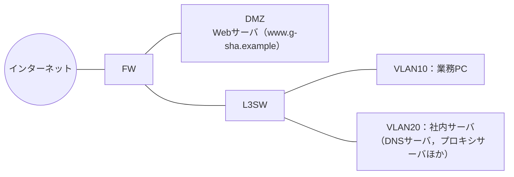
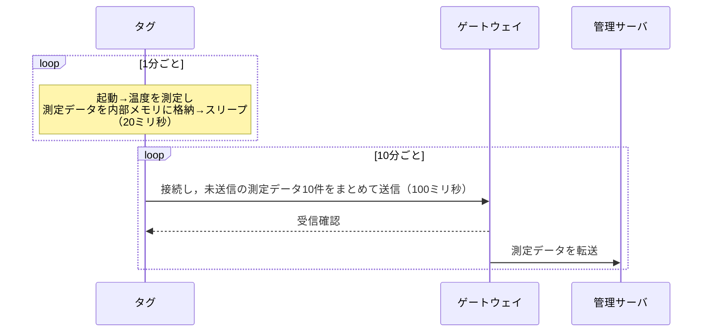
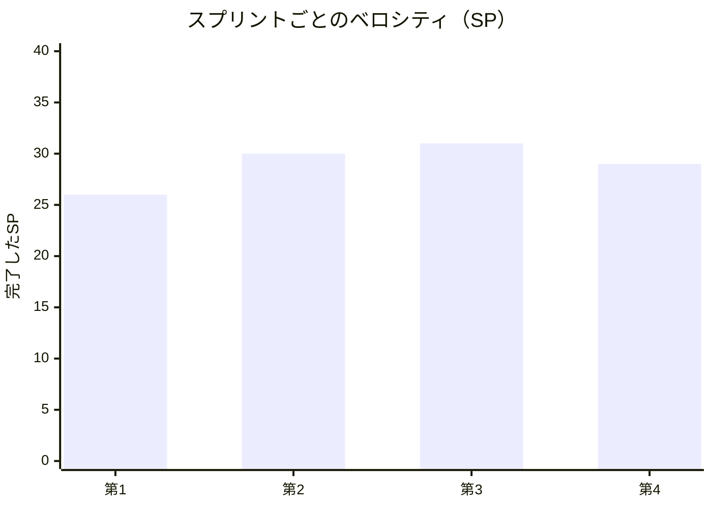

# 2026年度 応用情報技術者試験（科目B）予想模試 第2回 【問5〜問7】

> 問1〜問4は `第2回_問1-問4.md`。図はMermaid記法。解答例・配点・解説は各問末尾の「▶」をクリックすると表示されます。
> シラバスとの対応：Ver.7.2 の用語例「IPv6（必要性と特徴）」「NAT，IPマスカレード（NAPT）」「ステートフルパケットフィルタリング」（問5）、「BLE（Bluetooth Low Energy）」「電池」（問6）、「スクラムチーム（プロダクトオーナー，開発者，スクラムマスター）」「スプリント」「デイリースクラム」「ストーリーポイント」「ベロシティ」「プロダクトバックログ」（問7）。
> IPv6のアドレス自動設定やDNSのレコード種別など、用語例にない仕組みは問題文中で説明している。

---

## 問5 社内ネットワークへのIPv6導入に関する次の記述を読んで，設問に答えよ。

G社は，従業員500名の旅行会社である。取引先や顧客の一部がIPv6だけで通信する環境に移行しつつあるので，社内ネットワークでIPv4とIPv6を併用できるようにすることになった。情報システム部のJ主任が設計を担当した。

〔現在のネットワーク構成〕

G社のネットワーク構成を図1に示す。

図1 G社のネットワーク構成

- IPv4では，社内はプライベートアドレスを使用している。FWは，社内からインターネットへの通信の送信元アドレスを，NAPTによってFWのグローバルアドレスに変換する。インターネットからは，社内のPCのアドレスは見えない。
- Webサーバには，FWの静的NATによって，インターネットからIPv4でアクセスできる。
- 業務PCからのWeb閲覧はプロキシサーバを経由し，プロキシサーバは，送信元アドレス，日時，URLをアクセスログに記録している。業務PCのIPv4アドレスは，DHCPで機器ごとに固定のアドレスを割り当てているので，アクセスログの送信元アドレスから利用者を特定できる。

〔IPv6アドレスの設計〕

ISPからは，IPv6アドレスのプレフィックス 2001:db8:a000::/48 の割当てを受けた。J主任は，各セグメントに表1のプレフィックス長64ビットのサブネットを割り当てることにした。

表1 IPv6アドレスの割当て

| セグメント | サブネット |
|---|---|
| VLAN10（業務PC） | 2001:db8:a000:10::/64 |
| VLAN20（社内サーバ） | 2001:db8:a000:20::/64 |
| DMZ | 2001:db8:a000:f0::/64 |

このプレフィックスからは，プレフィックス長64ビットのサブネットを最大で ア 個作ることができる。

Webサーバには，2001:0db8:a000:00f0:0000:0000:0000:0080 を割り当てる。このアドレスを，各フィールドの先頭の0の省略と，連続する0のフィールドの“::”による省略を用いて最も短く表記すると， イ となる。

業務PCのIPv6アドレスは，次の方法で自動的に設定する。
- L3SWが，サブネットのプレフィックスを含むメッセージを定期的に送信する。PCは，受信したプレフィックスと，PC自身が生成した64ビットの値（インタフェースID）を組み合わせて，IPv6アドレスを生成する。
- PCは，プライバシー保護のため，インタフェースIDを乱数で生成した一時アドレスを通信に使用し，一時アドレスを1日ごとに作り直す。

〔DNSとFWの設定〕

DNSサーバには，www.g-sha.example のIPv4アドレスを登録するAレコードに加えて，IPv6アドレスを登録する a レコードを追加する。

また，IPv6ではNAPTを使用しないので，社内のPCにもインターネットで通用するアドレスが割り当てられる。そこで，FWに表2のIPv6用のルールを設定する。FWは，表2のルールを項番の小さい順に評価し，最初に該当したルールを適用する。

表2 FWのIPv6用のルール（抜粋）

| 項番 | 送信元 | 宛先 | サービス | 動作 |
|---|---|---|---|---|
| 1 | 任意 | ウ | HTTPS（TCP 443） | 許可 |
| 2 | 2001:db8:a000:20::/64 | 任意 | HTTP，HTTPS | 許可 |
| 3 | 任意 | 2001:db8:a000:10::/64 | 全て | 拒否 |
| 4 | 任意 | 任意 | 全て | 拒否 |

注記 FWは b の機能をもち，許可した通信に対する応答パケットは，表2のルールにかかわらず通過させる。

〔試験運用での問題〕

試験運用で，次の問題が発生した。

問題1：DNSサーバに a レコードを追加した日に，表2の項番1の設定作業が漏れていた。その間，社外の一部の利用者から“Webサイトの表示が始まるまでに30秒以上掛かる”との問合せがあった。調査したところ，IPv6とIPv4の両方で通信できる端末の中には，IPv6のアドレスを優先して接続を試み，一定時間応答がない場合にIPv4で接続し直すものがあることが分かった。

問題2：IPv6でWeb閲覧をした業務PCについて，②プロキシサーバのアクセスログから利用者を特定できないことがあった。

設問1 〔IPv6アドレスの設計〕について，本文中の ア に入れる適切な数値， イ に入れる適切なアドレスを答えよ。

設問2 〔DNSとFWの設定〕について答えよ。
- (1) 本文中及び表2中の a ， b に入れる適切な字句を解答群の中から選び，記号で答えよ。
- (2) 表2中の ウ に入れる適切なアドレスを，プレフィックス長を付けずに答えよ。
- (3) 表2の項番3のルールが必要な理由を，IPv4での構成と比較して45字以内で述べよ。

解答群
- ア AAAA
- イ CNAME
- ウ MX
- エ PTR
- オ ステートフルパケットフィルタリング
- カ スタティックパケットフィルタリング
- キ リバースプロキシ

設問3 問題1について，表示が始まるまでに30秒以上掛かった理由を，45字以内で述べよ。

設問4 本文中の下線②について答えよ。
- (1) 利用者を特定できない理由を，本文中の字句を用いて40字以内で述べよ。
- (2) 利用者を特定できるようにするための，プロキシサーバでの対策を35字以内で述べよ。

▶ 問5【解答例】【配点と採点基準】【出題意図とひっかけポイントの解説】（クリックで表示）

### 【解答例】

| 設問 | 解答例 |
|---|---|
| 設問1 | ア：65,536　イ：2001:db8:a000:f0::80 |
| 設問2(1) | a：ア　b：オ |
| 設問2(2) | ウ：2001:db8:a000:f0::80 |
| 設問2(3) | NAPTを使わないので，外部から社内PCのアドレスに直接接続できてしまうから（35字） |
| 設問3 | IPv6で接続を試みたがFWで遮断されて応答がなく，待った後にIPv4で接続し直したから（40字） |
| 設問4(1) | PCが一時アドレスを1日ごとに作り直すので，アドレスとPCの対応が固定されないから（39字） |
| 設問4(2) | プロキシサーバで利用者認証を行い，アクセスログに利用者IDを記録する（32字） |

**設問1の計算**：/48から/64までの16ビット分 → 2¹⁶ ＝ **65,536**個。
**アドレスの省略**：2001:0db8:a000:00f0:0000:0000:0000:0080 → 先頭の0を省略して 2001:db8:a000:f0:0:0:0:80 → 連続する0の4フィールドを“::”にして **2001:db8:a000:f0::80**。

### 【配点と採点基準（部分点の条件）】（計20点）

| 設問 | 配点 | 採点基準 |
|---|---|---|
| 設問1 | ア 2点／イ 2点 | アの「2¹⁶」は可。「16」は0点。イは「2001:db8:a000:f0::80」のみ。00f0 や 0080 のように先頭の0が残るものは0点（「最も短く」の指示） |
| 設問2(1) | 各2点 | b でスタティックを選ぶと、応答パケットを通す仕組みの説明と矛盾するので0点 |
| 設問2(2) | 2点 | サブネット（::/64）全体を答えたものは1点（「必要最小限の範囲」の観点で減点） |
| 設問2(3) | 3点 | 「NAPTを使わない（グローバルなアドレスが付く）」1点＋「外部から社内PCに直接接続（攻撃）できる」2点 |
| 設問3 | 3点 | 「IPv6を優先して接続を試みた」1点＋「FWで遮断され応答がない（タイムアウト）」1点＋「IPv4で接続し直した」1点 |
| 設問4(1) | 2点 | 「一時アドレス（アドレスが日々変わる）」が必須 |
| 設問4(2) | 2点 | 「利用者認証（ログに利用者IDを記録）」で満点。「PCのアドレスを固定する」は、プロキシサーバでの対策ではないので1点 |

### 【出題意図とひっかけポイントの解説】

- **出題意図**：シラバスの「IPv6の必要性と特徴」を、デュアルスタック移行という実務の題材で問う。アドレス表記・サブネット数の基本に加え、**NAPTが結果的に担っていた“外部から見えない”効果がIPv6ではなくなる**こと、ステートフルパケットフィルタリング、デュアルスタック特有の接続遅延、アドレスが変わることによるログの問題を問う。
- **解答を一意に導く根拠**
  - 設問2(3)：「インターネットからは，社内のPCのアドレスは見えない」（IPv4）と「IPv6ではNAPTを使用しないので…インターネットで通用するアドレスが割り当てられる」の対比。
  - 設問3：「IPv6のアドレスを優先して接続を試み，一定時間応答がない場合にIPv4で接続し直す」と「項番1の設定作業が漏れていた」（項番4で拒否される）。
  - 設問4：「一時アドレスを1日ごとに作り直す」と、IPv4では「機器ごとに固定のアドレス」の対比。
- **ひっかけポイント**
  - **“::”は1か所だけ**、各フィールドの先頭の0だけを省略できる（末尾の0は省略できない：f0 を f にしない）。
  - **評価順序**：項番3より前に項番1・2があるので、DMZ宛てのHTTPSと社内サーバからの通信は許可される。表のルールは上から評価されることを本文から読み取る。
  - 設問2(3)を「セキュリティのため」とだけ書くと0点。**IPv4との違い（NAPTがない）**を必ず書く。

---

## 問6 冷蔵倉庫用温度センサータグの省電力設計に関する次の記述を読んで，設問に答えよ。

H社は，冷蔵倉庫の温度を監視する，ボタン電池で動作する温度センサータグ（以下，タグという）を開発している。タグは倉庫内の棚に多数取り付けられ，測定した温度をBLE（Bluetooth Low Energy）で倉庫内のゲートウェイに送信する。ゲートウェイは，受信したデータを管理サーバに転送する。

〔タグの構成と動作〕

タグの構成要素と消費電流を表1に，タグの動作を図1に示す。

表1 タグの構成要素と消費電流

| 構成要素 | 概要 | 消費電流 |
|---|---|---|
| 制御部（MCU） | スリープ中も時計（RTC）は動作し，設定した時刻に制御部を起動する | 動作中 1.2mA，スリープ中 2µA |
| 温度センサー | 制御部が電源を入れて測定する | 測定中 0.3mA |
| 通信部（BLE） | ゲートウェイと接続してデータを送信する | 送信中 15mA（制御部の電流を含む） |
| 電池 | ボタン電池 | 容量 220mAh |

図1 タグの動作（現行設計）

- 測定中は，制御部と温度センサーの両方の電流が流れる。
- スリープ中の電流2µAは常に流れるものとし，測定中と送信中の電流はこれに上乗せされるものとする。
- 測定データは1件4バイトである。

〔電池寿命の計算〕

現行設計では，10分間に測定を10回，送信を1回行う。10分間（600秒）当たりの電荷量は，測定が 1.5mA × 0.02秒 × 10回 ＝ 0.3mA·秒，送信が ア mA·秒である。これに常時流れるスリープ電流を加えると，平均消費電流は イ µAとなる。電池容量を全て使えるものとすると，電池寿命は ウ 日となる。

製品企画部からは，電池寿命を7年以上にしたいとの要望があった。J君は，③測定データを1件ずつではなく，1回の送信で未送信の測定データをまとめて送る方式は維持したまま，送信間隔を30分に延ばす案を検討した。送信するデータ件数が増えても，送信1回の所要時間（100ミリ秒）と電流は変わらないものとする。この案の電池寿命は エ 日となる。

ただし，倉庫の温度が10℃を超えた場合は1分以内に管理サーバに通知するという要件がある。そこで，送信間隔を30分にしても，④この要件を満たせるように処理を追加した。

〔試験で発生した不具合〕

試験で，ゲートウェイの電源が30分間停止した際に，その間の測定データの一部が管理サーバに届かない不具合が発生した。調査したところ，タグは，内部メモリに10件分の測定データ領域を用意して順に上書きしており，送信が失敗した測定データも，次の測定で上書きされていたことが分かった。

J君は，受信確認を受け取れなかった測定データは消去せずに保持し，次回の送信時に再送するよう変更した。測定データの保持に使える内部メモリの容量は1,024バイトである。これによって，ゲートウェイが最大 オ 分間停止しても，測定データが失われないようになった。

設問1 〔電池寿命の計算〕について，本文中の ア 〜 ウ に入れる適切な数値を答えよ。ウは，小数点以下を切り捨てて整数で答えよ。

設問2 送信間隔を30分にした案について答えよ。
- (1) 本文中の エ に入れる適切な数値を，小数点以下を切り捨てて整数で答えよ。
- (2) 本文中の下線③について，1件ずつ送信せずにまとめて送信している理由を，表1の内容を踏まえて30字以内で述べよ。
- (3) 本文中の下線④について，追加した処理の内容を35字以内で述べよ。

設問3 〔試験で発生した不具合〕について答えよ。
- (1) 測定データが失われた原因を，“受信確認”という字句を用いて40字以内で述べよ。
- (2) 本文中の オ に入れる適切な数値を答えよ。

▶ 問6【解答例】【配点と採点基準】【出題意図とひっかけポイントの解説】（クリックで表示）

### 【解答例】

| 設問 | 解答例 |
|---|---|
| 設問1 | ア：1.5　イ：5　ウ：1,833 |
| 設問2(1) | エ：2,750 |
| 設問2(2) | 送信は消費電流が大きいので，送信の回数を減らすため（24字） |
| 設問2(3) | 測定した温度が10℃を超えた場合は，送信間隔を待たずに直ちに送信する（33字） |
| 設問3(1) | 受信確認の有無にかかわらず，送信済みの領域を次の測定データで上書きしていたから（38字） |
| 設問3(2) | オ：256 |

**計算過程**
- ア：送信 15mA × 0.1秒 × 1回 ＝ **1.5mA·秒**（制御部の電流は含まれているので加えない）
- イ：(0.3 ＋ 1.5) ÷ 600 ＝ 0.003mA ＝ 3µA、スリープ電流2µAを加えて **5µA**
- ウ：220mAh ÷ 0.005mA ＝ 44,000時間 ÷ 24 ＝ 1,833.3… → **1,833日**（約5.0年）
- エ：30分（1,800秒）当たり 測定 1.5 × 0.02 × 30 ＝ 0.9mA·秒、送信 1.5mA·秒 → (0.9 ＋ 1.5) ÷ 1,800 ＝ 0.001333…mA ＝ 1.333…µA、＋2µA ＝ 3.333…µA → 220mAh ÷ 0.003333…mA ＝ 66,000時間 ÷ 24 ＝ **2,750日**（約7.5年）
- オ：1,024バイト ÷ 4バイト ＝ 256件、1分に1件なので **256分**

### 【配点と採点基準（部分点の条件）】（計20点）

| 設問 | 配点 | 採点基準 |
|---|---|---|
| 設問1 | ア 2点／イ 3点／ウ 3点 | イで「3」（スリープ電流の加算漏れ）は0点。ウはイの誤りを引き継いだ場合、計算方法が正しければ1点 |
| 設問2(1) | 3点 | |
| 設問2(2) | 2点 | 「送信（通信部）の消費電流が大きい」＋「回数を減らす」で満点 |
| 設問2(3) | 3点 | 「10℃を超えたら」1点＋「直ちに（送信間隔を待たずに）送信」2点 |
| 設問3(1) | 2点 | 「受信確認を待たずに（確認がなくても）上書き」が必須 |
| 設問3(2) | 2点 | |

### 【出題意図とひっかけポイントの解説】

- **出題意図**：2023春（位置通知タグの駆動時間）、2018春（防犯ブザーの省電力）の系譜で、**間欠動作の平均消費電流と電池寿命の計算**、送信をまとめる省電力の考え方、送信間隔を延ばしたときにリアルタイム性の要件を守る例外処理、データ欠落の原因（上書き）を問う。
- **解答を一意に導く根拠**
  - ア：表1の「送信中 15mA（制御部の電流を含む）」。
  - イ：「スリープ中の電流2µAは常に流れるものとし…上乗せ」。
  - 設問2(3)：「10℃を超えた場合は1分以内に…通知」。1分ごとの測定のたびに判定すれば満たせる。
  - オ：「1,024バイト」「1件4バイト」「1分ごと」。
- **ひっかけポイント**
  - **単位換算**：mAとµA、mAhとmA·秒（時間と秒）を混同しない。採点講評（2020、2019春）で毎回指摘される失点。
  - **加算の漏れと重複**：送信中の電流に制御部の電流を二重に足す、スリープ電流を足し忘れる。
  - 設問3(1)で「ゲートウェイが停止したから」と書くのは、**きっかけ**であって**原因**ではない（2025秋の講評「欠落に至る前の状況を記述している解答が散見」と同型）。

---

## 問7 スクラムによるアプリケーション開発に関する次の記述を読んで，設問に答えよ。

L社は，国内旅行の予約サービスを提供する旅行会社である。顧客向けのスマートフォンアプリケーション（以下，新アプリという）を開発するために，スクラムを採用することにした。プロダクトオーナーは事業部のM課長，スクラムマスターは情報システム部のN主任が務め，開発者6名とともにスクラムチームを構成した。スプリントの期間は2週間とする。

〔リリース計画〕

M課長は，新アプリの機能をユーザーストーリーとしてプロダクトバックログに登録し，開発者が相対的な規模をストーリーポイント（以下，SPという）で見積もった。最初のリリースに含めるユーザーストーリーの合計は240SPであった。M課長は，事業計画上，最初のリリースを第8スプリントの終了時に行いたいと考えている。

〔スプリントの実績〕

第4スプリントまでに完了したSP（ベロシティ）を図1に示す。

図1 ベロシティの推移

| スプリント | 第1 | 第2 | 第3 | 第4 |
|---|---|---|---|---|
| ベロシティ（SP） | 26 | 30 | 31 | 29 |

第5スプリント以降のベロシティは，直近3スプリントの平均値で推移すると予測する。この予測では，最初のリリースに含めるユーザーストーリーの残りは ア SPであり，全て完了するのは第 イ スプリントの終了時となる。

N主任がこの予測をM課長に伝えたところ，M課長は，リリース時期を守ることを優先し，プロダクトバックログの優先順位が低いユーザーストーリーから順に最初のリリースの対象外とすることにした。対象外とする候補を表1に示す。

表1 最初のリリースの対象外とする候補（優先順位の高い順）

| 優先順位 | ユーザーストーリー | SP |
|---|---|---|
| 1 | 外国語で画面を表示する | 8 |
| 2 | お気に入りの宿を家族と共有する | 3 |
| 3 | 旅行の感想を投稿する | 5 |
| 4 | ポイントの履歴をグラフで表示する | 2 |

M課長は，第8スプリントの終了時に残りのユーザーストーリーが全て完了するように，表1の優先順位の低いものから必要な分だけを対象外とした。対象外としたユーザーストーリーは ウ である。

〔スプリント中の問題〕

第5スプリントの途中で，次の問題が発生した。

問題1：営業部のP部長が開発者のQさんに直接連絡し，“来月のキャンペーンに必要なので，クーポン表示機能を今週中に追加してほしい”と依頼した。Qさんは，スプリントで取り組む予定の作業を中断して，クーポン表示機能の開発を始めた。

問題2：スプリントレビューで，第3スプリントで“完了”としたユーザーストーリーの一部について，結合テストが未実施であったことが分かった。開発者によって“完了”の判断基準が異なっていたことが原因であった。N主任は，⑤スクラムチームで共通の判断基準を定め，全員で守るようにした。

問題3：デイリースクラムが，開発者が一人ずつM課長に作業の進捗を報告する場になっており，15分の予定が毎回40分以上掛かっていた。N主任は，⑥デイリースクラムの本来の目的に沿った進め方に改めた。

設問1 〔スプリントの実績〕について，本文中の ア ， イ に入れる適切な数値を答えよ。

設問2 本文中の ウ に入れる適切なユーザーストーリーを，表1の中から全て答えよ。

設問3 問題1について，P部長からの依頼の適切な扱い方を，プロダクトオーナーの役割を踏まえて45字以内で述べよ。

設問4 問題2について答えよ。
- (1) 本文中の下線⑤の判断基準を，スクラムでは何というか。10字以内で答えよ。
- (2) 判断基準が開発者によって異なっていた場合，リリース計画にどのような影響があるか。“ベロシティ”という字句を用いて40字以内で述べよ。

設問5 本文中の下線⑥について，デイリースクラムの本来の目的を35字以内で述べよ。

▶ 問7【解答例】【配点と採点基準】【出題意図とひっかけポイントの解説】（クリックで表示）

### 【解答例】

| 設問 | 解答例 |
|---|---|
| 設問1 | ア：124　イ：9 |
| 設問2 | ウ：旅行の感想を投稿する，ポイントの履歴をグラフで表示する |
| 設問3 | プロダクトオーナーのM課長に伝え，バックログに追加して優先順位を判断してもらう（39字） |
| 設問4(1) | 完成の定義（5字） |
| 設問4(2) | 未完了の作業を含めてベロシティが過大になり，残り期間の予測が楽観的になる（35字） |
| 設問5 | 開発者がスプリントゴールの達成に向けて当日の作業計画を調整すること（32字） |

**計算過程**
- 完了済み：26 ＋ 30 ＋ 31 ＋ 29 ＝ 116SP → 残り 240 − 116 ＝ **124SP**
- 予測ベロシティ：(30 ＋ 31 ＋ 29) ÷ 3 ＝ 30SP/スプリント
- 124 ÷ 30 ＝ 4.13… → 5スプリント必要 → 第4 ＋ 5 ＝ **第9スプリント**の終了時
- 第8スプリントまでの残り4スプリントで完了できるのは 30 × 4 ＝ 120SP → 124 − 120 ＝ 4SP以上を対象外にする必要がある
- 優先順位の低い順に：4位（2SP）で計2SP → 不足 → 3位（5SP）を加えて計7SP ≧ 4SP。よって **3位と4位** の2件

### 【配点と採点基準（部分点の条件）】（計20点）

| 設問 | 配点 | 採点基準 |
|---|---|---|
| 設問1 | ア 2点／イ 2点 | イで「8」（4.13を切り捨て）は0点。第1スプリントを含む4回平均（29）を使った場合でも、124 ÷ 29 ＝ 4.3 → 第9 となるため、イは正解とする |
| 設問2 | 3点 | 2件そろって3点。「ポイントの履歴をグラフで表示する」のみは0点（不足）。優先順位1・2位を含めたものは0点（必要な分だけの指示） |
| 設問3 | 4点 | 「プロダクトオーナー（M課長）に伝える」2点＋「プロダクトバックログに追加し優先順位を判断する」2点。「スプリントに追加する」「断る」は0点 |
| 設問4(1) | 2点 | 「完成の定義」「Definition of Done」「DoD」 |
| 設問4(2) | 3点 | 「ベロシティが実際より大きくなる」2点＋「予測（リリース計画）が楽観的・不正確になる」1点 |
| 設問5 | 4点 | 「スプリントゴールの達成に向けて」2点＋「計画の調整（検査と適応）」2点。「進捗を管理者に報告するため」は0点 |

### 【出題意図とひっかけポイントの解説】

- **出題意図**：2025秋（バーンダウンチャートの目的）、2021秋（プロダクトオーナーの役割）の論点を、スクラムの基本（ロール、ベロシティによる予測、完成の定義、デイリースクラム）として体系的に問う。計算はベロシティによるリリース予測とスコープ調整。
- **解答を一意に導く根拠**
  - 設問1：「直近3スプリントの平均値」で、第1スプリントの26は使わない。
  - 設問2：「優先順位の低いものから必要な分だけ」→ 4SP以上を、低い順に加算して初めて超えるところまで。
  - 設問3：「プロダクトオーナーは事業部のM課長」。優先順位の決定はプロダクトオーナーの責任。
- **ひっかけポイント**
  - **スプリント数の切上げ**：4.13スプリントは5スプリント必要。採点講評で繰り返し指摘される端数処理の誤り。
  - **目的を手段で答える**（2025秋の講評）：設問5を「進捗を共有するため」とすると、本文の問題（M課長への報告の場）をそのまま肯定してしまう。目的は**開発者自身がスプリントゴールに向けて計画を調整する**こと。
  - 設問3で「スプリントバックログに追加する」は誤り。スプリント中に作業を変える判断は、プロダクトオーナーと開発者がスプリントゴールに照らして行う。

---

> 次回出力予定：第3回 問1〜問4（パスキー・パスワード攻撃／Union-Find と最小全域木／再帰問合せとインデックス／マイクロサービス化）。
