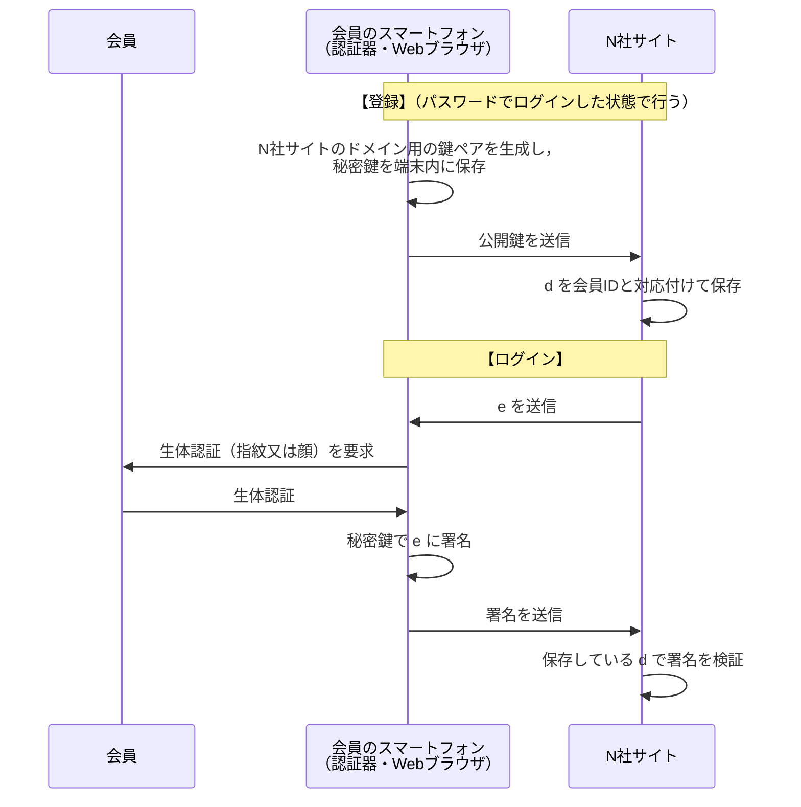
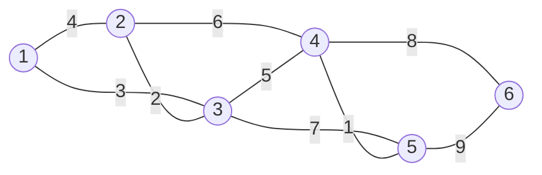
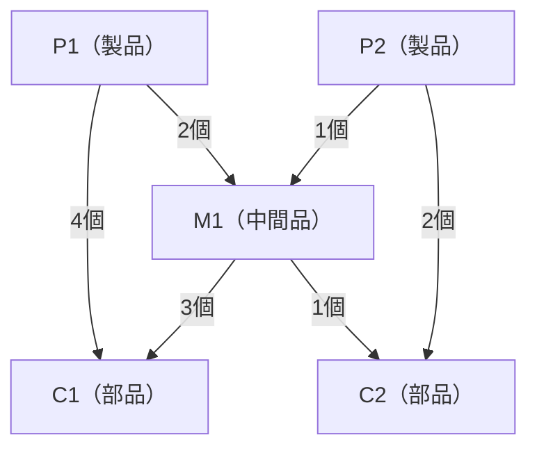
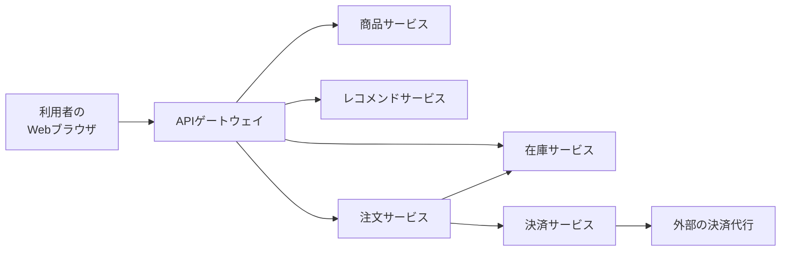

# 2026年度 応用情報技術者試験（科目B）予想模試 第3回 【問1〜問4】

> 本模試の問番号：問1（必須）情報セキュリティ／問2 プログラミング／問3 データベース／問4 システムアーキテクチャ／問5 ネットワーク／問6 組込みシステム開発／問7 プロジェクトマネジメント（問5〜問7は次回出力）。
> 図はMermaid記法。解答例・配点・解説は各問末尾の「▶」をクリックすると表示されます。
> シラバスとの対応：Ver.7.2 の用語例「総当たり攻撃」「リバースブルートフォース攻撃」「パスワードリスト攻撃」「パスワードクラック対策（ソルト，ストレッチング）」「多要素認証」「パスワードレス認証（FIDO2，WebAuthn）」（問1）、「グラフ理論」「計算量」（問2）、「副問合せ」「カーディナリティ」（問3）、「マイクロサービスアーキテクチャ」「サーキットブレーカー」「スケールアウト」「レスポンスタイム」（問4）。
> 最小全域木・Union-Find（問2）、再帰問合せ（問3）、APIゲートウェイ（問4）は用語例にないので、問題文中で仕組みを説明している。

---

## 問1 会員サイトの不正ログイン対策に関する次の記述を読んで，設問に答えよ。

N社は，会員数50万人のアウトドア用品の通信販売サイト（以下，N社サイトという）を運営している。会員は，会員IDとパスワードでログインし，登録したクレジットカードで買物ができる。最近，N社サイトへの不正ログインの試みが増えているので，情報システム部のR主任が対策を検討することになった。

〔現在の認証方式〕

- パスワードは，8文字以上の英数字とし，ハッシュ関数SHA-256によるハッシュ値だけを会員データベースに保存している。
- 同じ会員IDで5回連続してパスワードを誤ると，その会員IDを30分間ロックする（以下，アカウントロックという）。

〔ログの分析〕

R主任が過去1か月のログインのログを分析したところ，表1の3種類の事象が見つかった。

表1 ログの分析結果

| 事象 | 内容 |
|---|---|
| 事象1 | 一つのIPアドレスから，一つの会員IDに対して，1秒ごとに異なるパスワードでログインが試行された。5回目の失敗でアカウントロックされた。 |
| 事象2 | 約3,000個のIPアドレスから，延べ20万個の会員IDに対して，会員IDごとに1回ずつログインが試行された。パスワードは全て“Summer2026”であった。約50件のログインが成功した。 |
| 事象3 | 約5,000個のIPアドレスから，延べ8万個の会員IDに対して，会員IDごとに1回ずつログインが試行された。会員IDとパスワードの組は毎回異なり，約640件のログインが成功した。成功した会員にヒアリングしたところ，多くが他のサイトと同じパスワードを使っていた。 |

事象1は a ，事象2は b ，事象3は c と判断した。①事象2と事象3では，アカウントロックは機能しなかった。

〔パスワードの保存方法の見直し〕

R主任は，会員データベースが漏えいした場合に備えて，パスワードの保存方法を次のように変更することにした。

- 会員ごとに異なる乱数（以下，ソルトという）を生成し，パスワードとソルトを連結した値のハッシュ値を保存する。②ソルトを用いることで，事前に計算したハッシュ値の一覧を用いた攻撃に対する耐性が高まる。
- ハッシュ値の計算を1万回繰り返す（以下，ストレッチングという）。③ストレッチングによって，漏えいしたハッシュ値からのパスワードの解読を困難にする。

〔パスキーの導入〕

さらにR主任は，FIDO2（WebAuthn）に基づくパスワードを使わない認証方式（以下，パスキーという）を導入することにした。パスキーによる登録とログインの流れを図1に示す。


図1 パスキーによる登録とログインの流れ

- 鍵ペアは，Webサイトのドメインごとに生成される。Webブラウザは，アクセスしているWebサイトのドメインを認証器に伝え，認証器はそのドメイン用の秘密鍵だけで署名する。
- 秘密鍵は端末の外に出ない。生体情報は端末内で照合され，N社サイトには送信されない。
- e は，ログインのたびにN社サイトが生成する乱数である。

R主任は，パスキーには次の利点があると考えた。
- ④N社サイトのデータベースが漏えいしても，会員へのなりすましに使える情報は得られない。
- ⑤偽のサイトに誘導された会員がパスキーでログインしようとしても，攻撃者はN社サイトにログインできない。

一方で，⑥スマートフォンを紛失した会員がパスキーを再登録するための手続は，攻撃者に狙われやすい。

設問1 〔ログの分析〕について答えよ。
- (1) 本文中の a 〜 c に入れる適切な字句を解答群の中から選び，記号で答えよ。
- (2) 本文中の下線①について，アカウントロックが機能しなかった理由を，表1の内容に基づいて35字以内で述べよ。

解答群
- ア 総当たり（ブルートフォース）攻撃
- イ 中間者攻撃
- ウ パスワードリスト攻撃
- エ リバースブルートフォース攻撃
- オ リプレイ攻撃
- カ レインボーテーブル攻撃

設問2 〔パスワードの保存方法の見直し〕について答えよ。
- (1) 本文中の下線②について，ソルトによって耐性が高まる理由を40字以内で述べよ。
- (2) 本文中の下線③について，ストレッチングによって解読が困難になる理由を30字以内で述べよ。

設問3 〔パスキーの導入〕について答えよ。
- (1) 図1中の d ， e に入れる適切な字句を答えよ。
- (2) 本文中の下線④について，なりすましに使える情報が得られない理由を35字以内で述べよ。
- (3) 本文中の下線⑤について，攻撃者がログインできない理由を，図1の後の記述に基づいて45字以内で述べよ。

設問4 本文中の下線⑥について，再登録の手続が攻撃者に狙われやすい理由を40字以内で述べよ。

<details>
<summary>▶ 問1【解答例】【配点と採点基準】【出題意図とひっかけポイントの解説】（クリックで表示）</summary>

### 【解答例】

| 設問 | 解答例 |
|---|---|
| 設問1(1) | a：ア　b：エ　c：ウ |
| 設問1(2) | 一つの会員IDに対する試行が1回ずつで，5回連続の失敗に達しないから（32字） |
| 設問2(1) | 同じパスワードでも会員ごとにハッシュ値が異なり，事前計算した一覧が使えないから（38字） |
| 設問2(2) | 1回の試行に要する計算時間が長くなるから（19字） |
| 設問3(1) | d：公開鍵　e：チャレンジ（乱数） |
| 設問3(2) | 保存しているのは公開鍵だけで，署名に必要な秘密鍵は端末の外に出ないから（34字） |
| 設問3(3) | 認証器は偽サイトのドメイン用の鍵でしか署名しないので，N社サイト用の署名を得られないから（43字） |
| 設問4 | パスキーなしでログイン手段を再設定でき，本人確認を破れば乗っ取れるから（34字） |

### 【配点と採点基準（部分点の条件）】（計20点）

| 設問 | 配点 | 採点基準 |
|---|---|---|
| 設問1(1) | 各1点 | |
| 設問1(2) | 2点 | 「会員IDごとに1回ずつ（同じIDへの連続失敗にならない）」が必須。「IPアドレスが多数だから」は0点（アカウントロックはIP単位ではない） |
| 設問2(1) | 3点 | 「会員ごとにハッシュ値が異なる」2点＋「事前計算した一覧（レインボーテーブル）が使えない」1点 |
| 設問2(2) | 2点 | 「1回の試行（総当たり）に時間が掛かる」で満点 |
| 設問3(1) | 各1点 | e は「チャレンジ」「乱数」「ランダムな値」を正解 |
| 設問3(2) | 2点 | 「サイトには公開鍵しかない」1点＋「秘密鍵は端末内にある」1点 |
| 設問3(3) | 3点 | 「ドメインごとの鍵で署名」1点＋「偽サイトのドメインでは正規サイト用の秘密鍵が使われない」2点。「生体認証だから」は0点 |
| 設問4 | 3点 | 「パスキーなしでログイン手段を再設定できる」2点＋「本人確認を破ると乗っ取れる」1点 |

### 【出題意図とひっかけポイントの解説】

- **出題意図**：2019春・2024秋のパスワード管理、2025春のリバースブルートフォース（採点講評で正答率が低かった論点）を、シラバスVer.7.0で用語例に入った**パスワードレス認証（FIDO2，WebAuthn）**と組み合わせた。攻撃の見分け方、ソルトとストレッチングの役割の違い、公開鍵による認証がなぜ漏えいとフィッシングに強いかを問う。
- **解答を一意に導く根拠**
  - 設問1：表1の「一つの会員IDに…異なるパスワード」（総当たり）、「パスワードは全て同じ」（リバース）、「他のサイトと同じパスワード」（リスト）。
  - 設問3(3)：「認証器はそのドメイン用の秘密鍵だけで署名する」。
- **ひっかけポイント**
  - **ソルトとストレッチングの混同**：ソルトは事前計算（レインボーテーブル）を無効にする、ストレッチングは1回の計算を遅くする。逆に書くと0点。
  - **事象2と3の区別**：どちらも「IDごとに1回ずつ」だが、パスワードが固定（リバース）か、IDとパスワードの組が既知のもの（リスト）かで決まる。
  - 設問3(3)で「生体認証だから安全」と書く誤り。フィッシング耐性の根拠は**ドメインに結び付いた鍵**であって、生体認証ではない。
</details>

---

## 問2 拠点間回線の敷設計画に関する次の記述を読んで，設問に答えよ。

S社は，6か所の拠点（拠点1〜6）を専用回線で結ぶ計画を立てている。全ての拠点が，回線を経由して互いに通信できればよい。敷設可能な回線とその月額費用を図1に示す。S社は，月額費用の合計が最小になるように敷設する回線を選ぶプログラムを作成することにした。


図1 敷設可能な回線（線上の数値は月額費用，単位は万円。全ての辺と費用は表1にも示す）

〔最小全域木〕

拠点を点，回線を辺とするグラフで，全ての点を結び，閉路（ある点から出発して同じ辺を通らずに元の点に戻る経路）をもたない辺の集合を全域木という。全域木の辺の数は，点の数より1少ない。辺の費用の合計が最小となる全域木を最小全域木という。

最小全域木は，次の手順（クラスカル法）で求めることができる。
1. 辺を費用の小さい順に並べる。
2. 費用の小さい辺から順に調べ，その辺を加えても閉路ができない場合は，その辺を採用する。
3. 採用した辺の数が（点の数−1）になったら終了する。

〔閉路の判定〕

辺を加えると閉路ができるかどうかは，次の考え方で判定する。採用した辺でつながっている点の集まりを一つのグループとする。ある辺の両端の点が既に同じグループに属していれば，その辺を加えると閉路ができる。

グループは，各点の“親”を記録する大域の整数型の配列parentで表現する。親をたどって最終的に到達する，自分自身が親である点を，そのグループの代表とする。初期状態では，全ての点が自分自身を親とする（各点が1点だけのグループ）。

プログラムを図2に示す。配列の要素番号は1から始まる。辺は費用の小さい順に整列済みであり，k番目の辺の両端の点をeu[k]，ev[k]，費用をew[k]に格納している。

```
大域: 整数型の配列: parent

○整数型: find(整数型: x)        // xが属するグループの代表を返す
  while (     ア     )
    x ← parent[x]
  endwhile
  return x

○unite(整数型: x, 整数型: y)    // xとyのグループを一つにまとめる
  整数型: rx ← find(x)
  整数型: ry ← find(y)
  parent[ry] ← rx

○整数型: kruskal(整数型: n, 整数型: m, 整数型の配列: eu, ev, ew)
  // n: 点の数，m: 辺の数
  整数型: i, k, count, total
  for (i を 1 から n まで 1 ずつ増やす)
    parent[i] ← i
  endfor
  total ← 0
  count ← 0
  k ← 1
  while (     イ     and k ≦ m)
    if (     ウ     )
      unite(eu[k], ev[k])
      total ←     エ
      count ← count + 1
    endif
    k ← k + 1
  endwhile
  return total
```
図2 最小全域木の費用を求めるプログラム

図1の辺を費用の小さい順に並べたものを表1に示す。

表1 費用の小さい順に並べた辺

| k | 1 | 2 | 3 | 4 | 5 | 6 | 7 | 8 | 9 |
|---|---|---|---|---|---|---|---|---|---|
| eu[k] | 4 | 2 | 1 | 1 | 3 | 2 | 3 | 4 | 5 |
| ev[k] | 5 | 3 | 3 | 2 | 4 | 4 | 5 | 6 | 6 |
| ew[k] | 1 | 2 | 3 | 4 | 5 | 6 | 7 | 8 | 9 |

〔findの改良〕

図2のfindは，親をたどる回数が多くなると時間が掛かる。そこでT君は，findを図3のように改良した。

```
○整数型: find(整数型: x)
  if (parent[x] ＝ x)
    return x
  endif
  parent[x] ←     オ
  return parent[x]
```
図3 改良したfind

⑦この改良によって，2回目以降に同じ点からfindを呼び出したときの処理が速くなる。

設問1 図2中の ア 〜 エ に入れる適切な字句を答えよ。

設問2 図1，表1のデータで kruskal(6, 9, eu, ev, ew) を実行した。
- (1) 戻り値を答えよ。
- (2) 実行終了時の配列parentの内容を，parent[1]から順にカンマ区切りで答えよ。

設問3 〔閉路の判定〕について，ある辺の両端の点が同じグループに属している場合に，その辺を加えると閉路ができる理由を35字以内で述べよ。

設問4 〔findの改良〕について答えよ。
- (1) 図3中の オ に入れる適切な字句を答えよ。
- (2) 本文中の下線⑦について，処理が速くなる理由を35字以内で述べよ。

<details>
<summary>▶ 問2【解答例】【配点と採点基準】【出題意図とひっかけポイントの解説】（クリックで表示）</summary>

### 【解答例】

| 設問 | 解答例 |
|---|---|
| 設問1 | ア：parent[x] ≠ x　イ：count < n − 1　ウ：find(eu[k]) ≠ find(ev[k])　エ：total + ew[k] |
| 設問2(1) | 19 |
| 設問2(2) | 1, 1, 2, 1, 4, 1 |
| 設問3 | 両端の点は既に採用した辺でつながっており，新たな辺で一周できるから（33字） |
| 設問4(1) | オ：find(parent[x]) |
| 設問4(2) | たどった点の親が代表に直接書き換えられ，代表まで1回でたどれるから（32字） |

**設問2のトレース**（unite(x, y) は parent[find(y)] ← find(x)）

| k | 辺 | 判定 | parent（1〜6） | total |
|---|---|---|---|---|
| 初期 | | | 1, 2, 3, 4, 5, 6 | 0 |
| 1 | 4−5 | 代表4≠5 → 採用 | 1, 2, 3, 4, **4**, 6 | 1 |
| 2 | 2−3 | 代表2≠3 → 採用 | 1, 2, **2**, 4, 4, 6 | 3 |
| 3 | 1−3 | 代表1≠2 → 採用 | 1, **1**, 2, 4, 4, 6 | 6 |
| 4 | 1−2 | 代表1＝1 → 不採用 | 変化なし | 6 |
| 5 | 3−4 | 代表1（3→2→1）≠4 → 採用 | 1, 1, 2, **1**, 4, 6 | 11 |
| 6 | 2−4 | 代表1＝1 → 不採用 | | 11 |
| 7 | 3−5 | 代表1＝1（5→4→1） → 不採用 | | 11 |
| 8 | 4−6 | 代表1≠6 → 採用 | 1, 1, 2, 1, 4, **1** | 19 |
| — | | count＝5＝n−1 で終了 | | |

### 【配点と採点基準（部分点の条件）】（計20点）

| 設問 | 配点 | 採点基準 |
|---|---|---|
| 設問1 | 各2点 | イは「count < n − 1」「count ≦ n − 2」を正解。「count < n」は1点（全点がつながった後も残りの辺を調べ続けるので結果は同じだが、本文の手順3と異なる）。ウは「find(eu[k]) ≠ find(ev[k])」。「eu[k] ≠ ev[k]」「parent[eu[k]] ≠ parent[ev[k]]」は0点（代表で比較していない） |
| 設問2(1) | 2点 | |
| 設問2(2) | 3点 | 全要素一致のみ |
| 設問3 | 2点 | 「既に（別の経路で）つながっている」が必須 |
| 設問4(1) | 3点 | 「find(parent[x])」のみ。「parent[parent[x]]」は1段しか縮まないので0点 |
| 設問4(2) | 2点 | 「親が代表に直接書き換えられる（経路が短くなる）」で満点 |

### 【出題意図とひっかけポイントの解説】

- **出題意図**：2024春（ダイクストラ法）、2021秋（一筆書き）に続くグラフのアルゴリズムとして、**クラスカル法と素集合データ構造（Union-Find）**を扱う。親の配列をたどるトレース、閉路判定の考え方、再帰による経路圧縮を問う。
- **解答を一意に導く根拠**
  - 設問1 ア：「自分自身が親である点を，そのグループの代表とする」→ parent[x] ≠ x の間たどる。
  - 設問1 イ：手順3「採用した辺の数が（点の数−1）になったら終了」。
  - 設問2(2)：unite の「parent[ry] ← rx」（yの代表をxの代表の下に付ける）の向き。
- **ひっかけポイント**
  - **代表同士を比較する**：ウで parent[eu[k]] を比べると、k＝6（2−4）のとき parent[2]＝1、parent[4]＝1 で偶然一致するが、k＝7（3−5）では parent[3]＝2、parent[5]＝4 と異なり、誤って閉路を作る。
  - **unite の向き**：rx と ry を逆にすると parent の最終状態が変わる（総費用は同じ）。プログラムを本文どおりにトレースする。
  - **トレースでの手順の省略**：k＝5 で find(3) が 3→2→1 と2回たどることを見落とすと、代表を2と誤る。
</details>

---

## 問3 部品構成表のデータベースに関する次の記述を読んで，設問に答えよ。

U社は，業務用の厨房機器を製造している。製品は，中間品と部品から組み立てられ，中間品は更に中間品や部品から組み立てられる。U社は，製品の生産計画から必要な部品の数量を計算するために，部品構成表をデータベースで管理することにした。

〔テーブル構造〕

テーブル構造を図1に示す。主キーを【 】，外部キーを〈 〉，主キーかつ外部キーを【〈 〉】で示す。

```
品目 （【品目コード】, 品目名, 区分, 単価）
構成 （    f    , 所要数）
```
図1 テーブル構造（一部未記入）

- 品目テーブルには，製品，中間品及び部品を全て登録する。区分には，'製品'，'中間品'，'部品' のいずれかを格納する。
- 構成テーブルには，親の品目を1個作るのに必要な子の品目とその数量（所要数）を，親と子の組ごとに1行格納する。親品目コードと子品目コードは，いずれも品目テーブルの品目コードを参照する。
- 一つの中間品や部品は，複数の親の品目に使われることがある。

品目の構成の例を図2に，構成テーブルの内容を表1に示す。


図2 品目の構成の例（矢印は親から子への関係，数値は所要数）

表1 構成テーブルの内容

| 親品目コード | 子品目コード | 所要数 |
|---|---|---|
| P1 | M1 | 2 |
| P1 | C1 | 4 |
| M1 | C1 | 3 |
| M1 | C2 | 1 |
| P2 | M1 | 1 |
| P2 | C2 | 2 |

〔必要部品数を求めるSQL文〕

製品P1を1個作るのに必要な部品ごとの数量を求めるSQL文を図3に示す。WITH RECURSIVE 句は，初期値となる問合せ（UNION ALLの前）の結果に，再帰部分の問合せ（UNION ALLの後）を，新たな行が得られなくなるまで繰り返し適用した結果を，一時的な表“展開”として定義する。

```sql
WITH RECURSIVE 展開(品目コード, 必要数) AS (
    SELECT 子品目コード, 所要数
      FROM 構成
     WHERE 親品目コード = 'P1'
  UNION ALL
    SELECT k.子品目コード,     g
      FROM 展開 t JOIN 構成 k ON     h
)
SELECT e.品目コード, SUM(e.必要数) AS 必要数
  FROM 展開 e JOIN 品目 i ON e.品目コード = i.品目コード
 WHERE i.区分 = '部品'
 GROUP BY e.品目コード
```
図3 製品P1の必要部品数を求めるSQL文

図3のSQL文を実行した結果を表2に示す。

表2 図3のSQL文の実行結果

| 品目コード | 必要数 |
|---|---|
| C1 | ア |
| C2 | イ |

〔データの誤りへの対策〕

試験中に，構成テーブルに誤って（M1，M3，1）と（M3，M1，1）の2行が登録されたところ，⑧図3のSQL文の実行が終了しなくなった。

〔性能の検討〕

構成テーブルは約50万行になる見込みである。構成テーブルには主キー（親品目コード，子品目コード）の順の複合インデックスが作成される。主な検索は次の二つである。

検索1：ある品目の子を検索する（図3の再帰部分）。
検索2：ある部品の仕様を変更する場合に，その部品を使っている親の品目を全て検索する。

V主任は，⑨検索2のために，構成テーブルにインデックスを追加することにした。一方，⑩品目テーブルの区分列には，インデックスを作成しないことにした。

設問1 図1中の f に入れる適切な属性名を全て答え，図1の表記に従って【 】，〈 〉を付けて示せ。また，品目と構成の間の関連を，カーディナリティを含めて30字以内で説明せよ。

設問2 図3及び表2について答えよ。
- (1) 図3中の g ， h に入れる適切な字句を答えよ。
- (2) 表2中の ア ， イ に入れる適切な数値を答えよ。

設問3 本文中の下線⑧について，実行が終了しなくなった理由を40字以内で述べよ。また，このような誤りを防ぐために構成テーブルへの登録時に行うべきチェックを30字以内で述べよ。

設問4 〔性能の検討〕について答えよ。
- (1) 本文中の下線⑨について，追加するインデックスの対象とする列名を答えよ。また，主キーのインデックスでは検索2を効率化できない理由を35字以内で述べよ。
- (2) 本文中の下線⑩について，インデックスを作成しない理由を30字以内で述べよ。

<details>
<summary>▶ 問3【解答例】【配点と採点基準】【出題意図とひっかけポイントの解説】（クリックで表示）</summary>

### 【解答例】

| 設問 | 解答例 |
|---|---|
| 設問1 | f：【〈親品目コード〉】，【〈子品目コード〉】／関連：品目と構成は，親として1対多，子として1対多の二つの関連をもつ（30字） |
| 設問2(1) | g：t.必要数 * k.所要数　h：k.親品目コード = t.品目コード |
| 設問2(2) | ア：10　イ：2 |
| 設問3 | 理由：M1とM3が互いに子となる循環があり，再帰部分で新たな行が得られ続けるから（37字）／チェック：登録する子の下位に親の品目が含まれないことを確認する（26字） |
| 設問4(1) | 列名：子品目コード／理由：主キーの先頭列は親品目コードなので，子品目コードだけでは索引を使えないから（34字） |
| 設問4(2) | 値の種類が3種類しかなく，絞り込みの効果が小さいから（25字） |

**設問2(2)の計算**
- 初期値（P1の子）：(M1, 2)，(C1, 4)
- 1回目の再帰（M1の子）：(C1, 2 × 3 ＝ 6)，(C2, 2 × 1 ＝ 2)　※C1の子はないので行は増えない
- 2回目の再帰：C1，C2に子はないので終了
- 部品だけを集計：C1 ＝ 4 ＋ 6 ＝ **10**，C2 ＝ **2**

### 【配点と採点基準（部分点の条件）】（計20点）

| 設問 | 配点 | 採点基準 |
|---|---|---|
| 設問1 | f 2点／関連 2点 | f は2属性とも【〈 〉】で2点。関連は「1対多の関連が二つ（親と子）」で満点。「多対多」とだけ書いたものは1点（構成が品目間の多対多を分解した交差エンティティであることは正しいが、問いは品目と構成の関連） |
| 設問2(1) | 各2点 | g で「k.所要数」だけ（掛け算なし）は0点。h の左右逆（t.品目コード = k.親品目コード）は正解。「k.子品目コード = t.品目コード」は0点（親方向に展開してしまう） |
| 設問2(2) | 各2点 | ア「4」（中間品経由を数えていない）、「7」（掛け算を足し算にした）は0点 |
| 設問3 | 理由 2点／チェック 1点 | 理由は「循環（閉路）がある」＋「行が得られ続ける（終わらない）」 |
| 設問4(1) | 列名 1点／理由 2点 | 「複合インデックスの先頭列でない列だけの検索には使えない」趣旨で満点 |
| 設問4(2) | 2点 | 「値の種類が少ない（選択性が低い）」が必須 |

### 【出題意図とひっかけポイントの解説】

- **出題意図**：2024秋（再帰的な問合せ、B-treeインデックス）の発展として、製造業の**部品展開（BOM）**を題材に、自己参照の多対多を交差エンティティで表す設計、再帰問合せでの数量の掛け合わせ、循環データの危険、複合インデックスの先頭列の性質を問う。
- **解答を一意に導く根拠**
  - 設問1：「一つの中間品や部品は，複数の親の品目に使われる」→ 品目どうしは多対多 → 構成が交差エンティティとなり、品目から見ると1対多が二つ。
  - 設問2：〔必要部品数〕の「親の品目を1個作るのに必要な子の…数量」→ 展開は親の必要数 × 子の所要数。
  - 設問4(1)：「主キー（親品目コード，子品目コード）の順の複合インデックス」。
- **ひっかけポイント**
  - **掛け算と足し算**：中間品M1が2個必要なら、M1の部品は2倍必要になる。図2の矢印をたどって手計算で検算する。
  - **結合条件の向き**：h を子品目コード側で結合すると、部品から製品の方向へたどってしまう。
  - **カーディナリティの低い列へのインデックス**（2024秋の採点講評「適切ではない列にインデックスを設定すると性能低下を招く」）。
</details>

---

## 問4 ECサイトのマイクロサービス化に関する次の記述を読んで，設問に答えよ。

W社は，家具のECサイトを運営している。現行のECサイトは，全ての機能が一つのアプリケーションとして構築されており，一部の機能の改修でも全体の再テストとリリースが必要になっていた。そこでW社は，機能ごとに独立して開発・リリースできるよう，マイクロサービスアーキテクチャで再構築することにした。システム部のX主任が方式設計を担当した。

〔新システムの構成〕

新システムの構成を図1に示す。


図1 新システムの構成

- APIゲートウェイは，Webブラウザからの要求を受け付け，必要なサービスを呼び出して結果をまとめて返す。
- 各サービスは，それぞれ専用のデータベースをもち，他のサービスのデータベースには直接アクセスしない。

〔商品詳細画面の応答時間〕

商品詳細画面を表示する要求を受けると，APIゲートウェイは，商品サービス，在庫サービス，レコメンドサービスを呼び出す。各サービスの応答時間は，それぞれ30ミリ秒，40ミリ秒，200ミリ秒である。APIゲートウェイ自身の処理時間は合計10ミリ秒であり，ネットワークの伝送時間は無視する。

三つのサービスを順番に呼び出すと，商品詳細画面の応答時間は ア ミリ秒となる。三つのサービスは互いの結果を必要としないので，X主任は三つを同時に呼び出す方式とし，応答時間を イ ミリ秒に短縮した。

〔障害の連鎖への対策〕

試験中に，レコメンドサービスの応答が極端に遅くなる障害を発生させたところ，⑪商品詳細画面だけでなく，レコメンドサービスを使わない注文画面まで応答しなくなった。調査の結果，APIゲートウェイは，サービスからの応答を待つ間，要求処理用のスレッドを占有しており，応答の待ち時間に上限を設けていなかったことが分かった。

X主任は，次の対策を行うことにした。
- 各サービスの呼出しに，待ち時間の上限（300ミリ秒）を設定する。
- 直近10秒間の呼出しの失敗率が50%を超えたサービスについては，その後30秒間は呼出しを行わずに直ちに失敗として扱う仕組みを導入する。このような仕組みを c という。⑫この仕組みでレコメンドサービスの呼出しを止めている間も，APIゲートウェイは商品詳細画面を返す。

〔可用性〕

注文を確定する処理は，APIゲートウェイ，注文サービス，在庫サービス，決済サービスが全て稼働している場合だけ成功する。各構成要素の稼働率を，APIゲートウェイ99.95%，注文サービス，在庫サービス，決済サービスをそれぞれ99.9%とすると，注文を確定する処理の稼働率は ウ %となる。ここで，各構成要素の故障は互いに独立とし，外部の決済代行は考慮しない。

〔商品サービスの台数〕

商品サービスは，コンテナで稼働させ，負荷に応じて台数を自動的に増減させる。商品サービス1台の処理能力は，CPU使用率100%のときに毎秒200件である。CPU使用率を70%以下に保つ方針で，ピーク時の要求の毎秒1,200件を処理するためには，商品サービスは最低 エ 台必要である。

〔注文確定処理の整合性〕

注文確定処理では，注文サービスが，在庫サービスに在庫の引当てを依頼し，その後，決済サービスに決済を依頼する。各サービスは専用のデータベースをもつので，一つのトランザクションで全体を処理することはできない。⑬在庫の引当てが成功した後に決済が失敗した場合の処理を設計しておく必要がある。

設問1 〔商品詳細画面の応答時間〕について，本文中の ア ， イ に入れる適切な数値を答えよ。

設問2 〔障害の連鎖への対策〕について答えよ。
- (1) 本文中の下線⑪について，注文画面まで応答しなくなった理由を40字以内で述べよ。
- (2) 本文中の c に入れる適切な字句を答えよ。
- (3) 本文中の下線⑫について，APIゲートウェイが返す商品詳細画面の内容を30字以内で述べよ。

設問3 〔可用性〕について答えよ。
- (1) 本文中の ウ に入れる適切な数値を，小数第2位未満を切り捨てて答えよ。
- (2) 現行システム全体の稼働率が99.9%であったとすると，(1)の結果から，マイクロサービス化の際に留意すべきことを30字以内で述べよ。

設問4 本文中の エ に入れる適切な数値を答えよ。

設問5 本文中の下線⑬について，必要な処理の内容を35字以内で述べよ。

<details>
<summary>▶ 問4【解答例】【配点と採点基準】【出題意図とひっかけポイントの解説】（クリックで表示）</summary>

### 【解答例】

| 設問 | 解答例 |
|---|---|
| 設問1 | ア：280　イ：210 |
| 設問2(1) | 応答待ちの要求がゲートウェイのスレッドを占有し，他の要求を処理できなくなったから（39字） |
| 設問2(2) | c：サーキットブレーカー |
| 設問2(3) | レコメンドの欄を表示せず，商品情報と在庫だけを表示した画面（28字） |
| 設問3(1) | ウ：99.65 |
| 設問3(2) | 処理に関わるサービスが直列に増えると稼働率が下がること（26字） |
| 設問4 | エ：9 |
| 設問5 | 在庫サービスに依頼して，引き当てた在庫を元に戻す取消し処理を行う（31字） |

**計算過程**
- ア：30 ＋ 40 ＋ 200 ＋ 10 ＝ **280ミリ秒**
- イ：max(30, 40, 200) ＋ 10 ＝ **210ミリ秒**
- ウ：0.9995 × 0.999 × 0.999 × 0.999 ＝ 0.99650… → **99.65%**
- エ：1台が70%で処理できる件数 200 × 0.7 ＝ 140件/秒 → 1,200 ÷ 140 ＝ 8.57… → 切り上げて **9台**

### 【配点と採点基準（部分点の条件）】（計20点）

| 設問 | 配点 | 採点基準 |
|---|---|---|
| 設問1 | 各2点 | イで「200」（ゲートウェイの10ミリ秒を加えない）は0点 |
| 設問2(1) | 2点 | 「スレッドを占有」1点＋「他の要求（注文画面）を処理できない」1点 |
| 設問2(2) | 1点 | 「サーキットブレーカー（サーキットブレーカ）」 |
| 設問2(3) | 2点 | 「レコメンド以外（商品情報と在庫）を表示」で満点。「エラー画面」は0点（⑫の「商品詳細画面を返す」に反する） |
| 設問3(1) | 3点 | 99.66（四捨五入）は1点 |
| 設問3(2) | 2点 | 「直列に依存するサービスが増えると稼働率が下がる」が必須 |
| 設問4 | 3点 | 6（100%で計算）は0点。8（8.57を切り捨て）は1点 |
| 設問5 | 3点 | 「引当ての取消し（補償処理）」で満点。「決済をやり直す」だけは1点（失敗が続く場合に在庫が引き当てられたまま残る） |

### 【出題意図とひっかけポイントの解説】

- **出題意図**：シラバス用語例の「マイクロサービスアーキテクチャ」「サーキットブレーカー」を題材に、並列呼出しによる応答時間短縮、障害の連鎖とスレッド（資源）の枯渇、直列依存による稼働率の低下、スケールアウトの台数計算、サービス間でトランザクションを使えない場合の取消し処理（補償）を問う。第1回問4（ワーカの枯渇）と同じ論点を別の構成で確認する。
- **解答を一意に導く根拠**
  - 設問1 イ：「互いの結果を必要としないので…同時に呼び出す」→ 最も遅いサービスの時間で決まる。
  - 設問2(1)：「応答を待つ間，要求処理用のスレッドを占有」「待ち時間に上限を設けていなかった」。
  - 設問5：「一つのトランザクションで全体を処理することはできない」→ DBMSのロールバックは使えないので、アプリケーションで取り消す。
- **ひっかけポイント**
  - **並列化しても固定の処理時間は残る**（イにゲートウェイの10ミリ秒を足し忘れる）。
  - **台数の切上げと余裕率**：「70%以下に保つ」を無視すると6台。端数の切捨ても誤り。
  - 設問3(2)で「マイクロサービス化すべきでない」と書くのは題意と逆。**直列依存を減らす（非同期化・縮退運転）設計の必要性**に気付けるかを見ている。
</details>

---

> 次回出力予定：第3回 問5（ネットワーク：DNS切替えとサイト移転）、問6（組込み：電動アシスト自転車のバッテリ管理）、問7（PM：CCPMによるスケジュール管理）。
